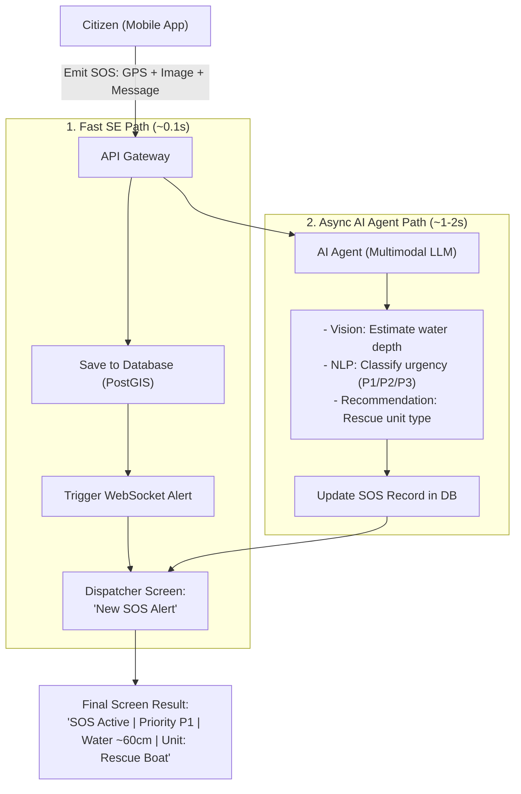

# AI ARCHITECTURE - ASYNC SOS TRIAGE PIPELINE

---

## 1. DUAL-PATH SOS EMIT WORKFLOW (SE + AI)



---

## 2. ASCII DIAGRAM

```
[ Citizen (Mobile App) ]
         │
         ▼ (Emit SOS: GPS + Image + Message)
   [ API Gateway ]
         │
         ├──────────────────────────────────────────────┐
         │ (1. Fast SE Path ~0.1s)                      │ (2. Async AI Agent Path ~1-2s)
         ▼                                              ▼
[ Save to Database (PostGIS) ]                 [ AI Agent Analysis ]
         │                                              │ - Vision: Water depth estimation
         ▼                                              │ - NLP: Urgency triage (P1 / P2 / P3)
[ Trigger WebSocket Alert ]                             │ - Recommender: Rescue unit required
         │                                              ▼
         │                                     [ Update SOS Record with AI Data ]
         │                                              │
         ▼                                              ▼
[ Dispatcher Screen: "New SOS Alert" ] ───► [ Append: "AI: Level P1, Depth ~60cm" ]
```

---

## 3. KEY HIGHLIGHTS

- **Zero-Latency Alert**: The SE path notifies the dispatcher instantly (~0.1s) without waiting for AI.
- **Fail-Safe**: If the AI service fails or slows down, the emergency alert is never lost.
- **Enriched Insights**: AI appends actionable data (flood severity, victim urgency, suggested unit) 1-2s later.
- **Cost Effective**: LLM/Vision APIs are only triggered on actual SOS events, not on standard map views.
