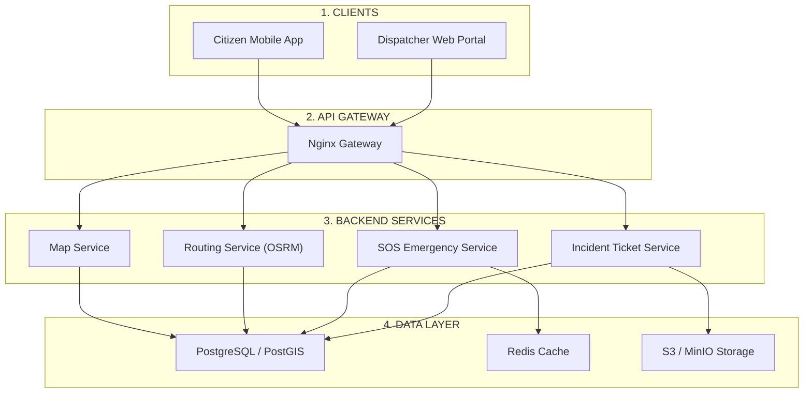
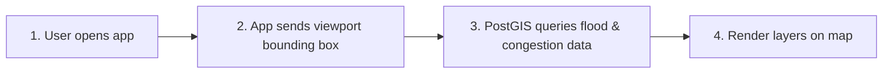
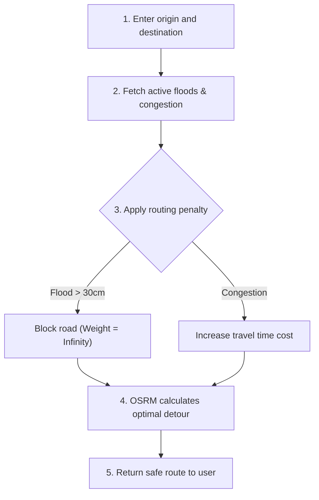
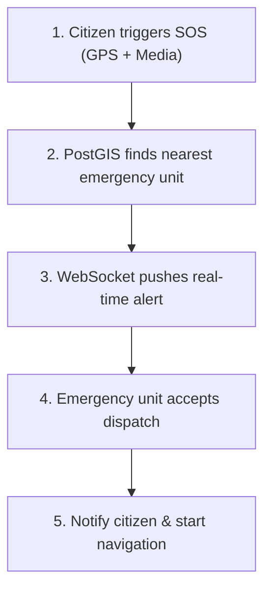
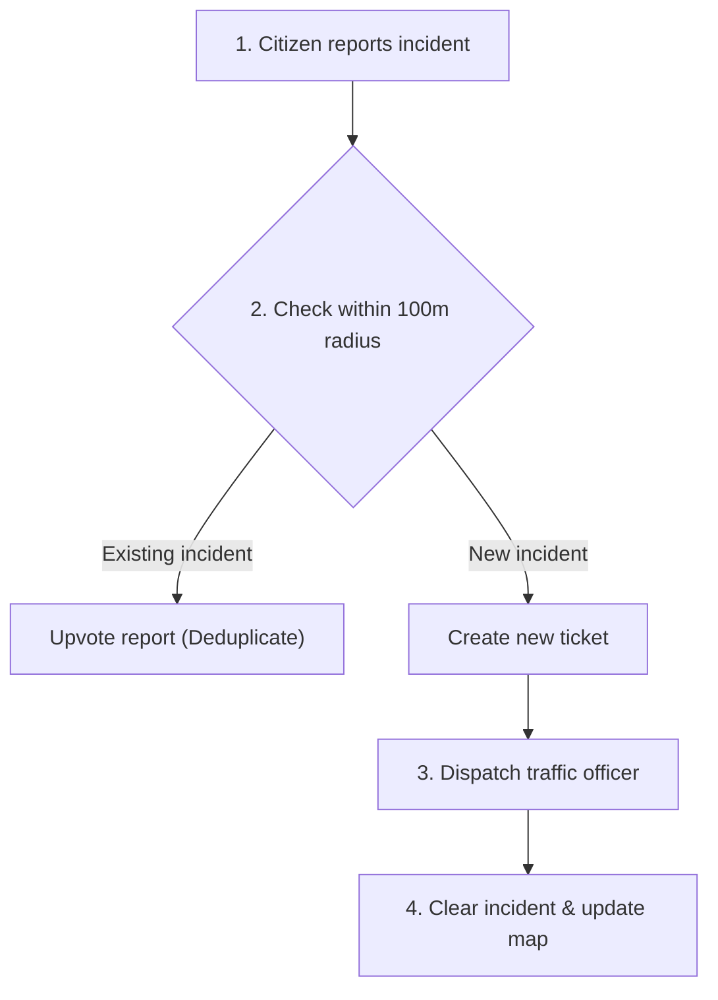

# SYSTEM ARCHITECTURE & WORKFLOWS

---

## 1. HIGH-LEVEL ARCHITECTURE

---

## 2. FLOW 1: FLOOD & TRAFFIC MAP VISUALIZATION

---

## 3. FLOW 2: SMART ROUTING (AVOID FLOOD & TRAFFIC)

---

## 4. FLOW 3: SOS EMERGENCY DISPATCH

---

## 5. FLOW 4: INCIDENT TICKETING (JAM & ACCIDENT)

