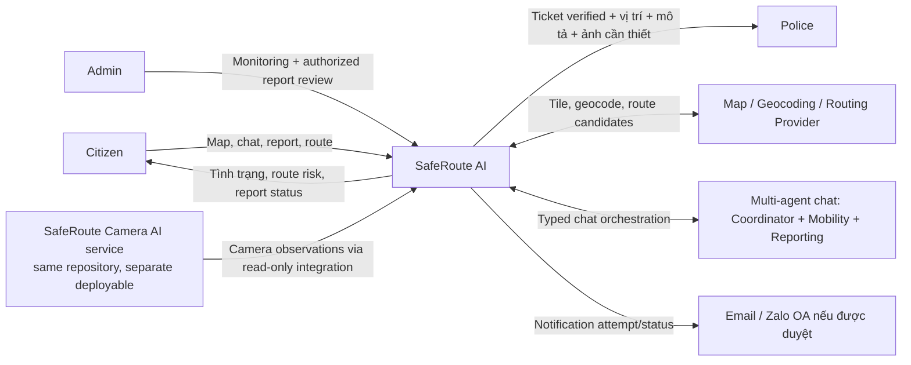
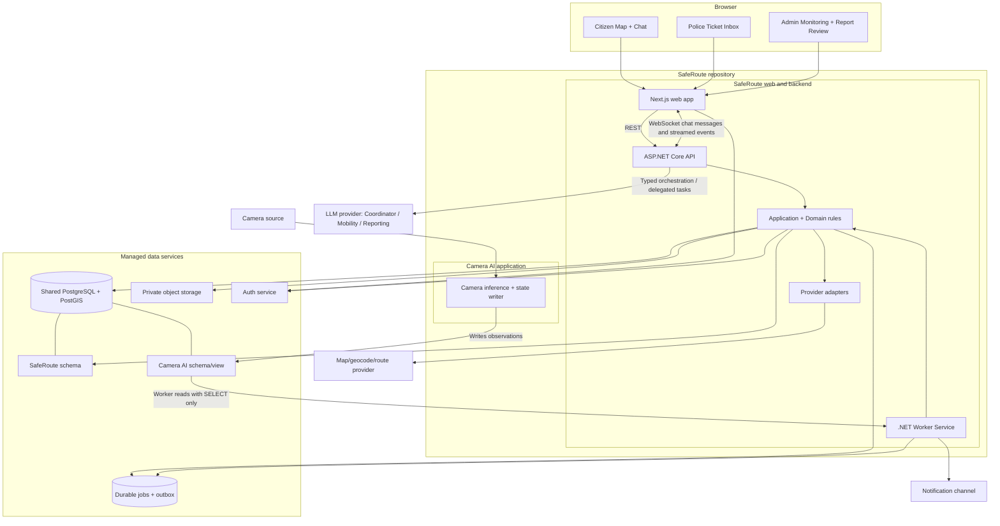
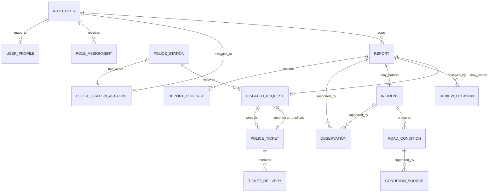

# SafeRoute AI — Software Design Document (SDD)

> **Phiên bản:** 1.3  
> **Trạng thái:** Kiến trúc mục tiêu đề xuất cho MVP; repo hiện chưa có mã ứng dụng để xác nhận triển khai.  
> **Ngày rà soát nguồn kỹ thuật:** 2026-10-15  
> **Loại tài liệu:** Software Design Document — thiết kế mục tiêu và hợp đồng kỹ thuật đề xuất.  
> **Phạm vi:** Tổng quan kiến trúc, công nghệ đề xuất, ranh giới thành phần, tích hợp và quyết định còn mở.

## 1. Cách đọc tài liệu

- [Software Requirements Document (SRD)](system-specification.md) là nguồn yêu cầu sản phẩm/nghiệp vụ: actor, chức năng, rule, trạng thái, quyền và acceptance.
- Tài liệu này mô tả **cách dự kiến xây hệ thống**. Đây là target architecture, không phải codebase hiện trạng.
- `Đề xuất` nghĩa là lựa chọn dựa trên kiến trúc MVP hiện có; chưa khóa cho tới khi team xác nhận.
- `Cần PoC/chốt` nghĩa là phụ thuộc provider, credentials, giấy phép, vùng phủ, chi phí hoặc quyết định sản phẩm.

Repo hiện có tài liệu thiết kế nhưng chưa có Web/API/Worker source, migration, pipeline triển khai hoặc cấu hình provider. Vì vậy không có lựa chọn nào trong bảng dưới được hiểu là đã triển khai.

## 2. Tech stack đề xuất

| Lớp | Công nghệ đề xuất | Trạng thái / lý do |
|---|---|---|
| Web app | Next.js 16.4 + React 19 + TypeScript, App Router | **Đã scaffold:** web độc lập trong `frontend/`; Citizen có Map/chat và tìm tuyến kiểu bản đồ chỉ đường; Police chỉ có màn hình nhận/xem ticket; Admin có monitoring và review |
| UI styling/forms | Tailwind CSS 4; form validation bằng schema phía client và server | **Đã scaffold styling:** thư viện form/component chỉ thêm khi có vertical slice cần dùng |
| Backend API | ASP.NET Core Web API, C# trên .NET 10 LTS | **Đã scaffold:** SDK 10.0.300, API host riêng, package lockfile; endpoint chỉ có health/metadata |
| Background worker | .NET Worker Service (`BackgroundService`) | **Đã scaffold:** host process riêng để xử lý evidence, camera, corroboration và notification job; không chạy inference dài trong request API |
| Camera AI deployable | Python 3.14 + FastAPI, source riêng trong `camera-ai/` | **Đã scaffold:** process riêng, health/contract endpoint và event contract v1. Chưa có live ingestion/inference hay quyền ghi database production |
| Kiểu kiến trúc | **Đã chốt MVP:** modular monolith; một backend solution, API và Worker là hai process | Multi-agent là các vai trò logic trong cùng ứng dụng; không tách agent thành microservice |
| Database | **Đã chốt baseline:** managed PostgreSQL + PostGIS; ưu tiên Supabase Database/Auth/Storage | Trước hạ tầng thật, PoC .NET/JWT/PostGIS/storage/region/backup/restore/privacy/cost. Nếu Supabase không đạt, dùng managed PostgreSQL + S3-compatible storage; domain contracts không đổi |
| Mạng đường tham chiếu cho camera và đo khoảng cách dọc đường | **Đã chốt baseline:** OSM Vietnam extract, import/cắt phạm vi Đà Nẵng vào PostGIS | Data owner vẫn phải xác nhận coverage, version/import provenance và attribution/ODbL trước pilot. Đây không phải routing engine |
| ORM/spatial | **Đã scaffold:** EF Core 10.0.13 + Npgsql EF Core 10.0.3 + NetTopologySuite | DbContext chỉ xác lập schema boundary; chưa có entity/migration nghiệp vụ |
| Auth | Supabase Auth + Google OAuth; Next.js dùng cookie-based SSR session; ASP.NET API xác minh JWT | Đã chốt Google login bắt buộc cho web. Supabase Auth xác thực; SafeRoute backend quản lý Citizen/Admin/Police role và resource permissions |
| File/evidence storage | **Đã chốt hướng:** private object storage qua adapter; ưu tiên Supabase Storage cùng nền tảng Supabase | Nếu Supabase không đạt compatibility/region/backup/privacy gate thì dùng S3-compatible storage. Database chỉ giữ metadata/object key; signed URL tối đa 10 phút và chỉ cấp sau authorization |
| Job queue | Bảng job trong PostgreSQL + transactional outbox, lease/retry/idempotency | Shared durable source cho API và worker; không dùng in-memory queue làm nguồn sự thật |
| Map rendering | **Đã chốt:** Leaflet + React-Leaflet; basemap dùng hosted tile provider | Tile vendor chọn theo coverage/attribution/quota/chi phí trước pilot; không mặc định public OSM tile server cho production. Không dùng MapLibre GL JS trong MVP hiện tại |
| Geocoding | **Đã chốt hướng:** một hosted geocoding provider qua adapter, độc lập routing | Chọn vendor sau khi kiểm tra địa chỉ/địa danh Đà Nẵng, API key, coverage, quota, chi phí và điều khoản trước pilot |
| Routing | Adapter `IRoutingProvider`; thử từng provider tuần tự, OSRM self-hosted trước | Nếu OSRM không đạt tiêu chí chất lượng nghiệm thu ở Đà Nẵng thì mới PoC VIETMAP Route v4. Provider production được chọn theo kết quả; không mặc định runtime fallback |
| AI/LLM chat + ảnh report | OpenCode Go + DeepSeek V4.1 Flash (`deepseek-v4.1-flash`) cho Coordinator + Mobility + Reporting và backend operation `AnalyzeReportImage` riêng | Đã chọn cùng model/provider; ảnh không vào chat-agent context. PoC phải xác nhận endpoint nhận ảnh và điều khoản cho phép trước production; API key ở backend |
| Điều phối agent | Một provider/model dùng cho ba vai trò; Coordinator định tuyến rồi tối đa một specialist trả lời cuối; tối đa hai lần gọi model mỗi lượt | Giới hạn latency/chi phí MVP; không fan-out song song, không gọi Coordinator lại để paraphrase và không dựng agent service riêng |
| Browser streaming | WebSocket cho chat hai chiều browser–API | **Đã chốt:** client và server gửi/nhận message/event trên cùng kết nối; assistant trả lời tăng dần theo chunk (`assistant.delta`). Không fallback sang SSE/polling; reconnect/resume bằng WebSocket và event sequence; lỗi thì báo lỗi, không giả đã nhận tin. Webhook chỉ dùng cho callback server-to-server, không phải chat stream |
| Webhook | Chỉ cho callback service-to-service | Có chữ ký, timestamp/replay protection, idempotency và retry |
| Logging/metrics | **Đã chốt hướng:** structured logs + OpenTelemetry | Chọn exporter/host cùng nền tảng triển khai; correlation ID nối HTTP request, report, job, incident và Police ticket; không log prompt/evidence/PII không cần thiết |
| Backend container | **Đã chốt:** Docker image riêng cho API và Worker, triển khai trên managed hosting | Web/API/Worker tách process; chọn nền tảng/region/domain/secrets trước pilot, ưu tiên phương án ít vận hành |
| Frontend hosting | **Đã chốt hướng:** managed hosting | Chọn theo region, domain, secret handling, tích hợp API và ngân sách trước pilot |
| Tests/quality | xUnit cho backend; Playwright cho frontend E2E; lint/build cho mọi deployable | **Đã scaffold:** CI chạy restore/build/test theo lockfile. Bộ acceptance nghiệp vụ bổ sung cùng từng vertical slice |

### 2.1 Quy ước phiên bản và lựa chọn

- Dùng runtime đang được hỗ trợ; `.NET 10 LTS` là baseline đề xuất tại ngày rà soát. Không dùng preview cho MVP.
- Pin package/runtime versions và commit lockfiles; cập nhật theo compatibility matrix giữa .NET, EF Core, Npgsql, NetTopologySuite và hosting provider.
- Với Supabase, xác nhận region, Postgres/PostGIS support, connection mode/pooler, backup, storage behavior và project limits trước khi tạo môi trường.
- Leaflet/React-Leaflet là renderer, không cung cấp basemap tiles, geocoding hoặc routing. Tile/style/geocoding/routing có license, attribution, quota và chi phí/vận hành riêng; không mặc định public tile server phù hợp production.
- Các lựa chọn provider có chi phí hoặc khó đảo ngược cần được ghi quyết định trước khi tích hợp sâu.

### 2.2 Đánh giá routing provider cho MVP Đà Nẵng

| Provider | Xe máy | Ô tô | Nhận xét cho MVP |
|---|---|---|---|
| **OSRM self-hosted** | Không có profile motorcycle mặc định; phải tạo Lua profile riêng và tiền xử lý OSM extract theo profile đó | Có profile car mặc định | **Provider thử đầu tiên theo quyết định hiện tại.** Có route alternatives và GeoJSON geometry; SafeRoute tự vận hành server, cập nhật OSM extract và kiểm chứng profile xe máy. Không dùng profile bicycle thay motorcycle. Chi phí license thấp không đồng nghĩa chi phí vận hành bằng 0. |
| **VIETMAP Route v4** | Có `vehicle=motorcycle` | Có `vehicle=car` | **Chỉ thử ở vòng kế tiếp nếu OSRM không đạt tiêu chí chất lượng.** Tài liệu mô tả route geometry, alternatives và chỉ dẫn trên mạng đường Việt Nam; trước PoC cần xác nhận gói/giá/API key. Không phải runtime fallback đã được chọn. |
| Google Routes API | Có `TWO_WHEELER`; Việt Nam nằm trong danh sách hỗ trợ | Có `DRIVE` | Không thuộc thứ tự PoC MVP hiện tại; chỉ xem xét sau này nếu cả OSRM rồi VIETMAP đều không đạt và có quyết định phạm vi/chi phí mới. |
| Mapbox Directions | Không có profile định tuyến xe máy riêng trong profile công bố | Có `driving` và `driving-traffic` | Không thuộc test path MVP vì thiếu profile xe máy phù hợp; `cycling` không thay thế motorcycle. |

**Quyết định kiến trúc:** giữ interface `IRoutingProvider` độc lập với engine/provider. Theo quyết định về thứ tự đánh giá, chỉ PoC OSRM self-hosted trước với profile car và motorcycle riêng. Nếu OSRM không đạt tiêu chí chất lượng đã thống nhất, mới bắt đầu PoC VIETMAP Route v4; không chạy benchmark song song và chưa chọn runtime fallback. Không gọi routing service trực tiếp từ browser; API backend giữ endpoint/secret, chuẩn hóa response và gắn metadata engine/profile/version. Bản đồ nền/tile, renderer, geocoding và routing là lựa chọn riêng; Leaflet không cung cấp các nguồn dữ liệu này.

**Checklist PoC trước khi khóa routing engine:** chạy provider theo thứ tự, bắt đầu chỉ với OSRM trên cùng bộ origin/destination đã chọn tại Đà Nẵng cho car và motorcycle; kiểm tra đường cấm/đường một chiều, hẻm/ngõ, cầu, route alternatives, geometry, hướng dẫn, snap origin/destination, latency, coverage và kết quả tránh flood. Ghi kết quả theo từng case và đối chiếu thực tế/nguồn tham chiếu. Với OSRM, ghi OSM extract date, Lua profile version, build/update/reload process và tài nguyên server. Chỉ nếu OSRM không đạt tiêu chí chất lượng đã thống nhất mới làm PoC VIETMAP trên cùng bộ case; sau đó chọn provider chất lượng đạt yêu cầu và phù hợp chi phí/điều khoản. Không nghiệm thu chỉ bằng fixture.

**Leaflet/React-Leaflet:** Leaflet là renderer web tương tác; React-Leaflet cung cấp bindings dạng React component, không thay thế Leaflet. Dùng GeoJSON/Polyline/Polygon cho flood, incident, pin và route; chọn tile layer độc lập. Do React-Leaflet gọi DOM trong lúc khởi tạo, bọc map trong client-only/dynamic import ở Next.js thay vì SSR.

### 2.2.1 Mạng đường để gán camera và đo dọc tuyến

**Baseline nguồn MVP đã chốt:** dùng dữ liệu đường OpenStreetMap (OSM) từ Geofabrik Vietnam extract, cắt/import theo ranh giới toàn thành phố Đà Nẵng vào PostGIS. Geofabrik cung cấp Vietnam extract ở định dạng PBF và GeoPackage; PBF phù hợp hơn làm nguồn import chuẩn, còn GeoPackage tiện kiểm tra GIS. Sau import, tạo `road_segments` có geometry, OSM source ID, thuộc tính đường cần thiết, phiên bản/ngày import và trạng thái kiểm tra. Tách segment tại nút giao và các điểm cần thiết để camera/report map-match ổn định; data owner xác nhận pin và segment trên Map.

Khi data owner xác nhận camera, registry phải lưu road path/segment cụ thể được chọn, vị trí camera đã snap lên path (chainage), và trạng thái xác nhận. Tạo extent bằng linear referencing từ `camera_chainage - 250 m` tới `camera_chainage + 250 m`, cắt ở đầu/cuối đường đã xác nhận nếu chưa đủ chiều dài. Tại nút giao chỉ tiếp tục theo path đã xác nhận; không duyệt toàn bộ graph để chọn nhánh gần nhất. Giữ lại geometry tạo ra cùng source road IDs/version để có thể tái tạo và audit.

OSM là nền geometry tham chiếu cho mapping camera, tạo extent 250 m mỗi phía dọc cùng segment, và đo khoảng cách dọc mạng giữa hai report. OSM không chứng minh camera thật đang nhìn thấy toàn bộ đoạn hoặc xác nhận tình trạng đường hiện tại; OSM road registry cũng tách biệt với route geometry của OSRM/VIETMAP. Vùng thiếu/không chắc road geometry phải được coi là chưa đủ dữ liệu, đưa camera/report vào review thay vì tự suy ra segment.

**Ranh giới nguồn dữ liệu:** giữ OSM-derived road graph và VIETMAP route geometry có provenance riêng. Không trộn/ghi đè hai nguồn geometry nếu chưa rà điều khoản lưu trữ và sử dụng của provider. VIETMAP Map Matching được mô tả cho việc bám vệt GPS xe đã chạy vào mạng đường; tài liệu công khai này không phải API xuất road-centerline dataset để xây registry nội bộ.

**Điều kiện khóa lựa chọn:** trước khi coi OSM là nguồn pilot, data owner kiểm tra mẫu các tuyến/đoạn camera trọng yếu tại Đà Nẵng (đường chính, đường nhánh, cầu, đường một chiều), xác nhận các camera có thể snap duy nhất vào road segment đúng hướng và không lan extent sang nhánh. Hiển thị attribution OSM và thông tin ODbL theo yêu cầu; đánh giá nghĩa vụ license cho database derivative trước khi phát hành.

### 2.3 Đăng nhập Google

- Bắt buộc đăng nhập trước khi dùng bất kỳ workspace nào trong web; Citizen dùng Google OAuth qua Supabase Auth.
- Next.js sử dụng session cookie cho SSR và PKCE callback theo hướng dẫn Supabase hiện hành. `@supabase/ssr` đang được tài liệu Supabase đánh dấu beta; pin phiên bản lúc scaffold và rà lại trước khi khóa dependency.
- Cấu hình Google OAuth Client ID/Secret trong project Google/Supabase Auth. Whitelist đúng redirect URL cho local, staging và production; không dùng wildcard redirect ngoài môi trường phát triển.
- Xin scope tối thiểu `openid`, email, profile; không dùng Google provider token vì MVP chỉ cần xác thực.
- Citizen được gán mặc định từ auth subject. SafeRoute provision đúng một Admin account active cho MVP. Police account được ánh xạ một-một với PoliceStation và mỗi station chỉ có một account active. Không suy quyền từ email/domain/profile; API .NET xác minh JWT và authorization trên từng request.
- Secrets nằm trong server/provider configuration; browser chỉ nhận publishable key. Không đưa service-role/secret key hoặc Google OAuth client secret vào client bundle.

## 3. Ranh giới và trách nhiệm hệ thống

SafeRoute sở hữu intake, lưu trữ, phân quyền, rule xác minh, trạng thái nghiệp vụ, đánh giá risk và dispatch. Flood verified chỉ cập nhật SafeRoute; accident/congestion verified mới có thể phát hành PoliceTicket. Provider ngoài chỉ cung cấp năng lực/dữ liệu theo hợp đồng; provider không quyết định trạng thái nghiệp vụ của SafeRoute.

| Thành phần | Trách nhiệm | Không chịu trách nhiệm |
|---|---|---|
| Web app | Citizen map/chat/route planner; Police ticket inbox tối giản; Admin monitor/review | Không quyết định authorization, verification hay ticket eligibility |
| API host | Authentication boundary, DTO validation, use-case routing, rate limit và response projection | Không giữ request lâu trong khi chạy AI/camera job dài |
| Application services | Use cases, policy checks, transaction, idempotency, state transitions và audit | Không gắn chặt logic nghiệp vụ vào provider SDK |
| Domain | Khái niệm, invariant và quy tắc trạng thái ổn định | Không gọi network, LLM hoặc EF Core |
| Infrastructure | PostgreSQL/PostGIS, auth/storage/map/AI/notification adapters và durable jobs | Không tự quyết định business state ngoài application/domain policy |
| Worker host | Claim job, xử lý source/evidence, tạo observation proposal, retry và ghi kết quả | Không bỏ qua policy hoặc tự nâng mức xác minh tùy ý |
| External providers | Tile, geocode, route candidates, AI inference, authentication/storage theo sản phẩm được chọn | Không là nguồn quyết định duy nhất cho mức an toàn hay quyền nghiệp vụ |

## 4. Sơ đồ kiến trúc mục tiêu

### 4.1 Context diagram



### 4.2 Container/component diagram



**Quan hệ repository/process:** `frontend`, `backend` và `camera-ai` nằm trong cùng SafeRoute repository nhưng là codebase/deployable boundary riêng. Web, API, Worker và Camera AI là các process/container riêng. API và Worker dùng chung backend application/domain libraries; Camera AI không tham chiếu các library này và giao tiếp với backend chỉ qua camera schema/view contract. Worker claim job bền vững từ database/outbox, không dựa vào memory queue giữa hai process. Multi-agent chỉ là các role/prompt/tool policy được điều phối trong API, không phải process riêng.

### 4.3 Cấu trúc repository đã chốt

```text
SafeRoute/
├── frontend/                 Next.js web; build/deploy riêng
├── backend/                  ASP.NET API + .NET Worker + Domain/Application/Infrastructure
├── camera-ai/                Camera ingestion/inference + writer; build/deploy riêng
│   ├── src/
│   ├── tests/
│   ├── migrations/           Chỉ sở hữu object trong schema camera_ai
│   └── Dockerfile
├── contracts/
│   └── camera-observations/  Contract version cho state/event/view; không chứa shared ORM model
├── infra/                    Local compose, deployment và observability
└── docs/                     SRD, SDD, ADR và research
```

`camera-ai` dùng Python 3.14 + FastAPI từ lúc scaffold. Nó không phải thư mục con của ASP.NET backend và không import source backend. Backend sở hữu migration schema `saferoute`; Camera AI sở hữu migration schema `camera_ai`. Mỗi migration runner không được sửa schema của bên kia. Scaffold hiện chỉ có health/contract boundary; live ingestion, model runtime, DB writer, tên read-only view, cadence và cursor vẫn là gate trước khi đưa dữ liệu thật vào hệ thống.

## 5. Backend module boundaries

```text
SafeRoute solution
├── SafeRoute.Api             HTTP/auth boundary, DTOs, OpenAPI, WebSocket chat endpoint
├── SafeRoute.Worker          Job host, handlers, retry, schedule/lease
├── SafeRoute.Domain          Report, Observation, Incident, RoadCondition, PoliceStation, DispatchRequest, PoliceTicket
├── SafeRoute.Application     Use cases, policies, state transitions, transactions
└── SafeRoute.Infrastructure  EF Core/PostGIS, storage, auth and provider adapters
```

Các module nghiệp vụ dự kiến:

- **Mobility/Map:** đọc conditions theo viewport, geocode, evaluate route risk.
- **Reporting:** tạo và tra cứu report theo owner, xác nhận đầu vào, evidence references.
- **Verification:** source coverage/freshness, observations, corroboration, dispute/expiry.
- **Dispatch:** chỉ nhận accident/congestion Report verified, lọc PoliceStation đủ điều kiện rồi chọn station gần nhất, suppress ticket trùng 1 giờ, tạo ticket tối thiểu và theo dõi delivery. Flood không đi vào module này; không có Police case-management lifecycle.
- **Chat:** Coordinator phân intent và giao tuần tự cho Mobility hoặc Reporting; tool allowlist riêng theo role và stream events.
- **Monitoring/Review:** một Admin account, một queue cũ nhất trước, read projections tối thiểu cho source/job/provider health; chỉ approve/reject report `manual_review`/`disputed` với reason và audit, không assignment hoặc phân quyền nhiều cấp.

Các module là ranh giới code nghiệp vụ, không phải microservices độc lập trong MVP.

## 6. Luồng dữ liệu và xử lý

### 6.1 Map/route read

1. Citizen nhập điểm đi và điểm đến bằng địa chỉ/gợi ý hoặc chọn trên Map, chọn xe máy/ô tô; Web gửi origin/destination tới API.
2. API xác minh actor, giới hạn truy vấn và chuẩn hóa tọa độ.
3. Routing adapter yêu cầu tuyến tốt nhất và các tuyến thay thế từ provider/engine.
4. Application service chỉ đọc flood RoadCondition verified, active và chưa hết hạn. Pin flood dùng buffer 100 m; extent/camera dùng geometry đoạn đường đã snap/cấu hình. Accident/congestion Incident không nằm trong route query.
5. Với từng candidate, PostGIS kiểm tra có giao geometry ngập hay không. Candidate không giao ngập được xếp trước; trong cùng nhóm ưu tiên coverage dữ liệu tốt hơn rồi thời gian ngắn hơn. MVP không dùng severity weight hoặc `road_closed`.
6. Nếu candidate ban đầu đều giao ngập, backend thử tìm thêm tuyến tránh flood geometry qua provider/engine hoặc waypoint strategy đã PoC; mọi tuyến mới đều được spatial-check lại. Không tự tạo geometry tuyến.
7. Public response có tối đa 3 candidate không giao ngập. Nếu không có tuyến tránh hoàn toàn, có thể kèm candidate có tổng chiều dài giao ngập nhỏ nhất dưới dạng tham khảo/cảnh báo, không gọi đó là tuyến an toàn/được khuyến nghị. Nếu provider không trả geometry thì không có tuyến để hiển thị.

Nguồn camera có `camera_id` và tọa độ chính xác. SafeRoute registry gán từng camera vào một road path cục bộ; vùng camera xác nhận tối đa 250 m dọc cùng path về mỗi phía, không phải buffer tròn, không rẽ sang đường nhánh. Flood verification dùng camera-first khi có observation còn mới từ camera đã map và report nằm trong coverage: `flooded` đủ confidence có thể verify; `not_flooded`/`uncertain`/mâu thuẫn chuyển Admin review, không dùng quorum thay thế. Chỉ khi không có observation sử dụng được vì ngoài coverage, thiếu, stale hoặc unmapped mới dùng hai Report từ hai account khác nhau trong 30 phút và ≤100 m dọc đường. Gỡ condition do camera sau 2 state event `not_flooded` liên tiếp còn mới (≤5 phút) và đủ confidence; state `flooded/uncertain` xen giữa reset bộ đếm.

AI upsert current state mỗi camera và append mỗi kết quả phân tích vào state-event history (`event_id`, `camera_id`, `observed_at`, revision, `flood_status`, confidence, model version và dữ liệu mức độ nếu có). Cả hai được commit cùng transaction. SafeRoute Worker đọc history bằng cursor/idempotency; một camera `flooded` mới/đủ confidence có thể tạo/cập nhật flood RoadCondition trên segment đã gán. Route service chỉ đọc flood RoadCondition active/chưa hết hạn; phần overlap chồng lấn chỉ tính một lần.

Vision/camera AI chịu trách nhiệm phân loại frame thành camera state có schema. Chat dùng ba vai trò logic: **Coordinator** phân loại intent; **Mobility Agent** diễn giải dữ liệu Map/điều kiện đường và route result; **Reporting Agent** hỗ trợ thu thập input, quản lý draft và nearby hint. Backend ánh xạ intent sang typed operations, thực thi operation được phép và đưa projection đã lọc cho specialist; chỉ sau Citizen confirmation application mới tạo Report. Mỗi lượt chạy tuần tự Coordinator → tối đa một specialist; specialist trả câu cuối cùng để tránh lần gọi model thứ ba. Một provider/model phục vụ cả ba role với system prompt và operation allowlist riêng. Đây là phân vai trong cùng API/application, không phải ba microservice hoặc ba actor nghiệp vụ. Mỗi agent chỉ nhận context tối thiểu cần cho tác vụ. Coordinator không có domain operation; Mobility chỉ có query/geocode/route operations; Reporting có intake/read operations. `create_hazard_report` là application command sau xác nhận, không phải thao tác tự do do model gọi.

Agent không có quyền review, xác minh hay dispatch. Agent không tự suy tọa độ ngập từ lời nhắn/ảnh, không ghi `Incident`/`RoadCondition`, không chọn PoliceStation và không đổi thứ hạng candidate backend trả về. Sau khi Report được tạo, Worker/backend verification policy xử lý Observation và state transition; backend Dispatch workflow tự kiểm tra eligibility, consent, chọn trụ sở và chống ticket trùng. Tool facade lấy actor identity từ authenticated server context, kiểm tra permission ở mỗi lần gọi, yêu cầu idempotency/audit cho write và không nhận model-generated SQL, arbitrary HTTP, shell hoặc quyền actor. Tool/agent calls gắn correlation ID và audit event, với log tối thiểu hóa dữ liệu.

Ảnh Report được backend xử lý qua operation `AnalyzeReportImage` riêng, sau khi Citizen xác nhận gửi report. Operation lấy ảnh từ private storage và gửi binary trực tiếp qua cùng AI adapter/provider đã chọn cho chat (OpenCode Go + DeepSeek V4.1 Flash), nếu PoC xác nhận API nhận ảnh; không gửi ảnh vào hội thoại hoặc context của chat agents. Tối đa một request phân tích cho mỗi Report, chứa 1–3 ảnh; nếu endpoint không hỗ trợ nhóm ảnh thì không fan-out, chuyển `manual_review`. Đây là ranh giới xử lý/quyền riêng biệt, không phải model/provider thứ hai. Không dùng signed URL, không kèm tên/email/account ID hoặc transcript. Kết quả là Observation có schema gồm nhãn ảnh, chất lượng, confidence, model/version và lý do ngắn; backend verification policy mới quyết định state. Job chạy nền, không chặn commit Report. Chỉ dùng khi điều khoản cấm training và retention đáp ứng policy. Nếu API ảnh/điều khoản chưa đạt hoặc lỗi, fail-closed sang manual review/typed flow; không tự chuyển provider khác trong MVP.

MVP không có `RiskExposure`/severity matrix. `overlap_length_m` chỉ dùng chọn tuyến tham khảo ít giao ngập hơn khi không có candidate tránh hoàn toàn. Xe máy/ô tô dùng route profile provider khác nhau nhưng cùng rule tránh mọi flood condition active. Chatbot chỉ trình bày kết quả backend.

### 6.2 Report/evidence worker

1. Citizen chọn loại `flood`, `accident` hoặc `traffic_congestion`; chatbot thu thập 1–3 ảnh, mô tả, thời gian và location picker. Pin/extent là input ban đầu; backend phải snap duy nhất vào road segment routable trong tolerance đầu vào 20 m, và geometry nghiệp vụ được lưu/dùng phải nằm trên đường. GPS không tham gia verification.
2. Khi draft đã có loại và snapped location, chatbot có thể gọi typed retrieval tìm report gần đây: flood trong 30 phút, accident/congestion trong 1 giờ; cùng segment hoặc cách ≤100 m dọc mạng đường. Tool trả tối đa 5 hint không có report ID/owner/exact point/description/evidence; trạng thái chỉ là `publicly_verified` hoặc `not_publicly_verified`. Citizen vẫn có thể xác nhận gửi; API lưu mỗi submission thành một Report độc lập cùng job/outbox bền vững.
3. Worker/backend verification workflow kiểm tra loại ảnh, vị trí, thời gian và nguồn có liên quan. Agent không tham gia quyết định trạng thái; policy backend quyết định `verified`, `pending_corroboration`, `manual_review` hay `rejected`.
4. Với report ngập, backend trước hết tìm Applicable Camera Observation: camera đã map đúng road path, report nằm trong coverage 250 m mỗi phía và observation còn mới ≤5 phút. Nếu có, đây là nhánh duy nhất: `flooded` đủ confidence có thể verify; `not_flooded`/`uncertain`/confidence thấp/mâu thuẫn chuyển Admin review, không tự bác bỏ và không chạy quorum. Nếu không có observation dùng được do ngoài coverage, thiếu, stale hoặc unmapped, cần hai Report độc lập từ hai Citizen account khác nhau, cách nhau ≤100 m dọc đường và nhận trong 30 phút; thiếu Report thứ hai thì Admin review.
5. Với tai nạn/ùn tắc, image verifier trả loại/confidence có cấu trúc. Nếu input đủ, evidence ≤30 phút, pin-on-road và threshold đạt, backend policy auto-verify; nếu không đủ căn cứ hoặc mâu thuẫn thì `manual_review`. Verified chỉ tạo Incident public có/không, không `road_closed` và không route-impact.
6. Khi flood verified, SafeRoute enqueue command nội bộ cập nhật Incident + RoadCondition; không tạo DispatchRequest/PoliceTicket và không chạy chống ticket trùng. Hai Flood Report dùng cho quorum vẫn giữ identity/evidence riêng.
7. Khi accident/congestion verified và có consent, backend Dispatch workflow trong Worker gọi `request_police_dispatch(report_id)`. Agent không gọi công cụ này. Jurisdiction MVP chỉ là registry station thuộc pilot: backend lọc station active có đúng một Police account active trước, chọn station gần snapped point nhất bằng PostGIS geography distance, rồi kiểm tra ticket cùng loại + cùng segment/≤100 m dọc đường + cùng station trong 1 giờ. Nếu có, lưu `duplicate_suppressed` cùng `existing_ticket_id`; Report/Incident vẫn độc lập. Nếu không, publish PoliceTicket idempotent vào inbox.
8. Police account nhận/xem ticket tối thiểu của PoliceStation mình: loại sự cố, thời gian xác minh, vị trí trên Map, mô tả và ảnh cần xử lý. Ticket `delivered` khi đã commit và query được trong inbox; không đồng nghĩa đã đọc. Không có API Police để truy cập profile Citizen, lịch sử report, hồ sơ đầy đủ, phân công hoặc đóng case.
9. Camera AI upsert current state và append từng state event vào schema riêng. SafeRoute Worker đọc event history qua view chỉ-đọc bằng cursor/revision, kiểm tra event và registry; state camera xử lý độc lập với Citizen report. Hai event `not_flooded` liên tiếp cùng camera, mỗi event fresh ≤5 phút và đủ confidence, gỡ riêng source contribution; `flooded/uncertain` xen giữa reset bộ đếm. AI không ghi trực tiếp RoadCondition.
10. Web/chat đọc report status, dispatch status (`not_applicable` cho flood), Map/route projection qua SafeRoute API; hội thoại chatbot dùng WebSocket và stream câu trả lời theo chunk. Webhook không dùng làm chat stream. Thông báo chủ động ngoài phiên không thuộc MVP.

### 6.3 Chat stream qua WebSocket

- Web gửi message với conversation/message id và metadata được phép.
- API xác thực context, lưu tin nhắn Citizen và câu trả lời cuối của Assistant cùng trạng thái phiên/draft cần thiết, rồi bắt đầu xử lý; transcript chỉ được lưu tạm theo TTL, không lưu lâu dài.
- `chat_session` là session hội thoại cấp ứng dụng, không phải Supabase Auth session/token. Session thuộc actor được API xác định từ authenticated context; ID do client gửi chỉ là tham chiếu opaque và backend phải kiểm tra ownership mỗi lần đọc/ghi. Lưu `chat_messages` (nội dung Citizen gửi và câu trả lời cuối của Assistant, theo thứ tự/thời điểm) cùng structured state tối thiểu (intent/slots đã xác nhận, draft reference, trạng thái turn/correlation). Mỗi model call nhận tối đa 30 tin nhắn gần nhất tính cả tin hiện tại (khoảng 15 lượt trao đổi), tối đa khoảng 8.000 token lịch sử chat, cộng structured state đã xác nhận; áp dụng giới hạn nào chạm trước. Khi vượt token cap, bỏ tin cũ nhất trước, giữ tin Citizen hiện tại và state đã xác nhận; không gửi toàn bộ transcript. Transcript, session state, draft và media chưa gửi hết hạn sau 24 giờ không hoạt động; Report đã commit và evidence theo retention riêng, không bị xóa theo session.
- WebSocket giữ một kết nối xác thực hai chiều giữa browser và API. Client gửi user message; API gửi event như `message.accepted`, `assistant.status`, `tool.started`, `tool.result`, `assistant.delta`, `assistant.completed`, `assistant.error`. Các `assistant.delta` cho phép UI hiển thị câu trả lời tăng dần theo chunk.
- Xác thực khi handshake bằng authenticated server context; kiểm tra session ownership và authorization với từng message/operation. WebSocket không mở quyền tool cho model. Tin nhắn chỉ được báo `accepted` sau khi backend lưu bền vững.
- Webhook là callback HTTP do một server gọi sang server khác; không dùng webhook để chuyển từng chunk tới browser. Nếu provider LLM có webhook callback thì đó là tích hợp provider→backend riêng, không thay thế browser chat stream.
- Coordinator gọi tối đa một specialist; trước specialist call, API/application thực thi các registered typed read/use-case operation phù hợp với intent và dữ liệu đã xác thực, rồi đưa projection đã lọc cho specialist trả câu cuối. Specialist không tự mở vòng lặp tool-call/model-call. Tối đa hai lần gọi model tuần tự cho một user turn.
- Tool write đi qua application service và yêu cầu Citizen xác nhận trước. Chỉ Reporting được gọi `create_hazard_report`; verification/dispatch là Worker/backend workflow.
- Nearby report lookup dùng typed `SearchNearbyRecentReports` có filter loại/thời gian/road trước, không cần vector search trong MVP. Đây là truy vấn nghiệp vụ có kiểm soát (không phải RAG vector); LLM chỉ nhận tối đa 5 projection an toàn và diễn đạt “đã có report gần đây”. Flood vẫn cho gửi để đóng góp quorum; accident/congestion report mới vẫn được lưu nhưng dispatch có thể bị suppress.
- Không triển khai vector RAG cho lịch sử chat hoặc dữ liệu tình trạng/route trong MVP: hội thoại lấy từ cửa sổ gần nhất; dữ liệu nghiệp vụ phải lấy qua operation có schema, filter và authorization. Chỉ lưu nội dung Citizen gửi và câu trả lời cuối của Assistant cùng structured state/draft cần để tiếp tục phiên; không lưu token stream, prompt nội bộ, chain-of-thought, raw tool arguments/results, binary hoặc signed URL. Transcript, session state, draft và media chưa gửi tự xóa sau 24 giờ không hoạt động. Report đã commit dùng retention D-23 độc lập với session. Audit tool/agent chỉ lưu metadata cần tra soát trong 365 ngày.
- Mục tiêu chat MVP: acknowledgement p95 ≤1 giây, progress p95 ≤2 giây, final response p95 ≤8 giây; tổng chat-model wait ≤6 giây, tối đa hai call tuần tự/user turn. Đây là target MVP, không phải SLA ngoài; routing/geocoding latency đo riêng. Nếu timeout/quota/provider error, hiển thị typed flow; không tự retry agent loop. Image analysis là job backend riêng sau xác nhận, tối đa một request/report; lỗi/timeout chuyển manual review, không chặn lưu Report.
- Webhook chỉ dành cho callback giữa server/provider; phải ký và chống replay. Không dùng webhook cho response streaming từ SafeRoute API về browser.

Context gửi theo role được giới hạn như sau:

| Role/provider | Được nhận | Không được nhận |
|---|---|---|
| Coordinator | Cửa sổ tối đa 30 tin nhắn chat gần nhất (tính cả tin hiện tại), structured state tối thiểu, conversation/session ID giả danh và tập intent hợp lệ | Email/tên/Google ID, lịch sử Report hoặc hồ sơ Citizen, transcript ngoài cửa sổ giới hạn |
| Mobility Agent | Tin hiện tại và các tin gần nhất liên quan yêu cầu Map trong giới hạn context chung, location IDs/địa điểm đã xác nhận, loại xe và kết quả typed tool | Ảnh/evidence, Report riêng tư của người khác, thông tin tài khoản, dữ liệu Map không lấy qua typed operation |
| Reporting Agent | Tin hiện tại và các tin gần nhất liên quan draft trong giới hạn context chung, trường draft do Citizen nhập, kết quả validate, nearby hints đã khử định danh, trạng thái report của chính Citizen | Ảnh binary/signed URL, identity, report/evidence của người khác, dữ liệu ngoài quyền Citizen |
| OpenCode Go / DeepSeek V4.1 Flash — operation `AnalyzeReportImage` | Ảnh cần phân tích và hazard type, gửi trực tiếp từ backend sau Citizen confirmation | Transcript/chat history, profile/identity, email, Google ID hoặc thông tin Police; không signed URL |

Free text người dùng được xem là dữ liệu không tin cậy; không thể đảm bảo phát hiện/xóa mọi thông tin cá nhân mà người dùng tự nhập. Vì vậy provider phải có điều khoản không huấn luyện trên request và retention giới hạn; hệ thống không thêm profile fields vào prompt. Tool outputs được lọc theo quyền và giảm thiểu trước khi đưa lại cho agent. Lưu usage metadata không chứa nội dung: provider/model, số call, token/usage units nếu API cung cấp, latency, outcome/error và chi phí nếu provider trả về; ngân sách tiền/tháng và app-level quota/rate limit phải được đặt trước production, nếu chạm quota thì dùng fallback thay vì lặp call.

## 7. Dữ liệu và bảo vệ quyền truy cập

- PostgreSQL + PostGIS và managed hosting đã chốt làm baseline; Supabase Database/Auth/Storage là nền tảng ưu tiên, subject to compatibility/region/backup/restore/privacy/cost PoC. Nếu không đạt, chuyển managed PostgreSQL và S3-compatible storage nhưng giữ domain contract. Geometry dùng SRID thống nhất; thời gian lưu UTC.
- Public/Citizen-owned/Police-ticket/Admin-review projections tách riêng; Police chỉ đọc trường trong ticket đã gửi cho PoliceStation mình, không có profile/report dossier endpoint.
- Truy vấn spatial theo bbox/route geometry, giới hạn result size và dùng spatial index phù hợp.
- Evidence nằm trong private object storage qua adapter; database chỉ lưu metadata và object key. Mỗi report có 1–3 JPEG/PNG/WebP, tối đa 10 MB/ảnh và 30 MB tổng, không video. Signed URL tối đa 10 phút và chỉ cấp sau authorization.
- Raw evidence được xóa 90 ngày sau khi report terminal; metadata/decision/delivery/audit giữ 365 ngày. Citizen chỉ đọc evidence của mình; Admin access trong review scope được audit; Police chỉ đọc evidence đã chiếu vào delivered ticket của PoliceStation mình.
- Nếu dùng Supabase: cài PostGIS vào schema riêng theo hướng dẫn hiện hành của provider, không cài vào schema `public`; không để secret/service-role key trong browser bundle; không cho frontend ghi trực tiếp vào bảng nghiệp vụ; bật RLS cho bảng trong exposed schema và dùng policy theo quyền/ownership làm defense in depth.
- Authorization chính luôn được kiểm tra trong API/application service; RLS không thay cho PoliceStation assignment hoặc dispatch eligibility.
- Job state và outbox cùng được ghi transaction hoặc bằng transactional-outbox pattern để tránh mất job khi API process dừng.
- Frontend đọc trạng thái camera, observation và RoadCondition qua API projection của SafeRoute. Browser không kết nối trực tiếp database nghiệp vụ.
- Camera AI nằm trong cùng repository nhưng là deployable riêng, sở hữu luồng phân tích và ghi state/event vào schema riêng trong cùng PostgreSQL. SafeRoute Worker đọc qua view được cấp SELECT tối thiểu; không sửa schema hay trạng thái nguồn.
- SafeRoute nhập observation cần thiết vào database nghiệp vụ của mình để giữ audit, idempotency và lifecycle. Chỉ SafeRoute verification service được quyền promote observation thành `Incident`/`RoadCondition` hiển thị.
- Trong tài liệu này, `schema` là vùng logic để nhóm bảng và gán quyền trong cùng PostgreSQL database (ví dụ `camera_ai.observations` và `saferoute.road_conditions`); không có nghĩa là hai server/database vật lý khác nhau. Dùng role riêng: AI chỉ ghi schema AI; Worker chỉ đọc view/schema AI được cấp và ghi schema SafeRoute theo quyền ứng dụng; browser không có DB role.

### 7.1 Danh mục dữ liệu logic cho MVP

Các actor không có database/schema riêng. Citizen, Admin và Police dùng cùng dữ liệu nghiệp vụ nhưng API trả projection và quyền khác nhau. Đây là danh mục entity cần có; tên bảng/column chính xác sẽ được chốt trong schema design/migration.

| Schema / chủ sở hữu | Entity logic | Dữ liệu chính và mục đích |
|---|---|---|
| Auth provider | `auth.users` | Google identity, login/session; provider quản lý, SafeRoute không tự lưu password |
| `camera_ai` / dịch vụ AI | `camera_current_state`, `camera_state_events` | Current table: một row mới nhất mỗi `camera_id`; event table: mỗi kết quả phân tích có event ID/revision để Worker replay; hai bảng được cập nhật cùng transaction |
| `saferoute` / SafeRoute | `user_profiles`, `role_assignments`, `police_stations`, `police_station_accounts` | Hồ sơ app tối thiểu; unique active Admin role cho đúng một account MVP; station có vị trí/trạng thái và một Police account active duy nhất; không suy role từ email |
| `saferoute` | `road_segments`, `camera_registry` | Geometry mạng đường/version; tọa độ camera chính xác và mapping camera tới đoạn ảnh hưởng cục bộ, trạng thái cấu hình |
| `saferoute` | `camera_state_sync`, `camera_state_history` | Cursor cuối Worker đã đọc, event ID/revision, thời điểm nhận và validation; SafeRoute lưu state transition để audit/lifecycle |
| `saferoute` | `reports`, `report_evidence` | Report bất biến của Citizen; pin/extent đã snap road segment, observed/received time, owner/status; metadata ảnh private storage, checksum và retention |
| `saferoute` | `incidents`, `road_conditions` | Incident verified cho Map; accident/congestion chỉ có active/absent public projection. RoadCondition MVP chỉ cho flood route geometry, source, verification và expiry/clear lifecycle |
| `saferoute` | `dispatch_requests`, `police_tickets`, `ticket_deliveries` | Chỉ cho accident/congestion. DispatchRequest lưu report/station, decision `publish` hoặc `duplicate_suppressed`, existing ticket ref, idempotency/retry; PoliceTicket là projection tối thiểu trong inbox station |
| `saferoute` | `review_decisions`, `audit_events` | Admin approve/reject/reason, ghi chú nội bộ riêng và audit ai làm gì/khi nào |
| `saferoute` | `background_jobs`, `outbox_events` | Job bền vững, retry/lease và phát sự kiện sau transaction; không mất report khi process restart |
| `saferoute` | `chat_sessions`, `chat_messages`, `report_drafts` | Session metadata/structured state; transcript tạm gồm tin Citizen và câu trả lời cuối Assistant; không lưu token stream/nội dung nội bộ/raw tool data; transcript/state/draft/media chưa gửi hết hạn sau 24 giờ không hoạt động; Report đã commit độc lập với session |

Ảnh/frame không lưu binary trong PostgreSQL; database giữ metadata và reference tới private object storage. Route candidates mặc định được tính theo request; chỉ lưu route log nếu cần audit/analytics và có retention/privacy policy.

## 8. Realtime, lỗi và khả năng quan sát

- Chat browser stream dùng WebSocket đã chốt; không fallback sang SSE/polling hoặc chạy song song thêm Supabase Realtime/SignalR. Khi đứt kết nối, client reconnect/resume bằng WebSocket và sequence ID; nếu không khôi phục được thì báo lỗi, không chuyển transport khác. Không báo accepted trước khi message được lưu bền vững.
- Mỗi WebSocket message/event có ID, sequence, timestamp, conversation/report correlation phù hợp và type. Handshake dùng authenticated server context; giới hạn kích thước/tần suất và kiểm tra authorization trên từng thao tác.
- Worker retry có giới hạn, backoff, lease expiration và trạng thái lỗi; job lỗi lặp được cách ly để xử lý, không bị bỏ qua âm thầm.
- Correlation ID liên kết HTTP request, report, job, incident và Police ticket; log không chứa token, ảnh hay PII không cần thiết.
- Metrics tối thiểu: request latency/error, DB latency, route/LLM provider latency/error/quota, worker backlog/retry, report state age, notification delivery.
- Health/readiness tách tình trạng process khỏi phụ thuộc ngoài; provider unavailable không nhất thiết làm toàn bộ app báo “healthy” nếu use case chính bị suy giảm.

## 9. Môi trường và triển khai mục tiêu

```text
Local development
  ├── Next.js web
  ├── ASP.NET API container/process
  ├── .NET Worker process
  ├── Camera AI container/process
  └── Local PostgreSQL + PostGIS; Supabase-compatible auth/storage adapters

MVP live pilot cho một khu vực
  ├── Frontend host (chưa chọn)
  ├── API container
  ├── Worker container/process riêng
  ├── Camera AI container/process riêng
  ├── Supabase Database + PostGIS (managed PostgreSQL baseline; qua compatibility gate)
  ├── Supabase private object storage (S3-compatible alternative nếu gate không đạt)
  └── Luồng camera/AI thật; current state + state events được ghi bền vững trong schema AI
```

- Cấu hình khác nhau qua environment; secrets chỉ ở secret store/server environment.
- Cung cấp `.env.example` không chứa secrets thật.
- Migration được review và chạy theo pipeline; API/Worker phải tương thích schema trong lúc deploy.
- Có backup/restore procedure cho database; backup object storage phải xét riêng vì database backup không thay thế evidence backup.
- Managed hosting là baseline; trước pilot chọn vendor/region/domain, secret store, backup/restore tier, log/metrics exporter/host và rollback strategy. Đây là deployment gate, không thay đổi kiến trúc/domain baseline.

## 10. Quyết định baseline và gate triển khai

| Quyết định | Trạng thái | Việc cần làm |
|---|---|---|
| Modular monolith, API + Worker processes | **Đã chốt MVP** | API/Worker deployable processes riêng, dùng chung application/domain libraries |
| Multi-agent chat + image analysis | **Đã chốt baseline:** OpenCode Go + DeepSeek V4.1 Flash dùng cho ba role chat và `AnalyzeReportImage` riêng; chat tối đa 2 calls tuần tự, 30 tin/~8.000 token lịch sử + state; TTL/session, image job và p95 theo D-10; usage telemetry không chứa nội dung | **Gate trước dữ liệu thật:** xác nhận app traffic/terms, multimodal PoC, workspace/API key/quota/billing/ZDR và đặt ngân sách tháng/app quota. Chưa qua gate thì chỉ dữ liệu tổng hợp; ảnh lỗi → manual review, chat → typed flow |
| Next.js + TypeScript | **Baseline đã chốt** | Pin supported package versions lúc scaffold |
| .NET 10 LTS + ASP.NET Core + Worker Service | **Baseline đã chốt** | Kiểm tra EF Core/Npgsql compatibility và hosting runtime trước khi scaffold |
| Camera AI: Python 3.14 + FastAPI | **Đã scaffold** | Giữ deployable/schema boundary; chỉ thêm ingestion, inference và writer sau khi gate data/mapping/role hoàn tất |
| PostgreSQL + PostGIS | **Đã chốt:** managed PostgreSQL + PostGIS | Baseline provider là Supabase; nếu compatibility/region/backup/restore/limits/cost PoC không đạt, chuyển managed PostgreSQL khác trước khi khóa hạ tầng |
| Supabase Database/Auth/Storage | **Baseline được chốt theo đề xuất** | PoC .NET/JWT/RLS/PostGIS/storage, region, backup/restore, limits/privacy/cost; nếu không đạt chỉ thay managed service adapter tương ứng, không thay đổi domain contract |
| Map UI renderer + tiles | **Đã chốt:** Leaflet + React-Leaflet và hosted tile provider | Chọn nhà cung cấp tile sau kiểm tra attribution, quota, coverage, key policy, error/offline behavior và chi phí trước pilot |
| Routing engine | **Đã chốt thứ tự thử:** PoC OSRM trước; chỉ thử VIETMAP tiếp nếu OSRM không đạt. Chọn provider production theo chất lượng thực tế | Dùng cùng bộ case Đà Nẵng cho car/motorcycle; đánh giá restrictions, alternatives/flood filtering, geometry, OSM update/build, tài nguyên, terms/chi phí; không mặc định runtime fallback |
| Geocoding provider | **Đã chốt hướng:** hosted provider riêng qua adapter | Chọn vendor sau kiểm tra địa chỉ/coverage Đà Nẵng, quota, terms và chi phí; xác nhận vị trí mơ hồ với Citizen |
| Geography/camera data contract | **Đã chốt phạm vi mục tiêu toàn thành phố Đà Nẵng.** Dùng chung một PostgreSQL database nhưng tách schema/role: AI upsert latest camera state và append state events; Worker SafeRoute chỉ đọc nguồn AI và ghi schema nghiệp vụ SafeRoute. Registry gán camera ID/tọa độ chính xác với segment 250 m mỗi phía dọc đường; ngoài coverage xác nhận là unknown | Nhận polygon hành chính chính thức và bản đồ coverage; chốt tên schema/view, event ID/revision, quyền truy cập và data owner mapping camera-road |
| Road network source | **Đã chốt baseline:** OSM Vietnam extract từ Geofabrik, import/cắt vào PostGIS; provenance tách biệt khỏi route geometry provider | Data owner kiểm tra coverage/độ đúng trên camera và tuyến pilot; hoàn tất attribution và rà ODbL trước pilot/phát hành |
| Report inputs / verification / Police ticket | Đã chốt: flood, accident, congestion cần 1–3 ảnh + mô tả + observed time + location picker đã snap road segment trong 20 m; GPS không verify. Flood verified cập nhật SafeRoute, không tạo Police ticket; accident/congestion verified + consent mới có thể dispatch | Giá trị threshold là cấu hình kỹ thuật phải hiệu chỉnh qua PoC; chưa cấu hình thì fail-closed/manual review |
| Verification theo loại report | Đã chốt camera-first cho flood: Applicable Camera Observation là nhánh chính; chỉ khi ngoài coverage hoặc data thiếu/stale/unmapped mới dùng quorum hai Report. Đã chọn auto-verify (không bắt buộc shadow mode) khi image output khớp loại, evidence fresh, pin-on-road và threshold đạt; không đủ căn cứ/mâu thuẫn → manual review | Provider PoC hiệu chỉnh threshold số; fail-closed/manual review khi chưa cấu hình |
| Police use case | **Đã chốt:** Police chỉ nhận/xem accident/congestion ticket verified của PoliceStation mình; ticket gồm loại, vị trí, mô tả và ảnh cần thiết. Không xem Citizen profile/dossier, không có case management | In-app inbox là channel MVP; `delivered` khi row đã commit và query được, không phải đã đọc |
| PoliceStation và delivery | **Đã chốt:** nhiều station, mỗi station đúng một account active. Lọc station active trong registry pilot/có account trước rồi chọn station gần nhất theo geography distance. Không có station hợp lệ → `delivery_failed` | Seed station/location/account và giữ stable station ID khi thay account trước pilot |
| Report độc lập / nearby lookup / chống ticket trùng | **Đã chốt:** không merge Report. Typed retrieval tìm cùng loại, cùng segment/≤100 m; flood 30 phút, accident/congestion 1 giờ và chỉ trả metadata an toàn. Accident/congestion có ticket cùng station trong 1 giờ → `duplicate_suppressed`; flood không áp dụng và vẫn dùng hai Report cho quorum | 100 m là contract MVP; chỉ đánh giá thay đổi sau pilot như quyết định phiên bản mới |
| Point route influence / extent | Đã chốt: location picker phải snap road segment routable trong 20 m. Pin flood ảnh hưởng route trong buffer 100 m; extent snap mạng đường. Accident/congestion không route-impact | — |
| Public data expiry | Đã chốt: flood RoadCondition và accident/congestion Incident hết hiệu lực 6 giờ sau evidence hỗ trợ gần nhất; chỉ evidence mới qua policy làm mới hạn. Admin chỉ approve/reject source Report, không có nút toàn cục đánh dấu đường an toàn | — |
| Route flood avoidance | Đã chốt: chỉ flood ảnh hưởng SafeRoute. Trả tối đa 3 candidate không giao flood; giữa các candidate này ưu tiên coverage rồi ETA. Không có severity/hard-block matrix; khi không tránh hoàn toàn, candidate giao ngập ít nhất chỉ là tham khảo/cảnh báo | PoC routing xác nhận provider trả đủ alternatives/detour; nếu không, giữ cảnh báo/không giả kết quả tránh ngập |
| Geometry route và road network | Candidate route do provider được chọn trả; OSM/PostGIS dùng camera mapping, flood extent và khoảng cách dọc đường | Đặt một matching tolerance theo kết quả PoC và fail-closed nếu không match/coverage không chắc. Không dùng tolerance 20 m pin→road cho route→OSM; accident/congestion không vào spatial route check |
| Ảnh report | Đã chốt: 1–3 JPEG/PNG/WebP, ≤10 MB/ảnh, ≤30 MB/report, không video; private storage, signed URL ≤10 phút; raw 90 ngày, metadata/decision/audit 365 ngày | Không còn quyết định MVP |
| Camera state và mapping lên đường | Đã chốt AI current state + event history; mỗi camera độc lập. Một `flooded` đủ threshold cập nhật condition trên road segment đã gán; vùng ảnh hưởng 250 m mỗi phía dọc đường. Hai event `not_flooded` liên tiếp đủ freshness/confidence gỡ riêng source đó | Data owner xác nhận mapping camera-road, cadence và threshold qua PoC trước pilot; thiếu mapping thì không dùng camera đó để verify |
| Manual review | Applicable Camera Observation `not_flooded`/`uncertain`/mâu thuẫn; hết cửa sổ quorum khi không có camera observation dùng được; hoặc detection chưa định vị được segment | **Đã chốt MVP:** một Admin account, một queue FIFO, chỉ approve/reject; public reason + internal note tách riêng + audit. Hiển thị queue age nhưng không cam kết trực 24/7/SLA 30 phút |
| Unverified reports | Đã chốt: chỉ người gửi xem được | Không trả qua public map API và không ảnh hưởng route trước khi đạt verification rule |
| Chat LLM | **Đã chọn baseline:** OpenCode Go + DeepSeek V4.1 Flash, model ID `deepseek-v4.1-flash` | Trước dữ liệu Citizen thật phải xác nhận app traffic được phép, workspace/API key/quota/billing và ZDR/terms hiện hành; không đạt gate thì giữ typed flow, không tự đổi provider |
| Durable Postgres job table + outbox | **Đã chốt baseline MVP** | Chốt schema/lease/retry chi tiết trong implementation trước Worker code |
| WebSocket chat browser–API | **Đã chốt; không có fallback transport** | Contract baseline: event ID/sequence; idempotency theo client message ID; persist message người dùng và câu trả lời cuối, không persist token chunks; resume trạng thái bền vững bằng WebSocket, nếu không còn trạng thái thì client báo lỗi và gửi lại idempotent; cancel chỉ dừng generation, không undo command đã commit; auth ở handshake và authorize mỗi thao tác |
| Email/Zalo OA | **Loại khỏi MVP baseline**; Police dùng inbox in-app, ngoài phiên chưa có proactive notification | Chỉ thêm ở phiên bản sau bằng quyết định phạm vi mới khi channel/account/approval/API sẵn sàng |
| Frontend/API hosting | **Đã chốt hướng:** managed hosting; API và Worker là process riêng, cấu hình qua secret store | Chọn vendor/region/domain/backup/rollback phù hợp pilot, ưu tiên ít vận hành; không host DB trên máy app |
| Chat session lifecycle/context | **Đã chốt MVP:** session thuộc actor đã xác thực, khác phiên đăng nhập; transcript/state/draft/media TTL 24h inactivity; mỗi call tối đa 30 tin/~8.000 token history + structured state; không vector RAG chat history/Map | Session ID opaque và ownership server-side; nearby lookup typed query; RAG tài liệu tri thức ngoài MVP |

## 11. Nguồn kỹ thuật chính thức

Được tra cứu ngày 2026-10-15; cần kiểm tra lại package/provider compatibility khi tạo source và trước khi tích hợp:

- [OpenCode Go](https://opencode.ai/docs/go/) — danh mục model hiện liệt kê DeepSeek V4.1 Flash (`deepseek-v4.1-flash`), API endpoint/format, giới hạn dùng và privacy table. Tài liệu nói dịch vụ thiết kế chủ yếu cho OpenCode và coding agents; privacy entry của DeepSeek nêu no training/0-day retention theo ZDR được gia hạn hàng tháng, hiện đến 2026-10-31. Rà lại điều khoản hiện hành và việc dùng cho ứng dụng SafeRoute trước production.

- [Microsoft .NET support policy](https://dotnet.microsoft.com/en-us/platform/support/policy/dotnet-core) — .NET 10 được liệt kê là LTS với thời hạn hỗ trợ đến 2028-11-14 tại thời điểm tra cứu.
- [Next.js App Router documentation](https://nextjs.org/docs/app/getting-started) — hướng dẫn chính thức về App Router.
- [Supabase Database overview](https://supabase.com/docs/guides/database/overview) và [PostGIS guide](https://supabase.com/docs/guides/database/extensions/postgis) — PostgreSQL/PostGIS, extension và truy vấn không gian.
- [Geofabrik Vietnam OpenStreetMap extract](https://download.geofabrik.de/asia/vietnam.html) — dữ liệu OSM Việt Nam ở PBF và GeoPackage để import/kiểm tra GIS.
- [OpenStreetMap Copyright and License](https://www.openstreetmap.org/copyright) — ODbL, attribution và yêu cầu cấp phép khi dùng dữ liệu.
- [VIETMAP Map Matching](https://maps.vietmap.vn/docs/vi/map-api/match-tolls/) — API bám vệt GPS chuyến đã đi vào mạng đường; không được xem là API tải road-centerline dataset.
- [Supabase Auth documentation](https://supabase.com/docs/guides/auth) — Auth/JWT, kết nối với PostgreSQL và RLS.
- [Supabase Google sign-in](https://supabase.com/docs/guides/auth/social-login/auth-google) — cấu hình Google OAuth client, callback, scopes và luồng đăng nhập.
- [Supabase SSR authentication](https://supabase.com/docs/guides/auth/server-side) và [Next.js cookie client](https://supabase.com/docs/guides/auth/server-side/creating-a-client?framework=nextjs&queryGroups=framework&router=app) — session cookie/PKCE; tài liệu hiện đánh dấu `@supabase/ssr` beta nên phải pin và rà lại lúc scaffold.
- [Supabase Auth redirect URLs](https://supabase.com/docs/guides/auth/redirect-urls) — allowlist redirect URI cho local/staging/production.
- [Leaflet API reference](https://leafletjs.com/reference.html) — renderer tương tác với tile layers, markers, vectors, GeoJSON và controls.
- [React-Leaflet introduction](https://react-leaflet.js.org/docs/start-introduction/) — bindings React cho Leaflet; tài liệu nêu Leaflet thao tác DOM và không tương thích SSR.
- [OSRM API documentation](https://project-osrm.org/docs/) và [HTTP Route service](https://project-osrm.org/docs/v26.5.0/http) — routing API, alternatives và các định dạng geometry như GeoJSON.
- [OSRM profiles](https://github.com/Project-OSRM/osrm-backend/blob/master/docs/profiles.md) — profile Lua quyết định đường nào được đi/tốc độ; profile dùng trong bước preprocess, profile mặc định gồm car, bicycle và foot, có thể tạo profile riêng.
- [VIETMAP Map API overview](https://maps.vietmap.vn/docs/vi/map-api/overview/) và [Route v4](https://maps.vietmap.vn/docs/vi/map-api/route-version/route-v4/) — tài liệu nhà cung cấp nêu hỗ trợ ô tô/xe máy và tham số tuyến.
- [Google Routes API two-wheeled coverage](https://developers.google.com/maps/documentation/routes/coverage-two-wheeled) và [two-wheeled routes](https://developers.google.com/maps/documentation/routes/route_two_wheel) — danh sách vùng có hỗ trợ; cảnh báo beta/chi phí cho chế độ hai bánh.
- [Mapbox Directions API](https://docs.mapbox.com/api/navigation/directions/) — các profile Directions được công bố gồm driving, driving-traffic, walking và cycling.

## 12. Thiết kế chi tiết định hướng triển khai

Mục này là baseline thiết kế để dev scaffold và chia code sau khi các gate tương ứng được chốt. Tất cả tên project, endpoint, table và contract dưới đây là **đề xuất** cho tới khi source/migration/OpenAPI đầu tiên được review. Quy tắc nghiệp vụ và quyền trong SRD luôn có ưu tiên cao hơn sự tiện lợi của framework.

### 12.1 Dependency rule và ranh giới code

```text
Web -> HTTP/WebSocket contracts -> Api -> Application -> Domain
                                  |          |
                                  v          v
                            Infrastructure <- ports

Worker -> Application -> Domain
   |           |
   v           v
Infrastructure adapters / durable job store
```

- `Domain` không tham chiếu ASP.NET, EF Core, provider SDK, Supabase SDK, LLM SDK hoặc clock/network trực tiếp.
- `Application` tổ chức use case, authorization theo resource, idempotency, transaction và domain transition; phụ thuộc interface/port, không phụ thuộc vendor.
- `Api` chỉ xác thực transport, bind/validate DTO, tạo authenticated actor context, gọi một use case và map response/error. Controller/minimal endpoint không chứa rule xác minh.
- `Infrastructure` implement repository, Unit of Work, outbox/job, PostGIS query, storage và provider adapter; không tự quyết định trạng thái nghiệp vụ.
- `Worker` chỉ claim job rồi gọi application use case giống API; handler không cập nhật table nghiệp vụ trực tiếp.
- `Web` không đọc/ghi bảng nghiệp vụ trực tiếp. Supabase browser client chỉ phục vụ auth/session theo contract; mọi dữ liệu SafeRoute đi qua API projection.

### 12.2 Module ownership đề xuất

| Module | Sở hữu write model | Public/application contract | Không được sở hữu |
|---|---|---|---|
| Identity & Access | app profile tối thiểu, đúng một active Admin role, PoliceStation và station-account mapping một-một | `GetActorContext`, role/ownership/station policies | Google credential, provider access token, business state khác |
| Mobility | road network reference, camera registry read model, flood-only route evaluation | `GetMapIncidents`, `GetFloodConditions`, `Geocode`, `EvaluateRoutes` | Verification decision, dùng accident/congestion để đổi route, tự tạo route geometry |
| Reporting | Report, ReportEvidence | `CreateReport`, `GetMyReport` | Incident/RoadCondition state, Police delivery state |
| Verification | Observation, source contribution, verification decision | `ProcessReport`, `ImportCameraEvent`, `ApplyReviewDecision`, `ExpireCondition` | Actor identity, provider SDK types |
| Incident | Incident Map projection; flood RoadCondition và affected geometry | `UpsertVerifiedIncident`, `UpsertFloodCondition`, `Dispute`, `Clear` | Raw Citizen dossier, Police case, accident/congestion route impact |
| Dispatch | PoliceStation, DispatchRequest, PoliceTicket, TicketDelivery | `CreateEligibleDispatch`, `PublishTicket`, `GetStationTickets` | Flood update, Report verification, Police case-management actions |
| Chat orchestration | Conversation/message state nếu bật retention; Coordinator, Mobility Agent, Reporting Agent policies | Phân luồng tác vụ và typed tool facade gọi application contracts với allowlist theo vai trò | Quyền actor, verification/review/dispatch decision, SQL/HTTP/shell tùy ý hoặc domain transition |
| Monitoring & Review | ReviewDecision, queue FIFO/read models tối thiểu, AuditEvent append | `GetReviewQueue`, `ReviewReport`, health/backlog queries | Multi-admin assignment, sửa Report/PoliceTicket, bypass state machine |

Quan hệ giữa module dùng ID và application contract/event có version; không cho module khác sửa table thuộc ownership bằng repository dùng chung. Trong modular monolith, ranh giới này được enforce bằng project/namespace dependency và review trước khi cân nhắc tách service.

### 12.3 Aggregate và transaction boundary

| Aggregate/boundary | Invariant thực thi trong transaction | Side effect sau commit |
|---|---|---|
| Report | Owner từ actor context; 1–3 ảnh hợp lệ; pin/extent snap road trong 20 m; observed time; idempotency; không sửa/rút/hủy/xóa sau commit; corrections tạo Report mới/liên kết Report trước | Enqueue verification qua outbox |
| Verification decision | Transition hợp lệ; policy version; evidence/source refs; audit decision | Flood: upsert Incident + RoadCondition, không dispatch; accident/congestion: upsert Incident rồi xét dispatch; hoặc enqueue review |
| Flood RoadCondition | Geometry có provenance; source contributions không trùng; active/expiry rule | Invalidate route/map read model nếu cần |
| Review decision | Report `manual_review`/`disputed`; actor là Admin account active duy nhất; action chỉ approve/reject; public reason thuộc taxonomy; internal note tách riêng | Approve tiếp tục verified flow; reject report chưa public thì kết thúc, còn report từng verified chỉ vô hiệu Incident/source contribution của report đó |
| DispatchRequest | Chỉ accident/congestion Report verified + consent; station eligibility trước distance; duplicate-window 1 giờ; idempotency theo report + purpose | `duplicate_suppressed` hoặc publish PoliceTicket qua outbox |
| Ticket delivery | PoliceStation đích bất biến; inbox commit/status transition hợp lệ | API status projection; không suy ra Police đã đọc |

Không giữ database transaction mở khi gọi LLM, routing, geocoding, object storage hoặc notification provider. Pattern mặc định: commit intent/job/outbox → worker gọi provider → transaction ngắn lưu kết quả với idempotency/concurrency check → phát event tiếp theo.

### 12.4 Application commands và queries

Tên dưới đây là contract logic, không bắt buộc là tên class cuối cùng.

| Contract | Loại | Actor | Input tin cậy từ server | Output chính |
|---|---|---|---|---|
| `CreateReport` | Command | Citizen | actor subject, request/correlation ID | report ID, `received`, committed time |
| `GetMyReport` | Query | Citizen owner | actor subject | owner-safe report/status + safe reason + delivery summary |
| `ProcessReportVerification` | Command/job | Worker | job identity, policy version, current time | structured decision + next jobs/events |
| `ImportCameraStateEvent` | Command/job | Worker | source cursor/lease | accepted/quarantined/duplicate + reason |
| `ReviewReport` | Command | Admin | singleton Admin actor + current report version | decision ID, resulting report state, audit ID; không nhận field sửa Report |
| `GetPublicMapData` | Query | authenticated web actor | actor context, bounded bbox | verified Incident + flood condition projections và coverage metadata |
| `EvaluateRoutes` | Query/orchestration | Citizen | actor context, provider configuration | candidate DTOs đã kiểm tra flood intersection + explanations |
| `SearchNearbyRecentReports` | Query/tool | Citizen/chat | actor context + draft/report ID; backend resolve type/location/window | tối đa projection an toàn của report gần đây; không identity/evidence |
| `CreateEligibleDispatch` | Command/job | Worker | accident/congestion report ID resolved server-side | dispatch ID + `delivery_pending`, `duplicate_suppressed` hoặc structured ineligible reason |
| `PublishPoliceTicket` | Command/job | Worker | dispatch identity/lease | delivery attempt + real receipt/status |
| `GetStationTickets` | Query | Police | actor PoliceStation assignment | delivered minimal ticket projections of that station only |

Operation policy theo vai trò: Coordinator chỉ phân loại intent/định tuyến, không có domain operation và không gọi lại để viết lại câu trả lời; Mobility chỉ được dùng `SearchIncidents`, `GetFloodConditions`, `GeocodePlace`, `EvaluateRoutes`; Reporting chỉ được dùng `ValidateReportEvidence`, `SearchNearbyRecentReports`, `CreateReport`, `GetMyReport`, `GetTicketDeliveryStatus`. API/application kiểm tra allowlist và chạy registered typed operation trước khi specialist được gọi; specialist nhận kết quả đã lọc, không tự gọi tool loop. `CreateReport` chỉ được thực hiện sau explicit Citizen confirmation; trước đó chỉ lưu draft trong chat state theo retention policy. Không agent nào có `ProcessReportVerification`, `ReviewReport`, `CreateEligibleDispatch` hoặc `PublishPoliceTicket`. Worker/backend workflow gọi các contract này theo domain rule. Operation arguments chỉ chứa dữ liệu tối thiểu như place text, selected location ID, draft ID hoặc report ID. Server tự lấy actor context và resource; không nhận `role`, `owner_id`, `station_id`, `verified=true`, duplicate flag, ticket body hoặc raw SQL từ model.

### 12.5 HTTP API surface đề xuất

```text
GET    /api/v1/me
GET    /api/v1/incidents?bbox=...
GET    /api/v1/road-conditions?bbox=...
POST   /api/v1/locations/validate
POST   /api/v1/routes/evaluate
POST   /api/v1/evidence/upload-intents
POST   /api/v1/reports/nearby-search
POST   /api/v1/reports
GET    /api/v1/reports/{reportId}
GET    /api/v1/reports/{reportId}/delivery
GET    /api/v1/admin/reviews
POST   /api/v1/admin/reviews/{reportId}/decisions
GET    /api/v1/police/tickets
GET    /api/v1/police/tickets/{ticketId}
POST   /api/v1/chat/messages
GET    /api/v1/chat/conversations/{conversationId}/events
```

Quy ước contract:

- API version trong path hoặc strategy tương đương phải được khóa trước khi public; OpenAPI là contract transport sau khi scaffold.
- Write endpoint nhận `Idempotency-Key`; server bind key với actor, operation và request fingerprint. Cùng key/cùng payload trả kết quả cũ; cùng key/khác payload trả conflict.
- Tất cả thời gian trả ISO-8601 UTC; geometry dùng GeoJSON với SRID/coordinate order được mô tả một lần trong OpenAPI.
- List endpoint dùng cursor hoặc bounded pagination; bbox, page size, geometry complexity và upload size có hard limit.
- `GET /reports/{id}` kiểm tra owner trước projection. Admin review và Police ticket dùng endpoint/projection riêng, không tái dùng DTO report đầy đủ.
- Evidence upload dùng intent/signed URL tối đa 10 phút; metadata được finalize server-side sau kiểm tra object key, MIME, size và checksum. Chỉ nhận 1–3 JPEG/PNG/WebP, ≤10 MB/ảnh và ≤30 MB/report; không video.
- `POST /locations/validate` nhận picker point/extent để preview snap và trả kết quả có cấu trúc (hợp lệ/không hợp lệ, snapped geometry/segment reference cần thiết cho UI, reason code có thể hiển thị). Đây chỉ là preview, không tạo state nghiệp vụ và không được xem là xác minh Report.
- `CreateReport` nhận picker point/extent, không nhận GPS accuracy làm evidence. Server snap lại vào road segment routable với tolerance 20 m ngay trong write use case; không có match duy nhất thì trả validation error yêu cầu đặt lại pin, kể cả khi preview trước đó hợp lệ.

Error envelope đề xuất:

```json
{
  "type": "https://saferoute.example/problems/report-not-reviewable",
  "title": "Report is not reviewable",
  "status": 409,
  "code": "report_not_reviewable",
  "traceId": "01...",
  "errors": []
}
```

Dùng Problem Details tương đương cho lỗi transport. `code` ổn định cho client; message không chứa secret, PII, SQL/provider raw error hoặc internal review note. Với resource khác owner/PoliceStation, đề xuất trả `404` để giảm enumeration; team phải khóa và áp dụng nhất quán trước khi viết authorization integration test.

### 12.5.1 Map UI và hợp đồng hiển thị MVP

**Mục tiêu:** Map là một UI đọc projection đã được backend cho phép; không phải nơi xác minh report, tính quorum, quyết định tình trạng đường hoặc tạo route geometry. Leaflet/React-Leaflet chỉ chịu trách nhiệm render và tương tác bản đồ. Các nguyên tắc dưới đây tham khảo [phân tích end-to-end FloodLens](../02-research/floodlens-end-to-end-analysis.md), nhưng SafeRoute giữ business contract trong SRD; không sao chép demo/mock behavior của FloodLens.

**Baseline phần Map/Route đã được chốt:** Leaflet + React-Leaflet là renderer client-only; basemap dùng hosted tiles; OSM/PostGIS là mạng đường tham chiếu riêng; routing đi qua backend `IRoutingProvider`, thử OSRM trước rồi chỉ thử VIETMAP nếu OSRM không đạt; geocoding dùng hosted provider riêng qua adapter. Tên vendor, coverage, điều khoản, quota và chất lượng thực tế vẫn là gate nghiệm thu trước pilot, không phải quyết định nghiệp vụ đang chờ.

```text
MapPage (route/page state, permissions, query orchestration)
├── MapCanvas (client-only Leaflet boundary)
│   ├── BaseTileLayer (provider riêng, attribution)
│   ├── PublicConditionsLayer (verified Incident/RoadCondition projections)
│   ├── RouteLayer (geometry do backend/provider trả)
│   └── LocationPickerLayer (raw point/extent và trạng thái snap)
├── MapToolbar (filter, locate/recenter, layer legend)
├── FeatureDetailsPanel (source, verification, observed/updated time)
└── AccessibleResultsList (cùng tập kết quả public với Map)
```

- Đặt Leaflet trong client-only boundary của Next.js; component cha không import Leaflet/DOM APIs trong SSR path. `MapPage` giữ state điều phối/query; tách layer, toolbar và details thành component nhỏ, không nhồi data fetching và business rules vào một `MapPage` lớn.
- Basemap tile/style là provider riêng, không phải dữ liệu nghiệp vụ SafeRoute. Hiển thị attribution theo yêu cầu nhà cung cấp/nguồn dữ liệu. Chọn provider, quota, key policy và offline/error behavior là gate trước pilot; không mặc định public OSM tile server là dịch vụ production.
- Z-order đề xuất: basemap → public flood geometry/incident markers → route candidates và selected route → picker marker/extent → controls/popups. Route và picker luôn nổi trên condition layer để người dùng thao tác được. Legend phải giải thích ký hiệu; không chỉ dùng khác biệt màu.
- `PublicConditionsLayer` chỉ nhận DTO từ `GET /incidents` và `GET /road-conditions`, đã được backend lọc quyền, trạng thái verified/active/expiry và viewport. Flood condition render geometry đường/extent; accident và congestion render point marker đơn giản, status chỉ có active/không active theo SRD. Không tải report pending, reporter identity, private evidence, internal review note hoặc camera raw event lên browser.
- Mọi feature hiển thị chi tiết dùng projection có `sourceType`, `verificationState`, `observedAt` và `updatedAt` khi có dữ liệu. `unknown`, stale, lỗi API hoặc vùng ngoài coverage phải được thể hiện rõ; UI không tô vùng đó thành “an toàn” và không suy ra an toàn từ việc không có marker.
- Viewport query chỉ phát khi map move/zoom kết thúc (debounce), với bbox/zoom/page bounds do contract quy định. Hủy hoặc bỏ kết quả request cũ khi người dùng di chuyển tiếp; giữ loading/error state rõ ràng và không để response đến trễ ghi đè viewport mới. Không gọi routing, geocoding hoặc camera service trực tiếp từ browser.
- Picker giữ riêng `selectedPoint/selectedExtent` (ý định người dùng) và `validatedSnap` (preview từ `POST /locations/validate`). Chỉ backend mới xác nhận snap vào road segment routable trong tolerance 20 m và phát hiện vị trí ngoài đường/mơ hồ. Chỉ cho bước xác nhận report khi preview snap hợp lệ; khi submit backend snap/validate lại như một phần của write use case. Nếu sai, hiển thị lỗi có thể hành động để chọn lại. Không dùng GPS làm evidence; geolocation nếu được dùng chỉ để recenter Map.
- Route layer chỉ vẽ geometry candidate trả về từ API evaluate. Khi routing provider lỗi hoặc không trả route, hiển thị trạng thái không tính được; không nối origin-destination bằng đường thẳng, nội suy tuyến hoặc tự dựng polyline ở client. Chú giải route phải phân biệt candidate được đề xuất với route đang chọn và cảnh báo flood theo response backend.
- MVP density policy: không cluster flood line/polygon; point markers có thể gom cụm ở zoom thấp, mở cụm bằng zoom khi bấm. Accessible results list vẫn cho phép chọn cùng feature mà không cần thao tác chính xác trên marker. Nếu cluster plugin không được chọn lúc scaffold, dùng giới hạn/zoom thay vì tự xây clustering phức tạp. Search/list pagination và marker cap phải thống nhất với API bounds.
- Loading/empty/error/offline không được dùng dữ liệu giả hoặc localStorage làm nguồn nghiệp vụ. Có thể dùng skeleton/last viewport presentation trong phiên hiện tại nếu gắn rõ thời điểm và trạng thái stale; mọi hành động ghi dữ liệu vẫn gọi API và tuân thủ authorization/idempotency.

**Checklist nghiệm thu UI cho slice Public Map:** SSR trang không khởi tạo Leaflet trên server; khi API thành công chỉ projection hợp lệ được render; stale/unknown/error hiển thị không gây hiểu nhầm là an toàn; bbox đổi thì response bbox cũ không thay dữ liệu mới; detail có nguồn/trạng thái/thời điểm; picker không cho submit khi backend snap lỗi/mơ hồ; routing lỗi không tạo geometry giả; marker có list/legend và thao tác không phụ thuộc màu.

### 12.6 Mô hình dữ liệu quan hệ tối thiểu



Đây là quan hệ logic, không phải migration cuối. Đặc biệt:

- **PostGIS responsibility cho MVP:** lưu/query point, road segment, route candidate geometry và flood affected geometry. Backend gửi location picker point; spatial query tìm road segment routable duy nhất trong tolerance đầu vào 20 m bằng đơn vị đo mét phù hợp (`geography` hoặc phép chiếu metric đã chọn), rồi lưu riêng input gốc phục vụ audit/preview và segment/điểm đã snap. Tọa độ nghiệp vụ dùng cho Report/Map/verification phải là điểm đã snap nằm trên đường, không dùng picker point off-road. Không so sánh khoảng cách mét trực tiếp trên tọa độ kinh-vĩ độ dạng độ. Kết quả không có segment phù hợp hoặc bị mơ hồ thì backend từ chối/chuyển người dùng chọn lại; PostGIS không tự xác minh Report.
- Route candidate geometry do `IRoutingProvider` trả về. Backend/PostGIS chỉ kiểm tra giao với `RoadCondition` flood đã verified, active và chưa hết hạn; accident/congestion không tham gia kiểm tra tuyến. Không có giao cắt trong dữ liệu hiện có chỉ có nghĩa là chưa tìm thấy flood condition đã biết trên tuyến, không phải bằng chứng tuyến an toàn. Application policy quyết định candidate/cảnh báo, không để query GIS tự đổi domain state.
- `Observation` liên kết source + observed time + received time + schema/model/policy version; không thay thế Report.
- Mỗi Citizen Report giữ identity riêng và không có bảng merge Report. Incident tạo từ Citizen Report tham chiếu đúng một Report nguồn; flood quorum lưu các source reference riêng trên verification decision/RoadCondition contribution thay vì gộp Report.
- Report lưu picker geometry gốc, snapped road segment/geometry, snap distance, road source/version, `observed_at` và `received_at`; không dùng device GPS làm verification field.
- RoadCondition chỉ lưu flood geometry, state, `verified_at`, `last_supported_at`, `expires_at` và source contributions. Accident/congestion dùng Incident active/expired projection, không có `road_closed` hoặc severity route.
- Dispatch chỉ chấp nhận `accident`/`traffic_congestion`; uniqueness tối thiểu theo report + dispatch purpose/version. `duplicate_suppressed` lưu `existing_ticket_id` và không tạo PoliceTicket. TicketDelivery có attempt number, channel=`in_app`, inbox commit receipt/timestamps.
- `role_assignments` có unique partial constraint cho role Admin active để MVP chỉ có một Admin account; provisioning account khác phải vô hiệu role cũ trong cùng transaction. `police_station_accounts` có unique partial constraint để mỗi station chỉ có một account active và mỗi auth user chỉ gắn tối đa một station active; ticket foreign key trỏ `police_station_id`, không trỏ account.
- Review public reason và internal note là trường/phần dữ liệu khác nhau; projection Citizen tuyệt đối không select internal note.

Index/constraint baseline đề xuất:

- GiST/SP-GiST phù hợp cho road/condition geometry; B-tree cho state/time/cursor/foreign key; partial index cho condition active và job claim nếu PostgreSQL plan xác nhận có lợi.
- Unique constraint cho idempotency scope, camera `event_id`, `(camera_id, source_revision)`, một account/corroboration cluster, active station-account mapping và ticket projection theo dispatch.
- Check constraint cho enum/value range có tính ổn định; threshold/policy thay đổi theo pilot lưu versioned configuration, không hard-code trong database constraint.
- Mọi foreign key và delete behavior phải được chọn rõ. Evidence, audit, verification và delivery history không cascade-delete chỉ vì xóa profile hiển thị.

### 12.7 Durable jobs, outbox và concurrency

| Job type | Idempotency/dedupe key | Retryable | Terminal/quarantine condition |
|---|---|---:|---|
| `verify-report` | report ID + verification policy version | Có cho bước nội bộ trước khi gọi provider | invalid evidence contract → review/failed; image request đã gửi/không rõ kết quả thì không gửi lần hai, chuyển `manual_review` nếu không đối soát được |
| `sync-camera-event` | source event ID/revision | Có | unknown camera/schema violation/stale invalid event → quarantine |
| `expire-road-condition` | condition ID + expected expiry revision | Có | condition đã được refresh/closed thì no-op |
| `expire-incident` | incident ID + expected expiry revision | Có | incident đã được refresh/cleared thì no-op |
| `create-dispatch` | report ID + dispatch purpose | Có | flood/ineligible → no-op có reason; không có eligible station → `delivery_failed`; duplicate window match → `duplicate_suppressed` |
| `publish-police-ticket` | dispatch ID + channel | Có | retry exhausted → `delivery_failed`; giữ audit |
| `emit-outbox-event` | outbox event ID | Có | dead-letter/quarantine có cảnh báo vận hành |

Claim job bằng atomic update/`FOR UPDATE SKIP LOCKED` hoặc cơ chế tương đương đã được kiểm chứng. Job có `available_at`, lease owner/expiry, attempt count, last error code và correlation ID. Handler phải an toàn khi chạy lại sau khi provider đã thành công nhưng worker chết trước lúc lưu kết quả: ưu tiên provider idempotency key và reconciliation bằng receipt ID.

Với `AnalyzeReportImage`, một Report chỉ được có tối đa một lần gửi request chứa 1–3 ảnh. Trước khi gọi provider, Worker ghi bền vững trạng thái/marker lần gọi theo key `report_id + verification_policy_version`; unique guard ngăn worker khác gửi lại. Nếu Worker dừng trước marker thì job có thể retry. Nếu đã ghi marker và request đã gửi hoặc có thể đã gửi nhưng chưa lưu response/receipt, không replay request; thử đối soát cùng invocation bằng idempotency/receipt nếu provider hỗ trợ, nếu không thì kết thúc job theo nhánh `manual_review`. Không tuyên bố exactly-once cho lời gọi mạng. Tác vụ nội bộ/DB và job khác vẫn retry theo idempotency riêng.

Riêng `create-dispatch`, transaction phải lấy lock theo `police_station_id + hazard_type`, rồi kiểm tra lại ticket `delivery_pending/delivered` trong cửa sổ 1 giờ và khoảng cách ≤100 m trước khi insert. Cách khóa theo station + loại cố ý serialize một lượng nhỏ dispatch trong MVP để ngăn race tạo hai ticket; không giữ lock khi gọi provider. `publish-police-ticket` retry tối đa 5 lần với exponential backoff; lần publish in-app phải dùng unique dispatch ID để không tạo hai inbox row.

### 12.8 Authorization policy đề xuất

| Policy | Check server-side |
|---|---|
| `Authenticated` | token hợp lệ, subject hiện hữu và account chưa bị vô hiệu |
| `ReportOwner` | authenticated subject bằng `Report.owner_subject`; không nhận owner từ route/body |
| `AdminReviewer` | actor là Admin account active duy nhất + resource đang `manual_review`/`disputed`; không có assignment/scope nhiều Admin trong MVP |
| `StationTicketReader` | Police role + active one-to-one station assignment + ticket station trùng + ticket `delivered` |
| `SystemJobExecutor` | worker credential/service identity + valid lease + registered job type |
| `DispatchEligible` | report verified + consent + type accident/congestion + PoliceStation active trong registry pilot/có account; đây là business policy, không chỉ role check |

Authorization chạy trước khi trả projection và lặp lại trong command ngay trước write để tránh TOCTOU. RLS (nếu schema được expose) là defense in depth; service-role không được biến thành lý do bỏ application policy.

### 12.9 Event và audit contract

Domain/integration event đề xuất dùng past tense và version, ví dụ `report.received.v1`, `report.verification-decided.v1`, `road-condition.activated.v1`, `dispatch.created.v1`, `police-ticket.delivered.v1`. Event envelope tối thiểu có `eventId`, `eventType`, `occurredAt`, `correlationId`, `causationId`, aggregate ID/version và payload đã giảm thiểu dữ liệu.

Audit event khác integration event: audit ghi actor/service identity, action, resource, decision reason code, time và trace; không dùng outbox event thay toàn bộ audit. Không đưa token, raw ảnh, signed URL, reporter PII hoặc prompt/model response đầy đủ vào log/event mặc định.

WebSocket chat dùng event ID/sequence riêng. Client gửi `clientMessageId` làm idempotency key; backend lưu bền vững user message và câu trả lời cuối, còn token chunks/progress chỉ là event tạm. Reconnect/resume qua cùng WebSocket: nếu turn đã hoàn tất, trả final answer; nếu turn đang chạy thì reattach theo event sequence; nếu server không còn trạng thái thì báo lỗi và cho gửi lại cùng `clientMessageId`. Cancel dừng generation đang chạy, không undo command/report đã commit. Chỉ báo `accepted` sau khi lưu bền vững; WebSocket write thành công không tự nó chứng minh business action đã hoàn tất.

### 12.10 Thứ tự triển khai theo vertical slice

| Thứ tự | Slice | Artifact kỹ thuật tối thiểu | Gate trước khi code sâu |
|---:|---|---|---|
| 1 | Foundation + identity | solution/app scaffold, auth callback, actor context, error/idempotency middleware, migration baseline | Pin runtime/packages; Supabase project/Google OAuth; role provisioning flow |
| 2 | Public map read | Incident + flood RoadCondition projections, bounded bbox API, Map UI states | Pilot polygon, SRID, tile/style source, public geometry policy |
| 3 | Route evaluate | `IRoutingProvider`, provider normalization, flood intersection evaluator, route UI | Routing PoC xe máy/ô tô, alternatives/detour tránh flood, geometry tolerance |
| 4 | Report intake | picker road-snap validation, private upload, immutable Report, transactional job/outbox, owner status | Consent copy; evidence/location policy đã chốt ở D-11/D-13/D-23 |
| 5 | Verification + camera | camera read-only adapter, cursor, Observation, policy versions, RoadCondition source contributions | Camera schema sample/view/grant, registry owner, confidence/freshness threshold |
| 6 | Admin review | singleton Admin provisioning, FIFO queue/read model, approve/reject command, reason taxonomy và evidence audit | Seed Admin account; không có assignment/SLA |
| 7 | Dispatch + Police | PoliceStation registry/account constraint, 1-hour duplicate query, DispatchRequest, outbox publisher, station ticket projection | Seed station/location/account và xác nhận inbox publication contract |
| 8 | Multi-agent Chat + WebSocket | Coordinator/Mobility/Reporting policies, delegated task schema, per-agent tool allowlist, audit/correlation, conversation state, WebSocket event contract, typed fallback forms | Contract baseline đã chốt ở 6.3/8/12.9; trước dữ liệu thật phải qua provider/privacy, image API, quota/ngân sách gates |

Mỗi slice phải giữ đường đi end-to-end nhỏ nhưng thật: UI → API → application/domain → persistence/provider adapter → projection. Không dựng chatbot trước rồi để model gọi mock logic không có cùng authorization/state transition với REST.

### 12.10.1 Contract chạy multi-agent đã chốt cho MVP

```text
Authenticated user turn
  → API dựng actor context từ session server-side và kiểm tra quyền
  → Coordinator trả intent enum + slot schema tương ứng (hoặc clarify)
  → API validate intent/slot; backend ánh xạ intent sang specialist và registered operation
  → API chạy typed operation phù hợp, không dùng tên tool do model sinh
  → API lọc operation result theo permission
  → 0 hoặc 1 specialist nhận task/result đã lọc và trả câu cuối (không tool-call loop)
  → Web nhận progress/result và gửi message tiếp theo qua WebSocket
```

- Coordinator chỉ phân loại/định tuyến; không nhận domain write tools. Intent đóng gồm `condition_lookup`, `route_search`, `report_prepare`, `report_status`, `clarify`; backend ánh xạ bốn intent đầu sang Mobility/Reporting. Output điều phối gồm intent và slot schema tương ứng, không phải tên tool, URL, actor ID hoặc quyền do model tự sinh. Slot text/values vẫn là untrusted input và được validate. Nếu intent mơ hồ hoặc field bắt buộc còn thiếu, yêu cầu Citizen làm rõ và chưa chạy operation không đủ input.
- Ma trận intent và prefetch MVP:

  | Intent | Specialist | Typed operation trước specialist | Input tối thiểu |
  |---|---|---|---|
  | `condition_lookup` | Mobility | Đọc public incidents/road conditions theo viewport hoặc vị trí đã chọn | Place text đã resolve hoặc selected location reference; bounded viewport |
  | `route_search` | Mobility | Geocode/validate origin-destination, `EvaluateRoutes` | Origin, destination và `car`/`motorcycle`; địa điểm mơ hồ thì yêu cầu Citizen chọn |
  | `report_prepare` | Reporting | Validate draft/location, nearby recent search | Draft hiện tại do server resolve; loại, thời gian, mô tả, evidence references và location do Citizen cung cấp |
  | `report_status` | Reporting | Đọc status/delivery projection của owner | Report reference; backend vẫn kiểm tra owner theo authenticated actor |
  | `clarify` | Không gọi specialist | Không chạy operation | Field thiếu/mơ hồ được biểu diễn bằng mã prompt đã đăng ký |

- Mỗi turn tối đa 2 lần gọi model tuần tự (Coordinator rồi một specialist); không gọi song song, không tự retry, không reflection loop, không gọi Coordinator lần ba để viết lại. Để giữ giới hạn này, API/application chạy operation phù hợp từ registry sau Coordinator và trước specialist; specialist chỉ nhận kết quả tool đã lọc, không phát sinh thêm tool-call round-trip. Nếu provider trả output sai schema hoặc quá hạn, dùng typed fallback.
- API dựng operation plan cố định từ intent/slot hợp lệ, kiểm tra allowlist theo specialist, rồi chạy registered typed function/use case để lấy dữ liệu trước specialist call. Specialist nhận task cùng projection đã lọc và trả câu cuối; không có tool-call round-trip. Actor identity, role, ownership, PoliceStation, quyền truy cập, consent và idempotency key do server/use case cung cấp; không lấy từ model output. Mỗi operation xác thực lại resource authorization và domain rule.
- Mobility chỉ query Map/route; Reporting thu thập draft, nearby hint và status của chính Citizen. `create_hazard_report` không thuộc operation prefetch và chỉ chạy qua application command sau xác nhận tóm tắt rõ ràng của Citizen; dùng cùng use case với REST. Không agent nào verify, review, promote Incident/RoadCondition hoặc dispatch PoliceTicket.
- Chat agent không nhận binary ảnh. Sau Citizen confirmation, API commit Report cùng job/outbox bền vững; Worker chạy `AnalyzeReportImage` như background operation riêng, tối đa một provider request cho một Report chứa 1–3 ảnh. Đây là job AI riêng, không tính thành lần gọi thứ ba trong chat turn và có quota/cost riêng. Kết quả chỉ là Observation; policy backend mới quyết định transition. Lỗi/không hỗ trợ batch ảnh/điều khoản chưa đạt thì giữ Report và chuyển `manual_review`.
- WebSocket frame chỉ chứa message người dùng và acknowledgement, trạng thái tiến độ, tool result đã lọc hoặc câu trả lời được phép hiển thị. Không gửi chain-of-thought, raw prompt, private tool arguments hay binary evidence. Audit lưu role/tool/outcome/time/correlation ID, không lưu nội dung chat/evidence đầy đủ.
- Nếu Coordinator/Mobility/Reporting provider lỗi hoặc quota hết: cho Citizen tiếp tục qua form/query typed tương ứng; không tuyên bố thành công nếu use case chưa commit. Nếu image operation lỗi thì không ảnh hưởng việc tạo Report, nhưng không auto-verify bằng ảnh.

**Trạng thái chốt:** ranh giới agent, luồng tuần tự, giới hạn call, allowlist, xác nhận ghi, image separation, WebSocket event/reconnect/idempotency/cancel baseline và typed fallback đã được chốt cho MVP. Còn gate production ngoài thiết kế: quyền/điều khoản OpenCode Go cho traffic ứng dụng SafeRoute, PoC payload ảnh, workspace/ZDR hiện hành và ngân sách/quota bằng số. Chưa qua gate thì chỉ dùng dữ liệu tổng hợp; không gửi dữ liệu Citizen thật và không tự đổi provider.

### 12.11 Gate còn chặn contract triển khai

| Gate | Nếu chưa chốt thì được làm | Không được khóa/claim hoàn tất |
|---|---|---|
| Ranh giới hành chính toàn Đà Nẵng + SRID + OSM validation | Scaffold spatial types và adapter cho toàn thành phố; thể hiện camera/data coverage thực có | Camera mapping, coverage accuracy, live map acceptance nếu chưa có polygon/coverage đã được data owner xác nhận |
| Routing engine/profile PoC + route/OSM matching tolerance | Viết `IRoutingProvider`, fixture có nhãn dev; PoC OSRM profile car và custom motorcycle trước, thống nhất bộ case/tiêu chí | Live route acceptance/detour tránh flood; chỉ nếu OSRM không đạt mới PoC VIETMAP; production provider và matching tolerance chỉ khóa theo kết quả |
| Supabase/managed platform compatibility | Scaffold adapter, migration và schema contract; dùng dữ liệu tổng hợp | Chọn Supabase baseline chỉ sau .NET/JWT/PostGIS/storage/region/backup/restore/privacy/cost PoC; nếu không đạt chọn managed alternatives trước khi khóa hạ tầng |
| Hosted geocoding/tile vendors | Xây adapter boundaries và mock/fixture gắn nhãn | Chọn vendor, attribution, keys, quota, coverage, terms và chi phí trước pilot; không dùng public OSM tiles như production mặc định |
| Managed hosting/backup/observability | Containerize Web/API/Worker; cấu hình OpenTelemetry/structured logs | Chọn vendor/region/domain/secrets, backup+restore, rollback và alert routing trước pilot |
| Camera AI codebase + DB contract D-06 | Scaffold `camera-ai` bằng FastAPI, health/contract endpoint và `contracts/camera-observations/v1` | Live frame ingestion/inference, production DB writer/view, cursor, freshness/confidence handling |
| Camera/Admin/Police operational data | Hoàn thiện schema/role/queue và các use case bằng fixture | Data owner xác nhận camera-road mapping/coverage; seed một Admin và station/account/location trước pilot |
| PoliceStation registry/account seed D-09/D-24 | Tạo domain port, duplicate-suppressed và failed-state workflow | Chọn station live hoặc claim inbox delivered |
| Image verifier threshold PoC | Implement policy port và fail-closed sang manual review | Hiệu chỉnh/duyệt threshold số; chỉ auto-verify khi threshold đã cấu hình và đạt PoC |
| LLM/privacy/retention D-07/D-10/D-25 | Typed non-LLM fallback; role/tool contract; image/chat context separation; TTL, usage telemetry và targets theo D-10/D-25 | Xác nhận OpenCode Go cho phép SafeRoute app traffic, API multimodal hoạt động qua PoC, workspace/quota/API key/ZDR; chủ sản phẩm đặt ngân sách tiền/tháng + app quota; không gửi dữ liệu Citizen thật trước khi gate privacy hoàn tất |

## 13. Tài liệu liên quan

- [Software Requirements Document (SRD)](system-specification.md)
