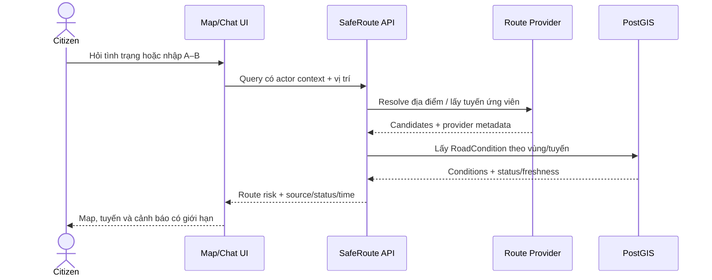
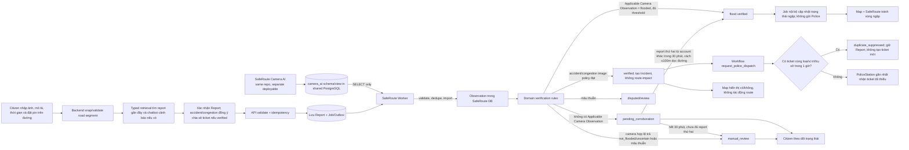

# SafeRoute AI — Software Requirements Document (SRD)

> **Phiên bản:** 1.3  
> **Trạng thái:** Bản đặc tả MVP đang được làm rõ; các quyết định còn mở được liệt kê ở mục 11.  
> **Loại tài liệu:** Software Requirements Document — nguồn chuẩn cho yêu cầu và quy tắc nghiệp vụ.  
> **Phạm vi:** Yêu cầu sản phẩm, nghiệp vụ, actor, luồng, trạng thái, quyền và tiêu chí nghiệm thu. Không phải mô tả chức năng đã được triển khai.  
> **Thời hạn mục tiêu:** MVP trong 12 ngày, bao gồm viết tài liệu và phát triển.

## 1. Mục đích và cách dùng tài liệu

Tài liệu này mô tả **hệ thống cần làm gì và hành vi nào được phép**. Dùng làm cơ sở cho thiết kế UI, API, data model và chia backlog. Kiến trúc và stack mục tiêu nằm trong [Tổng quan hệ thống & Tech Stack](system-overview.md).

Quy ước:

- `MUST`: bắt buộc trong phạm vi MVP đã thống nhất.
- `SHOULD`: nên làm nếu không ảnh hưởng luồng MVP.
- `[CẦN CHỐT]`: cần chủ sản phẩm/team quyết định trước khi khóa contract có liên quan.
- Dữ liệu mock/fixture/seed phải được gắn nhãn rõ; không trình bày như nguồn live.

## 2. Mục tiêu, phạm vi và giới hạn

### 2.1 Mục tiêu MVP

MVP hướng tới phục vụ toàn thành phố Đà Nẵng. Tình trạng camera chỉ được xác nhận trong phạm vi camera đã map/có dữ liệu hợp lệ; ngoài coverage phải hiển thị rõ là chưa có dữ liệu, không được hiểu là an toàn. Routing/Map dùng dữ liệu có coverage thực tế và phải nêu giới hạn.

1. Citizen xem tình trạng ngập, tai nạn, ùn tắc và nguy cơ đường trên Map, kèm trạng thái xác minh và thời điểm cập nhật từ nguồn thật.
2. Citizen tìm tuyến bằng xe máy và ô tô qua routing provider đã chọn; SafeRoute ưu tiên tuyến không giao với vùng ngập đã xác minh và còn hiệu lực.
3. Citizen hỏi chatbot về tình trạng, gửi báo cáo với vị trí đã xác nhận và theo dõi trạng thái.
4. Report được lưu bền vững, phân tích qua job nền và chỉ tạo/cập nhật tình trạng đường theo rule xác minh.
5. Citizen gửi report ngập, tai nạn hoặc ùn tắc; mỗi report bắt buộc có ảnh, mô tả và vị trí đường đã xác nhận. Flood verified cập nhật trạng thái ngập nội bộ; chỉ accident/congestion verified mới có thể tạo ticket tối thiểu tới PoliceStation phù hợp.
6. Police chỉ nhận/xem ticket đã xác minh cùng vị trí chính xác và nội dung cần xử lý; không truy cập hồ sơ Citizen hay toàn bộ report dossier. Admin giám sát hệ thống và review trường hợp chưa đủ căn cứ.

Pilot được giới hạn trong thành phố Đà Nẵng; polygon/vùng ưu tiên và camera coverage cụ thể phải được xác nhận với dữ liệu thực trước khi chốt nghiệm thu live.

### 2.2 Ngoài phạm vi MVP mặc định

- Nhiều khu vực/tỉnh thành và nhiều routing provider cùng lúc.
- Phân tích video CCTV live liên tục nhiều camera hoặc huấn luyện mô hình computer vision riêng. MVP dùng API/frame thật trong coverage đã chọn; xử lý mọi camera và stream liên tục quy mô lớn để sau.
- Tích hợp Zalo OA/email chính thức nếu tài khoản, quyền, credentials và người nhận chưa sẵn sàng.
- Điều phối đa cơ quan/phân cấp phức tạp, hoặc Police case management đầy đủ.
- Cam kết an toàn tuyệt đối, ETA phản ứng của cảnh sát hoặc dự đoán ngập nếu không có dữ liệu hỗ trợ.
- SLA production/24-7 và khả năng mở rộng quy mô lớn chưa được đo.

## 3. Thuật ngữ nghiệp vụ

| Thuật ngữ | Định nghĩa | Ranh giới |
|---|---|---|
| `Report` | Nội dung do Citizen gửi về tình trạng/sự cố | Report đơn lẻ chưa chứng minh sự cố là thật |
| `Observation` | Một nhận định có nguồn và thời điểm, từ camera, ảnh hoặc nguồn dữ liệu | Kết quả AI chỉ là proposal/observation, không tự quyết định trạng thái cuối |
| `RoadSegment` | Một cạnh đường định tuyến có hình học riêng, tách tại nút giao hoặc ranh giới coverage/hazard; cạnh dài được chia nhỏ thêm khi cần định vị cục bộ | Không đồng nhất với toàn bộ con đường/tên phố |
| `Incident` | Sự kiện đã xác minh được công khai trên Map; Incident tạo từ Citizen Report giữ tham chiếu đúng một Report nguồn và không gộp các Report trong MVP | Có identity/lifecycle riêng với Report; accident/congestion không tham gia đánh giá route |
| `RoadCondition` | Ảnh hưởng ngập đã xác minh đang áp dụng lên hình học đoạn đường/vùng thực sự bị ảnh hưởng, dùng cho Map và đánh giá tuyến MVP | MVP chỉ dùng flood RoadCondition cho SafeRoute; không tự gán cho toàn con đường chỉ vì cùng tên phố |
| `PoliceStation` | Trụ sở Công an có vị trí và đúng một tài khoản Police đang hoạt động trong MVP | Ticket thuộc về trụ sở; thay tài khoản không thay lịch sử ticket |
| `DispatchRequest` | Quyết định nội bộ, bền vững để phát hành hoặc suppress PoliceTicket cho một accident/congestion Report đã verified và được Citizen đồng ý chia sẻ | Dùng để chọn trụ sở, chống ticket trùng, retry và audit; không áp dụng cho flood và không phải Police case |
| `PoliceTicket` | Projection tối thiểu của accident/congestion Report gửi tới PoliceStation: loại, vị trí, mô tả và evidence cần xử lý | Không phải flood update, hồ sơ Citizen/report đầy đủ hay Police case |
| `Nearby Report Match` | Kết quả truy xuất report cùng loại, gần vị trí và còn trong cửa sổ thời gian để chatbot báo đã có người gửi | Chỉ là gợi ý read-only; không gộp Report và không tự chứng minh hai report là cùng một sự cố |
| `Source` | Camera, Citizen report hoặc provider cung cấp dữ liệu/observation | Phải lưu danh tính loại nguồn và thời điểm; không mặc định nguồn còn mới |
| `Agent` | Thành phần LLM có vai trò và tool allowlist riêng, được điều phối trong hội thoại | Chỉ hỗ trợ hội thoại và gọi typed application contract; không sở hữu state nghiệp vụ hoặc quyền của actor |

## 4. Actor và quyền cấp cao

| Actor | Mục đích | Được phép | Không được phép |
|---|---|---|---|
| Citizen | Đăng nhập bằng Google để dùng web; xem điều kiện đường, tìm tuyến, hỏi chatbot, gửi và theo dõi report của mình | Đọc dữ liệu map được phép; đọc hồ sơ do mình gửi; tạo report sau xác nhận | Xem PII/evidence/vị trí chính xác riêng tư của người khác; tự đặt trạng thái xác minh |
| Police | Nhận ticket accident/congestion đã xác minh để biết loại sự cố và vị trí cần xử lý | Tài khoản duy nhất của trụ sở chỉ xem ticket được gửi tới PoliceStation mình, vị trí trên Map, mô tả và ảnh liên quan | Tìm/xem hồ sơ Citizen, lịch sử report, thông tin tài khoản; tự xác minh report; acknowledge/assign/close case hoặc sửa trạng thái AI |
| Admin | Một account duy nhất cho MVP, dùng để monitoring và review report cần người xử lý | Xem tổng hợp report, freshness nguồn/camera, job/provider health; xem evidence/vị trí và approve/reject report trong review queue | Sửa nội dung Report; xem/sửa Police ticket thay Police; thay đổi kết quả ngoài review workflow/audit |
| System Worker | Xử lý job nền và tạo observation/proposal | Đọc nguồn được cấu hình; lưu kết quả có schema; retry job | Bỏ qua domain rule, tự cấp quyền hoặc trực tiếp phát hành trạng thái không qua rule service |

Citizen phải đăng nhập bằng Google trước khi dùng web; tài khoản xác thực được tạo/đăng nhập qua Supabase Auth OAuth. Citizen identity dùng server-issued auth subject để đếm nguồn báo cáo khác nhau. MVP chỉ provision một Admin account active. Quan hệ một-một giữa Police account với PoliceStation do SafeRoute cấp từ nguồn tin cậy. Không suy quyền từ email domain, Google profile metadata hoặc dữ liệu do client/model gửi; API xác minh session/JWT và permission server-side ở mọi request.

## 5. Yêu cầu chức năng

### 5.0 Đăng nhập và danh tính

| ID | Yêu cầu | Ưu tiên | Tiêu chí chính |
|---|---|---|---|
| AUTH-001 | Bắt buộc đăng nhập Google trước khi truy cập web SafeRoute | MUST | Không có chế độ guest/anonymous trong MVP; session còn hiệu lực thì giữ trạng thái đăng nhập qua lần tải lại |
| AUTH-002 | Dùng Supabase Auth làm OAuth broker cho Google | MUST | Chỉ xin `openid`, email và profile cơ bản; OAuth client secret nằm trong cấu hình server/provider, không gửi xuống browser |
| AUTH-003 | Gán Citizen làm role mặc định cho tài khoản mới sau lần đăng nhập đầu tiên | MUST | Admin/Police identity phải được cấp trước bằng quy trình tin cậy; không cấp role theo email, domain hoặc Google profile metadata |
| AUTH-004 | Admin/Police được cấp quyền qua dữ liệu role và PoliceStation do SafeRoute quản lý | MUST | Chỉ một Admin account active trong MVP; mỗi PoliceStation có đúng một Police account active và mỗi Police account chỉ thuộc một trụ sở; mỗi API/stream kiểm tra role/station ở server |
| AUTH-005 | Cho phép đăng xuất và thu hồi session theo policy | MUST | Xóa session cookie; write/dispatch/review endpoints từ session đã hết hiệu lực bị từ chối |

Luồng web dùng session cookie an toàn cho SSR; backend ASP.NET xác minh access token/JWT từ Supabase. Supabase Auth user ID (`sub`) là định danh Citizen dùng khi tính số report khác nhau. Không dùng Google provider access token để gọi API Google vì MVP chỉ cần đăng nhập.

Luồng đăng nhập: Citizen bấm **Đăng nhập với Google** → Next.js khởi tạo OAuth/PKCE qua Supabase Auth → Google trả về redirect URL đã allowlist → callback hoàn tất session cookie → web mở workspace; middleware/server component và ASP.NET API từ chối request thiếu session/JWT hợp lệ. Tài khoản mới nhận role Citizen; Admin/Police dùng user ID đã được provision. Đăng xuất xóa session và quay về màn đăng nhập.

### 5.1 Citizen Map và tình trạng đường

| ID | Yêu cầu | Ưu tiên | Tiêu chí chính |
|---|---|---|---|
| MAP-001 | Map hiển thị các loại sự kiện được phép công khai: ngập, tai nạn, ùn tắc và điều kiện đường | MUST | Chỉ hiển thị sự kiện đã verified, giới hạn theo viewport và public policy |
| MAP-002 | Mỗi chi tiết hiển thị trạng thái xác minh, thời điểm quan sát/cập nhật và nguồn nếu có | MUST | Dữ liệu stale được đánh dấu; không coi thiếu dữ liệu là an toàn |
| MAP-003 | Citizen lọc theo loại và trạng thái công khai đã chốt | SHOULD | Bộ lọc áp dụng đồng nhất ở UI và API |
| MAP-004 | UI xử lý loading, empty, provider lỗi, mất mạng và không có vị trí thiết bị | MUST | Có cách nhập địa chỉ/chọn vị trí thay cho geolocation |
| MAP-005 | Không công khai danh tính, liên hệ, evidence riêng tư hoặc tọa độ chính xác bị bảo vệ | MUST | Kiểm tra ở response server, không chỉ ẩn ở UI |
| MAP-006 | Báo cáo chưa xác nhận chỉ người gửi xem được trạng thái; không hiển thị trên public map | MUST | Tọa độ/evidence và trạng thái pending không được trả qua public map API |
| MAP-007 | Citizen dùng location picker để đặt pin hoặc chọn đoạn đường và xác nhận trước khi gửi report | MUST | GPS chỉ có thể dùng để đưa Map tới khu vực gần người dùng, không tham gia verification. Pin nhập vào chỉ là vị trí chọn ban đầu; backend phải snap thành vị trí nghiệp vụ nằm trên road segment routable trong 20 m. Pin khu phố/khu dân cư không snap được hoặc snap mơ hồ phải được đặt lại/xác nhận đường; không lưu pin off-road làm vị trí Report |
| MAP-008 | Map có legend, filter và cách xem thay thế khi marker dày hoặc không dùng được map canvas | SHOULD | Trạng thái không chỉ phân biệt bằng màu. MVP gom cụm point marker ở zoom thấp (bấm cụm để zoom); không gom flood line/geometry. Danh sách kết quả tương ứng phải cho phép xem/chọn feature mà không cần bấm chính xác marker. Khi map lỗi, vẫn hiển thị thông báo và danh sách nếu API còn dữ liệu; không dùng dữ liệu giả hoặc coi vùng không có marker là an toàn |
| MAP-009 | API lấy incident/condition theo viewport và giới hạn kết quả | MUST | Không tải toàn bộ dữ liệu; geometry/fields phải theo actor permission |
| MAP-010 | Citizen chọn cách ghi nhận vị trí sự cố là một điểm hoặc phạm vi bị ảnh hưởng trên đường | MUST | Điểm/đầu-cuối picker phải snap duy nhất vào road segment routable trong tolerance đầu vào 20 m; geometry vị trí được lưu/dùng nghiệp vụ phải nằm trên đường sau khi snap. Ngoài tolerance hoặc nhiều đường cạnh tranh thì chưa cho gửi. Chỉ flood verified mới tạo geometry ảnh hưởng route; accident/congestion chỉ tạo Incident hiển thị Map |

### 5.2 Tìm địa điểm và route risk

| ID | Yêu cầu | Ưu tiên | Tiêu chí chính |
|---|---|---|---|
| ROUTE-001 | Citizen nhập điểm đầu/cuối bằng địa chỉ, gợi ý hoặc chọn trên map | MUST | Địa điểm mơ hồ phải được Citizen chọn/xác nhận |
| ROUTE-010 | Map có trải nghiệm tìm đường kiểu bản đồ chỉ đường: nhập điểm đi và điểm đến, chọn loại xe, xem các route ứng viên trên Map | MUST | Điểm đi/đến được geocode và xác nhận; vẽ route geometry, thời gian/quãng đường, cảnh báo rủi ro; Citizen chọn một route để xem chi tiết |
| ROUTE-002 | Hệ thống lấy tuyến ứng viên từ một provider đã chọn cho cả xe máy và ô tô | MUST | Live acceptance phải dùng provider thật và credentials hợp lệ; fixture chỉ dùng ở local/dev, không thay routing live |
| ROUTE-003 | Backend đối chiếu tuyến với flood RoadCondition còn hiệu lực | MUST | Chỉ dùng `hazard_type=flood`; pin flood dùng buffer ảnh hưởng 100 m, extent/camera dùng geometry đoạn đường đã snap; trả vùng ngập giao cắt, verification state, source/time |
| ROUTE-004 | Kết quả thể hiện rủi ro tương đối và giới hạn dữ liệu | MUST | Không tuyên bố tuyến an toàn tuyệt đối |
| ROUTE-005 | Chỉ flood RoadCondition đã đạt rule xác minh và còn hiệu lực được dùng để đánh giá route | MUST | Accident/congestion không tác động thứ hạng hoặc loại route trong MVP; pending/unverified report không tác động route hay public map |
| ROUTE-006 | Provider lỗi thì UI cho biết không tính được tuyến | MUST | Vẫn xem được Map/tình trạng có sẵn khi backend còn hoạt động |
| ROUTE-007 | Xếp các tuyến ứng viên theo giao cắt với vùng ngập | MUST | Ưu tiên candidate không giao flood RoadCondition active; giữa các candidate cùng nhóm ưu tiên coverage dữ liệu tốt hơn rồi thời gian ngắn hơn. Không cần severity matrix cho MVP |
| ROUTE-008 | Không có tuyến tránh toàn bộ vùng ngập | MUST | Báo rõ không tìm thấy tuyến tránh ngập phù hợp. Có thể hiển thị candidate giao ngập ít nhất dưới dạng tham khảo có cảnh báo nổi bật; không gọi đó là tuyến an toàn/được khuyến nghị |
| ROUTE-009 | Tìm và trả các lựa chọn tuyến tránh ngập | MUST | Backend yêu cầu alternatives và thử tìm thêm candidate tránh geometry flood đã biết. Chỉ trả geometry do routing provider/engine tạo và đã backend kiểm tra. Trả tối đa 3 tuyến không giao flood; nếu không đủ thì trả số thực có và nêu giới hạn |

Loại phương tiện xe máy và ô tô đã được xác nhận cho MVP. Cả hai cùng dùng rule tránh mọi flood RoadCondition active; vehicle type chỉ dùng để yêu cầu route profile phù hợp từ provider. Accident/congestion vẫn hiển thị trên Map nhưng không tham gia SafeRoute ranking trong MVP.

### Quy tắc xác minh theo loại report

| Loại report | Evidence bắt buộc | Xác minh tự động được phép | Khi chưa đủ bằng chứng | Khi được công khai/tác động route |
|---|---|---|---|---|
| `flood` có Applicable Camera Observation | Ảnh, mô tả, vị trí đường đã Citizen xác nhận | Camera đã map đúng road path, report nằm trong coverage 250 m mỗi phía và observation `flooded` còn mới (≤5 phút), đạt confidence threshold | Đây là nhánh camera-first, không lấy hai Citizen Report thay kết quả camera. `not_flooded`, `uncertain`, confidence thấp hoặc bằng chứng mâu thuẫn → `manual_review`; không tự kết luận đường an toàn | Sau khi verification policy trả `verified` hoặc Admin approve |
| `flood` không có Applicable Camera Observation | Ảnh, mô tả, vị trí đường đã xác nhận; đủ cả hai report phải đạt kiểm tra ảnh/vị trí | Hai account Citizen khác nhau, cùng loại nguy cơ, cách nhau ≤100 m dọc road network, server nhận trong 30 phút; mỗi account chỉ tính một lần/cụm | Áp dụng khi ngoài coverage hoặc camera observation không dùng được vì thiếu/stale/unmapped. Thiếu report thứ hai sau 30 phút, ảnh/vị trí không đạt hoặc mapping đường mơ hồ → `manual_review` | Sau quorum hợp lệ hoặc Admin approve |
| `accident` | Ảnh, mô tả, thời gian còn mới và pin đã snap đúng road segment | Tự động verified khi image verifier trả đúng loại accident, input đủ và backend policy chấp nhận kết quả | Ảnh không đủ căn cứ, confidence dưới threshold, mâu thuẫn hoặc pin không xác nhận được → `manual_review`; không route-impact | Sau `verified`/Admin approve: tạo Incident có/không trên Map và Police ticket; không tạo trạng thái `road_closed` trong MVP |
| `traffic_congestion` | Ảnh, mô tả, thời gian còn mới và pin đã snap đúng road segment | Tự động verified khi image verifier trả đúng loại congestion, input đủ và backend policy chấp nhận kết quả | Ảnh không đủ căn cứ, confidence dưới threshold, mâu thuẫn hoặc pin không xác nhận được → `manual_review`; không route-impact | Sau `verified`/Admin approve: tạo Incident có/không trên Map và Police ticket; không ảnh hưởng route |

“Đủ tin cậy” là verifier trả output có cấu trúc khớp loại report và đạt threshold cấu hình. Backend policy mới thực hiện transition `verified`; Agent/LLM không tự đặt trạng thái. Threshold model được hiệu chỉnh trong provider PoC và fail closed sang `manual_review` nếu chưa cấu hình. Location verification chỉ kiểm tra pin/extent đã snap đúng road segment, không dùng GPS hiện tại của Citizen.

### Phạm vi camera và ghép với mạng đường

- SafeRoute duy trì camera registry: `camera_id`, tọa độ chính xác, `road_segment_id` được gán, geometry đoạn cục bộ ảnh hưởng route, nguồn và trạng thái cấu hình. Mỗi camera được gắn với một road path cụ thể; vùng camera xác nhận kéo dài tối đa 250 m dọc path về mỗi phía (tối đa 500 m tổng); không dùng buffer tròn và không rẽ sang đường nhánh.
- Setup pilot: import camera ID/tọa độ; hệ thống gợi ý road edge gần nhất; data owner xác nhận camera point và một road path cụ thể trong registry. Lưu road source IDs/version và vị trí camera đã snap (chainage) trên path. Tạo geometry ảnh hưởng bằng linear referencing từ chainage −250 m đến +250 m, cắt tại đầu/cuối path đã xác nhận; ở giao lộ tiếp tục đúng path, không duyệt sang nhánh. Map matching chỉ là gợi ý, không tự xác nhận road path. Camera chưa có mapping được xác nhận thì `unconfigured` và không ảnh hưởng route.
- AI camera chỉ cập nhật trạng thái mới nhất của camera: ngập, không ngập hoặc không chắc. Khi một camera được cấu hình báo ngập và đạt ngưỡng confidence/freshness, SafeRoute áp trạng thái lên geometry đoạn đường đã gán cho camera. Camera không cần tự trả geometry ngập; camera point và đoạn ảnh hưởng là dữ liệu registry riêng.
- Camera state `not_flooded` không được dùng để bác bỏ một Citizen report mâu thuẫn. Gỡ condition do camera tạo sau 2 state event `not_flooded` liên tiếp của cùng camera, cả hai còn mới (≤5 phút) và đạt confidence threshold; state `flooded`/`uncertain` ở giữa làm reset bộ đếm. Chỉ gỡ source contribution của camera đó; nếu còn nguồn đang active hỗ trợ cùng geometry thì RoadCondition vẫn active.
- Khoảng trống giữa các đoạn camera được gán là `unknown / chưa có dữ liệu`, không phải an toàn. Tình trạng một camera không lan sang camera/đoạn đường khác. Nếu có geometry quan sát thực tế thì có thể lưu riêng làm evidence, nhưng MVP route impact dùng đoạn đường đã cấu hình.
- Coverage geometry là dữ liệu nội bộ. Public Map/route chỉ trả tình trạng đường và độ phủ/trạng thái dữ liệu theo policy, không trả camera feed hay thông tin nhạy cảm của camera.

### Hợp đồng trạng thái camera mới nhất

Theo quyết định hiện tại, dịch vụ AI duy trì một row trạng thái mới nhất/camera và đồng thời append từng kết quả phân tích vào state-event history. Cả current state và event history được ghi cùng transaction; event có ID/revision đơn điệu để Worker đọc bền vững, không bỏ lỡ lần chuyển trạng thái. AI không ghi đè `RoadCondition`; SafeRoute sở hữu lifecycle nghiệp vụ.

| Trường | Quy tắc |
|---|---|
| `camera_id` | Khóa duy nhất trong current-state table, khớp camera trong SafeRoute registry |
| `event_id`, `source_revision` | Mỗi kết quả phân tích được ghi vào history có ID duy nhất và revision tăng đơn điệu để Worker cursor/idempotency; current-state row trỏ revision mới nhất |
| `observed_at`, `source_updated_at` | UTC; `observed_at` là thời điểm frame được phân tích, freshness tính từ đây; `source_updated_at` là thời điểm AI commit trạng thái |
| `flood_status` | `flooded`, `not_flooded`, `uncertain`; `uncertain` không tự clear/confirm |
| `confidence`, `model_version` | Confidence có scale/range đã mô tả; lưu model/version để audit và hiệu chỉnh |
| `severity` | Cấp độ quan sát có định nghĩa ổn định (ví dụ `low`, `moderate`, `high`, `impassable`); lưu riêng với confidence |
| `water_depth_cm`, `depth_confidence`, `depth_method` | Nullable; chỉ có số cm khi pipeline đo đã hiệu chuẩn; lưu cách đo và confidence, nếu không để null và dùng severity category, không bịa số độ sâu |
| `evidence_ref` | Tham chiếu ảnh/frame trong storage riêng tư nếu cần review; không nhúng binary hoặc public URL vào row |

Không lấy tọa độ camera làm geometry của cả con đường. `camera_location` là điểm hiển thị vị trí camera; `camera_road_segment` là geometry đường đã gán trong registry và dùng làm vùng ảnh hưởng mặc định khi trạng thái camera là `flooded`. Mỗi camera là nguồn độc lập; không yêu cầu camera thứ hai xác nhận. Nếu nhiều camera được gán segment chồng lấn, route chỉ tính phần chiều dài bị ảnh hưởng một lần; giữ revision/nguồn riêng để audit. Nếu trạng thái nguồn xung đột trên cùng vùng, dùng nguy cơ bảo thủ hoặc chuyển review, không lấy trung bình để che rủi ro.

Ví dụ minh họa một observation đã định vị (giá trị confidence/severity dưới đây không phải threshold đã chốt):

```json
{
  "event_id": "cam-018-rev-482",
  "camera_id": "cam-018",
  "observed_at": "2026-10-13T08:15:00Z",
  "source_updated_at": "2026-10-13T08:15:04Z",
  "source_revision": 482,
  "flood_status": "flooded",
  "confidence": 0.94,
  "model_version": "flood-model-vX",
  "severity": "moderate",
  "water_depth_cm": null,
  "depth_confidence": null,
  "depth_method": null,
  "evidence_ref": "private://camera-evidence/obs-cam-018"
}
```

SafeRoute kiểm tra segment được tham chiếu với camera registry và thời điểm observation, sau đó chỉ tạo/cập nhật RoadCondition cục bộ. Hệ thống không đóng mọi segment trùng tên đường.

### Cách đánh giá tuyến MVP

1. Routing provider trả một hoặc nhiều tuyến ứng viên cùng geometry, thời gian và hướng dẫn.
2. Backend chỉ đọc `RoadCondition` có `hazard_type=flood`, đã verified, `state=active` và `expires_at > now`. Point flood dùng buffer 100 m; extent/camera dùng geometry đoạn đường đã snap/cấu hình. Route request không gọi camera hay image verifier trực tiếp.
3. PostGIS kiểm tra mỗi candidate có giao `affected_geometry` ngập hay không. Accident/congestion Incident bị loại khỏi query đánh giá route.
4. Candidate không giao vùng ngập được xếp trước; trong cùng nhóm ưu tiên coverage dữ liệu tốt hơn rồi thời gian ngắn hơn. MVP không tính severity weight hoặc trạng thái `road_closed`.
5. Nếu candidate ban đầu đều giao ngập, backend yêu cầu provider/engine tìm alternatives hoặc detour tránh geometry ngập, rồi spatial-check lại. Không dựng polyline bằng LLM hay tự nối điểm thành đường.
6. Trả tối đa 3 candidate không giao ngập. Nếu không có tuyến tránh ngập, có thể hiển thị candidate có tổng chiều dài giao ngập nhỏ nhất dưới dạng **tuyến tham khảo có cảnh báo**, ghi rõ không tìm thấy tuyến tránh ngập phù hợp và không gọi đó là tuyến an toàn/được khuyến nghị. Nếu provider không trả geometry thì báo không thể tính tuyến.

MVP không dùng công thức `RiskExposure` hoặc severity matrix. `overlap_length_m` chỉ dùng để chọn candidate tham khảo ít giao ngập hơn khi không có tuyến tránh hoàn toàn. Unknown coverage vẫn là thiếu dữ liệu, không phải bằng chứng đường thông thoáng.

**Thứ tự đánh giá đã chốt:** PoC từng routing provider tuần tự, bắt đầu với OSRM self-hosted; chỉ thử VIETMAP Route v4 nếu OSRM không đạt tiêu chí chất lượng. Chưa provider nào được xác nhận là lựa chọn production và không mặc định có runtime fallback. OSRM hỗ trợ route alternatives và GeoJSON geometry, nhưng profile mặc định gồm car/bicycle/foot; xe máy cần profile Lua riêng và graph phải được preprocess theo profile. Không dùng profile bicycle thay cho motorcycle. PoC đầu tiên kiểm tra tuyến car/motorcycle thực tế tại Đà Nẵng, gồm độ đúng hướng đi/đường cấm, alternatives và kiểm tra flood. Nếu OSRM không đạt, thử VIETMAP (có `vehicle=motorcycle`) trên cùng bộ case rồi chọn provider chất lượng đạt tiêu chí; không giả định OSRM đã hỗ trợ xe máy chỉ vì có bicycle profile.

### 5.3 Chatbot

| ID | Yêu cầu | Ưu tiên | Tiêu chí chính |
|---|---|---|---|
| CHAT-001 | Nhận diện intent: hỏi tình trạng, tìm tuyến, báo nguy cơ, báo tai nạn/điều phối, tra cứu trạng thái của mình | MUST | Intent không chắc thì hỏi làm rõ |
| CHAT-002 | Thu thập trường bắt buộc và không hỏi lại trường Citizen vừa xác nhận | MUST | Vị trí/địa danh mơ hồ phải yêu cầu chọn/xác nhận |
| CHAT-003 | Chỉ gọi function có tên/schema/permission đã đăng ký | MUST | Không cho model SQL, arbitrary HTTP, shell hoặc gửi notification tùy ý |
| CHAT-004 | Report cần hiển thị tóm tắt và yêu cầu Citizen xác nhận gửi | MUST | Tóm tắt gồm loại nguy cơ, ảnh, mô tả, vị trí đường và thời gian; với accident/congestion, thông báo ticket verified có thể được chia sẻ với PoliceStation; flood chỉ cập nhật SafeRoute, không gửi Police |
| CHAT-005 | Chat trao đổi hai chiều và trả lời tăng dần theo chunk qua stream đã xác thực | MUST | WebSocket browser–API; client và server gửi message/event trên cùng kết nối; assistant stream từng chunk qua `assistant.delta`. Không fallback sang SSE/polling. Có thể reconnect/resume bằng cùng WebSocket; nếu không kết nối được, báo lỗi và không giả đã nhận tin. Webhook chỉ dành cho callback server-to-server, không dùng làm chat stream. Chat/provider fallback nghiệp vụ đã chốt riêng không bị thay đổi bởi lựa chọn transport |
| CHAT-006 | Trả lời nêu source/status/freshness khi có dữ liệu | MUST | Không bịa camera, route, PoliceStation nhận hoặc trạng thái gửi ticket; Nearby Report Match chỉ được nói là có report gần đây, không nói Police đã nhận/xử lý |
| CHAT-007 | Trình bày route options do backend tính | MUST | `evaluate_routes` trả tối đa 3 candidate đã xếp theo vehicle type, risk level, uncertainty/data coverage, ETA và lý do; LLM chỉ tóm tắt kết quả, không tự tạo geometry, điểm an toàn hoặc đổi thứ hạng |
| CHAT-008 | Trước khi Citizen xác nhận report, chatbot có thể truy xuất report gần đây quanh vị trí đã chọn | SHOULD | Dùng typed retrieval do backend lọc; flood tìm trong 30 phút để nhắc nhưng vẫn cho gửi nhằm đủ quorum; accident/congestion tìm trong 1 giờ để nhắc và làm đầu vào chống ticket trùng; không trả identity/evidence của người khác |
| CHAT-009 | Chat sử dụng mô hình multi-agent gồm một Coordinator và hai agent chuyên trách Mobility, Reporting | MUST | Coordinator phân loại intent và giao tác vụ; mỗi agent chỉ có tool allowlist riêng, nhận dữ liệu tối thiểu cần thiết; fallback về typed flow khi agent/provider lỗi |
| CHAT-010 | Agent Mobility chỉ xử lý tra cứu tình trạng và tìm tuyến | MUST | Chỉ được dùng query/geocoding/route operation qua typed server facade; không tạo/sửa Report, Incident, RoadCondition, review decision hoặc Police ticket |
| CHAT-011 | Agent Reporting hỗ trợ thu thập và gửi Report | MUST | Có thể quản lý draft trong hội thoại, kiểm tra input và tra cứu nearby hint; chỉ gọi `create_hazard_report` sau khi Citizen xác nhận tóm tắt; verification và dispatch chạy bằng backend workflow |
| CHAT-012 | Hệ thống ghi audit/correlation cho việc điều phối agent và tool | MUST | Ghi agent role, tool, kết quả allow/deny/error, correlation ID và thời điểm; không ghi raw evidence hoặc dư thừa nội dung nhạy cảm vào log |
| CHAT-013 | Quản lý session và lịch sử hội thoại tạm thời, tách khỏi phiên đăng nhập | MUST | Session gắn với actor đã xác thực và server kiểm tra quyền sở hữu; lưu tạm tin Citizen gửi và câu trả lời cuối của Assistant để hiển thị/tiếp tục hội thoại; transcript, structured state, draft và media chưa gửi hết hạn sau 24 giờ không hoạt động; Report đã commit tồn tại độc lập theo retention của Report |
| CHAT-014 | Cung cấp ngữ cảnh hội thoại gần nhất cho model trong giới hạn | MUST | Mỗi model call nhận tối đa 30 tin nhắn mới nhất (tính cả tin hiện tại, tương đương khoảng 15 lượt trao đổi), theo thứ tự thời gian, và structured state đã xác nhận; giới hạn phần lịch sử chat ở khoảng 8.000 token, lấy giới hạn nào chạm trước. Khi vượt giới hạn token, bỏ các tin cũ nhất trước và giữ tin Citizen hiện tại cùng state đã xác nhận. Dữ liệu nghiệp vụ chỉ bổ sung qua typed retrieval được phân quyền; không dùng vector RAG cho lịch sử chat hoặc trạng thái Map |

Phân quyền operations MVP: Coordinator chỉ được phân loại intent và trả đích điều phối đã đăng ký; Mobility chỉ được yêu cầu các operation `search_incidents`, `get_road_conditions`, `geocode_place`, `evaluate_routes`; Reporting chỉ được yêu cầu `validate_report_evidence`, `search_nearby_recent_reports`, `create_hazard_report`, `get_my_report_status`, `get_ticket_delivery_status`. Backend kiểm tra allowlist rồi chạy registered typed function/application use case; specialist nhận projection đã lọc để trả lời. Không có model-generated SQL, arbitrary HTTP/shell hoặc tool loop không giới hạn. Write operation `create_hazard_report` chỉ chạy sau explicit Citizen confirmation. Không agent nào có `verify_report` hoặc `request_police_dispatch`; Worker/backend policy xử lý verification, chọn PoliceStation, chống ticket trùng và dispatch. Server tự lấy actor/resource; không nhận role/owner/station, `verified=true`, recipient hoặc ticket body từ model.

**Contract điều phối multi-agent đã chốt cho MVP:** mỗi user turn chạy tuần tự tối đa một lần gọi Coordinator rồi tối đa một lần gọi Mobility hoặc Reporting; specialist được gọi trả câu cuối, không gọi Coordinator lại để paraphrase. Coordinator chỉ trả `intent` trong enum đóng (`condition_lookup`, `route_search`, `report_prepare`, `report_status`, `clarify`) và các slot có schema cho intent đó; backend ánh xạ intent sang specialist, kiểm tra slot và tự chọn registered operation. Mọi text/slot từ model đều là untrusted input; không coi ID/role/quyền do model trả là actor context. `clarify` thì hỏi Citizen và không gọi specialist. Không fan-out song song, không retry/reflection loop và không cho model chọn tool tùy ý. Nếu output điều phối không hợp lệ hoặc provider lỗi, chuyển sang typed flow. Đây là giới hạn thiết kế MVP, không phải cam kết provider luôn đáp ứng latency.

**Ranh giới xử lý ảnh:** ảnh gốc không được đưa vào prompt hoặc tool context của Coordinator, Mobility hay Reporting. Sau khi Citizen xác nhận gửi report, backend gọi operation `AnalyzeReportImage` riêng, lấy ảnh từ private storage và gửi trực tiếp qua AI adapter tới cùng OpenCode Go + DeepSeek V4.1 Flash đã chọn cho chat, nếu PoC xác nhận endpoint hỗ trợ payload ảnh và điều khoản cho phép. Một Report tạo tối đa một yêu cầu phân tích chứa 1–3 ảnh; nếu API không hỗ trợ phân tích chung trong một request thì không fan-out thành nhiều call, chuyển `manual_review`. Đây là thao tác backend riêng để cô lập dữ liệu/luồng và áp dụng quyền, không phải provider/model khác. Adapter trả Observation có cấu trúc (nhãn phù hợp, chất lượng, confidence, model/version và lý do ngắn); đây không phải kết luận `verified`. Backend áp dụng rule đã chốt để quyết định `verified` hoặc `manual_review`. Không gửi account ID, email, tên hay hội thoại kèm ảnh; request không được dùng để huấn luyện và phải có retention phù hợp. Nếu khả năng ảnh, quyền sử dụng hoặc điều kiện riêng tư chưa đạt, hoặc provider lỗi, không tự động xác minh bằng ảnh; chuyển manual review/typed flow. Việc dùng cùng model cho chat và ảnh là lựa chọn MVP, còn phải qua gate PoC/điều khoản trước production.

### 5.4 Report intake và xác minh

Citizen report có đúng ba loại trong MVP: `flood`, `accident`, `traffic_congestion`. Cả ba bắt buộc có ảnh evidence, mô tả bằng chữ, thời điểm quan sát và vị trí đường do Citizen chọn bằng location picker. Citizen có thể báo cáo sau khi đã rời hiện trường; GPS hiện tại không dùng để verification. Pin/đầu-cuối người dùng chọn chỉ là input; backend chỉ chấp nhận khi snap duy nhất vào road segment routable trong tolerance đầu vào 20 m, sau đó geometry dùng nghiệp vụ phải nằm trên đường. Pin khu phố/khu dân cư, không snap được hoặc mơ hồ phải được đặt lại/chọn đúng đường; không lưu vị trí Report off-road. Agent Reporting chỉ hỗ trợ intake; Worker/backend verification policy xử lý kết quả, không agent nào tự kết luận thật/giả hoặc gọi verification tool.

| ID | Yêu cầu | Ưu tiên | Tiêu chí chính |
|---|---|---|---|
| REPORT-001 | Nhận một trong ba loại `flood`, `accident`, `traffic_congestion`, cùng ảnh, mô tả, thời điểm quan sát và vị trí đường đã xác nhận | MUST | Ảnh + mô tả + thời gian + vị trí đường bắt buộc; GPS không bắt buộc và không tham gia verification; picker phải snap duy nhất vào road segment routable trong tolerance đầu vào 20 m và geometry Report được lưu phải nằm trên đường; nếu không thì hỏi đặt lại, chưa tạo report |
| REPORT-002 | Lưu report và job xử lý bền vững trước khi trả nhận thành công | MUST | Retry cùng idempotency key không tạo report/job trùng |
| REPORT-003 | Với report ngập, ưu tiên camera khi có Applicable Camera Observation tại vị trí report | MUST | Camera phải map đúng road path, chứa report trong coverage tối đa 250 m mỗi phía và observation còn mới ≤5 phút. `flooded` đủ confidence có thể xác minh; `not_flooded`/`uncertain`/confidence thấp/mâu thuẫn chuyển review. Khi observation hợp lệ tồn tại, không chạy quorum hai Report song song |
| REPORT-004 | Ghép report với observation do Camera AI deployable trong SafeRoute repository ghi vào schema riêng | MUST khi có camera data | SafeRoute Worker chỉ đọc schema/view được cấp quyền; kiểm tra camera mapping, coverage, schema/source/time/confidence/reason. Observation thiếu, stale, unmapped hoặc sai contract không phải Applicable Camera Observation và không được promote state |
| REPORT-005 | Xác nhận chéo report ngập khi không có Applicable Camera Observation | MUST | Áp dụng cho ngoài coverage hoặc camera data thiếu/stale/unmapped. Cần 2 Citizen account khác nhau; cả hai report có ảnh, mô tả và vị trí tin cậy; cùng loại nguy cơ, cách nhau tối đa 100 m dọc mạng đường và nhận trong 30 phút. Khi đủ quorum, hai Report giữ identity riêng và được verified độc lập; hết 30 phút chưa đủ thì Admin review |
| REPORT-005A | Xác minh tự động report tai nạn và ùn tắc | MUST | Khi input đủ, pin nằm trên road segment, evidence còn mới và image verifier trả đúng loại với confidence đạt policy, backend chuyển `verified`; nếu không đủ căn cứ/confidence hoặc có mâu thuẫn thì `manual_review`. Khi verified chỉ tạo Incident có/không trên Map và ticket; không route-impact |
| REPORT-006 | Không đủ căn cứ thì giữ report ở trạng thái chờ, không đưa vào lớp đã xác minh | MUST | Citizen chỉ xem trạng thái report của mình; report không public, không ảnh hưởng route và không gửi Police ticket; hết cửa sổ xác nhận chéo/camera không phát hiện/chứng cứ mâu thuẫn thì chuyển Admin review |
| REPORT-007 | Phát hiện tín hiệu liên quan/trùng, evidence cũ/không liên quan và bằng chứng mâu thuẫn | SHOULD | Tín hiệu trùng không merge/xóa Report; trường hợp mâu thuẫn chuyển `disputed`/review, không chọn kết quả thuận tiện |
| REPORT-008 | Hết nguy cơ hoặc dữ liệu quá cũ thì gỡ khỏi cảnh báo hiện hành nhưng giữ lịch sử | MUST | Flood RoadCondition và accident/congestion Incident public hết hiệu lực 6 giờ sau lần xác nhận/cập nhật hỗ trợ gần nhất; chỉ evidence mới qua rule mới làm mới hạn. Admin chỉ approve/reject nguồn Report qua review, không có nút toàn cục “đường an toàn”; history/audit không bị mất |
| REPORT-009 | Citizen tra cứu kết quả report của chính mình | MUST | Trả trạng thái và lý do an toàn cho người dùng sau quyết định; không trả ghi chú nội bộ Admin; kiểm tra ownership ở server |
| REPORT-010 | Ghép camera state với vị trí đường | MUST khi dùng camera | Ghép `camera_id` qua SafeRoute registry, chỉ áp dụng lên road segment cục bộ đã xác nhận; camera chưa có mapping bị quarantine và không tạo Applicable Camera Observation, nên Report đi nhánh quorum |
| REPORT-011 | Định vị phạm vi ảnh hưởng từ camera | MUST khi camera phát hiện nguy cơ | AI trả trạng thái camera, không cần tự trả geometry; `RoadCondition.affected_geometry` lấy từ segment cục bộ đã gán trong registry. Không suy rộng cả tên đường; chiều dài/điểm đầu-cuối segment camera cần cấu hình rõ |
| REPORT-012 | Giới hạn evidence ảnh MVP | MUST | Mỗi report 1–3 ảnh JPEG/PNG/WebP, tối đa 10 MB/ảnh và 30 MB/report; không nhận video; file hỏng/sai MIME/quá giới hạn bị từ chối trước khi tạo Report |
| REPORT-013 | Kiểm tra freshness của evidence Citizen | MUST | `observed_at` do Citizen khai báo và `received_at` do server ghi; ≤30 phút đủ điều kiện auto-verification, >30 phút đến 2 giờ chuyển `manual_review`, >2 giờ không xác nhận tình trạng hiện tại; EXIF chỉ tham khảo, thời gian tương lai quá 5 phút bị từ chối |
| REPORT-014 | Report bất biến sau khi gửi | MUST | Trước xác nhận chỉ là client draft; sau commit Citizen không sửa, rút, hủy hoặc xóa Report. Thông tin sai/cập nhật phải gửi thành Report mới và có thể liên kết report trước; không ghi đè Report gốc; evidence tuân theo retention riêng |
| REPORT-015 | Mỗi lần Citizen xác nhận gửi tạo một Report độc lập | MUST | Không merge, overwrite hoặc biến nhiều Report thành một Report; flood verification có thể tham chiếu hai Report độc lập để đạt quorum nhưng vẫn giữ nguyên identity/evidence của từng Report |
| REPORT-016 | Tìm report gần đây phục vụ chatbot mà không làm lộ dữ liệu | SHOULD | Backend lọc cùng hazard type, cùng road segment hoặc cách tối đa 100 m dọc mạng đường; cửa sổ flood 30 phút, accident/congestion 1 giờ. Tool chỉ trả tối đa 5 hint ẩn danh gồm source type `citizen_report`, loại, thời gian làm tròn, tên đường xấp xỉ và `publicly_verified` hoặc `not_publicly_verified`; không trả ID, exact point, mô tả, evidence hoặc owner |

Evidence lưu private. Citizen đọc ảnh report của mình; Admin chỉ đọc khi review và access được audit; Police chỉ đọc ảnh đã chiếu vào ticket `delivered` của PoliceStation mình. Signed URL có hạn tối đa 10 phút. Raw evidence xóa sau 90 ngày kể từ khi report kết thúc; metadata, verification/delivery history và audit giữ 365 ngày. Không ghi ảnh/signed URL vào log hoặc gửi sang model provider chưa được duyệt.

### 5.5 Police ticket

Police use case MVP chỉ nhận ticket `accident`/`traffic_congestion` đã verified do SafeRoute workflow phát hành. Flood verified chỉ cập nhật Incident/RoadCondition trong SafeRoute, không tạo DispatchRequest hoặc PoliceTicket. Verification là kết quả của policy backend và tools có audit; LLM không được tự đánh dấu verified, chọn trụ sở hoặc tự gửi ticket. Ticket chỉ chứa mã ticket, loại sự cố, trạng thái/thời điểm xác minh, vị trí Map, mô tả Citizen và ảnh liên quan. Không kèm profile, email, Google identity, lịch sử Citizen hay ghi chú review nội bộ. Không xây police case management, tìm kiếm hồ sơ, phân công/đóng case hoặc sửa dữ liệu nguồn.

| ID | Yêu cầu | Ưu tiên | Tiêu chí chính |
|---|---|---|---|
| DISPATCH-001 | Chỉ xét tạo DispatchRequest/PoliceTicket từ accident/congestion Report đã verified | MUST | Flood không đi vào dispatch; Report gồm ảnh, mô tả, vị trí, loại và thời gian; model không tự quyết định verified hoặc ticket eligibility |
| DISPATCH-002 | Citizen xem tóm tắt report và xác nhận gửi; với accident/congestion, UI nói rõ ticket verified có thể được chia sẻ với PoliceStation | MUST | Trả mã Report sau commit; xác nhận là consent cho bước chia sẻ sau verification. Flood confirmation chỉ cho phép SafeRoute dùng report cập nhật condition, không phải consent gửi Police |
| DISPATCH-003 | Backend chọn PoliceStation gần nhất trong danh sách trụ sở đủ điều kiện | MUST | Jurisdiction MVP được giản lược thành registry station thuộc pilot: trước hết lọc trụ sở active thuộc pilot và có đúng một Police account active, sau đó tính khoảng cách đường chim bay từ snapped report point và chọn gần nhất; không có polygon địa bàn phức tạp. Hòa khoảng cách dùng station ID ổn định. Không có trụ sở đủ điều kiện thì `delivery_failed` |
| DISPATCH-004 | Police account chỉ xem ticket verified đã gửi tới PoliceStation của mình | MUST | Ticket thuộc PoliceStation, không thuộc account cá nhân; ticket view giới hạn trường và không có endpoint xem hồ sơ Citizen/report dossier |
| DISPATCH-005 | Ghi trạng thái quyết định dispatch và publication vào inbox | MUST | `delivered` khi ticket đã commit và truy vấn được trong inbox của PoliceStation; không đồng nghĩa Police đã đọc. MVP không có acknowledge/assign/close |
| DISPATCH-006 | Retry lỗi publish mà không tạo ticket trùng | SHOULD | Retry idempotent tối đa 5 lần với backoff; hết retry chuyển `delivery_failed` và giữ audit |
| DISPATCH-007 | Chống tạo PoliceTicket accident/congestion trùng trong 1 giờ | MUST | Nếu cùng loại, cùng road segment hoặc cách ≤100 m dọc mạng đường, cùng PoliceStation đích và đã có ticket `delivery_pending`/`delivered` tạo trong 1 giờ trước thì không tạo ticket mới; lưu `duplicate_suppressed` cùng `existing_ticket_id`. Report/Incident mới vẫn độc lập; sau 1 giờ được phép tạo ticket mới |
| DISPATCH-008 | Không áp dụng chống ticket trùng cho flood | MUST | Flood không tạo PoliceTicket; mọi Flood Report vẫn độc lập, đặc biệt Report thứ hai có thể hoàn thành quorum khi không có Applicable Camera Observation |

MVP dùng hộp nhận ticket tối giản trong Police workspace/in-app. Mỗi PoliceStation có đúng một Police account active truy cập inbox của trụ sở; email/Zalo OA nằm ngoài critical path MVP.

Mọi Report vẫn độc lập và phải qua verification. Quorum 2 Report trong REPORT-005 chỉ dùng khi flood không có Applicable Camera Observation; hai Report không bị gộp và không đi qua chống ticket trùng. Flood verified enqueue cập nhật Incident/RoadCondition nội bộ. Với accident/congestion, workflow chỉ tạo ticket sau `verified` và consent; nếu đã có PoliceTicket thỏa rule trùng 1 giờ thì giữ Report mới nhưng ghi dispatch `duplicate_suppressed`, không publish ticket mới. Report chưa đủ căn cứ vẫn được Citizen theo dõi và Admin review.

### 5.6 Admin monitoring và review report

- ADM-001 — MVP có đúng một Admin account active, được provision từ nguồn tin cậy; không có team, assignment, claim hoặc phân quyền Admin nhiều cấp.
- ADM-002 — Admin xem một queue `manual_review`/`disputed` đơn giản, cũ nhất trước; thấy loại, review reason, thời gian chờ, ảnh, mô tả, vị trí và observation liên quan.
- ADM-003 — Admin chỉ `approve` hoặc `reject`; không sửa loại, ảnh, mô tả, thời gian hoặc vị trí Report và không thao tác PoliceTicket thay Police.
- ADM-004 — Dashboard tối thiểu chỉ cần số report đang chờ, report chờ lâu nhất, camera/source stale, job lỗi và delivery lỗi; dữ liệu demo phải được gắn nhãn.
- ADM-005 — Mỗi lần Admin mở evidence/vị trí nhạy cảm hoặc approve/reject đều ghi audit actor/time/action/reason; model/LLM không được review thay Admin.
- ADM-006 — Lưu `queued_at`/`reviewed_at` và hiển thị queue age để vận hành; MVP không cam kết Admin trực 24/7 hoặc SLA xử lý 30 phút.
- ADM-007 — Quyết định cần public reason an toàn cho Citizen và có thể có internal note riêng; API Citizen chỉ trả public reason, không trả internal note.

Reason code MVP:

| Nhóm | Code | Ý nghĩa |
|---|---|---|
| Đưa vào queue | `camera_uncertain_or_conflict` | Camera hợp lệ không xác nhận rõ hoặc mâu thuẫn với Report |
| Đưa vào queue | `corroboration_timeout` | Không có Applicable Camera Observation và hết 30 phút chưa đủ Report thứ hai |
| Đưa vào queue | `image_not_conclusive` | Ảnh accident/congestion không đủ confidence hoặc mâu thuẫn |
| Đưa vào queue | `location_not_verifiable` | Không xác nhận được RoadSegment bị ảnh hưởng |
| Kết quả Citizen | `approved_after_review` | Admin đã approve Report |
| Kết quả Citizen | `insufficient_evidence` | Admin reject vì chưa đủ căn cứ |
| Kết quả Citizen | `location_unverifiable` | Admin reject vì vị trí không thể xác nhận |
| Kết quả Citizen | `evidence_conflict` | Admin reject vì bằng chứng mâu thuẫn |
| Kết quả Citizen | `evidence_too_old` | Admin reject vì evidence không còn phản ánh hiện trạng |

Nếu Report chưa từng public bị reject, không tạo Incident/RoadCondition/DispatchRequest. Nếu Report đã từng verified rồi chuyển `disputed`, reject chỉ vô hiệu Incident hoặc source contribution của Report đó; camera/source khác còn hợp lệ vẫn giữ RoadCondition active. Admin không được dùng reject để tuyên bố toàn bộ đoạn đường an toàn.

## 6. Luồng đầu-cuối

### 6.1 Hỏi tình trạng và tìm tuyến



### 6.2 Báo cáo nguy cơ đường



### 6.3 Verified report: flood update và Police ticket

```text
Citizen nhập loại report, ảnh, mô tả, thời gian và đặt pin trên đường
  → backend xác nhận pin snap đúng road segment; không dùng GPS để verify
  → Citizen xác nhận tóm tắt gửi
  → SafeRoute lưu report và chạy verification workflow ở Worker/backend
  → nếu thiếu căn cứ: giữ riêng cho Citizen, Admin review; không gửi Police
  → nếu flood verified: job nội bộ cập nhật Incident và flood RoadCondition dùng cho SafeRoute; không tạo PoliceTicket
  → nếu accident/congestion verified: tạo Incident có/không trên Map, không tác động route
  → workflow kiểm tra ticket trùng 1 giờ; trùng thì ghi duplicate_suppressed, không tạo ticket mới
  → nếu không trùng, backend lọc PoliceStation đủ điều kiện rồi chọn trụ sở gần nhất và publish ticket tối thiểu
  → Police chỉ nhận/xem ticket của trụ sở; Citizen xem trạng thái xác minh và dispatch
```

## 7. Trạng thái và chuyển trạng thái

`Report`, `Incident/RoadCondition` và `PoliceTicket` có lifecycle riêng; không tái dùng một cột status chung.

### Report / verification

| State | Nghĩa | Hành vi |
|---|---|---|
| `received` | Report đã được lưu | Trả mã theo dõi; chưa khẳng định nguy cơ |
| `checking` | Worker đang kiểm tra evidence/source | Có thể retry; hiển thị tiến độ |
| `pending_corroboration` | Chưa đủ báo cáo xác nhận chéo trong cửa sổ 30 phút | Chỉ người gửi xem được; không public map/route; nếu hết cửa sổ mà vẫn thiếu report thứ hai thì chuyển `manual_review` |
| `manual_review` | Applicable Camera Observation trả `not_flooded`/`uncertain` hoặc mâu thuẫn; hết cửa sổ quorum mà chưa đủ hai Report; hoặc AI không định vị được RoadSegment | Không tự bác bỏ cũng không công khai; đưa vào queue của Admin account duy nhất để approve/reject, có public reason, optional internal note và audit |
| `verified` | Verification policy hoặc Admin review approve đã xác nhận report đạt rule | Flood cập nhật Incident + RoadCondition nội bộ và có thể tác động SafeRoute; accident/congestion cập nhật Incident Map và có thể đi vào dispatch. Flood không tạo PoliceTicket |
| `disputed` | Có bằng chứng mâu thuẫn/đáng ngờ | Ẩn khỏi public map/route và chuyển Admin review queue; Admin có thể approve hoặc reject với reason và audit |
| `rejected` | Report không đạt validation/policy hoặc bị xác định không đáng tin | Citizen xem trạng thái và lý do an toàn; ghi chú nội bộ chỉ Admin có quyền xem; lưu audit |

Admin review chỉ cho phép chuyển theo domain transition đã đăng ký. Với `manual_review`/`disputed`, Admin có thể approve để chuyển report sang `verified`: flood được promote thành Incident + public RoadCondition dùng cho SafeRoute và không gửi Police; accident/congestion chỉ thành public Incident có/không, không tác động route và có thể đi vào dispatch nếu Citizen đã consent. Reject giữ report trong lịch sử. Mỗi quyết định bắt buộc có lý do an toàn cho Citizen, optional internal note, và actor/time audit. Citizen chỉ nhận trạng thái cùng lý do an toàn; ghi chú nội bộ không được trả bởi API/chat. Không có chức năng sửa trực tiếp DB hay đặt trạng thái tự do.

### Incident / flood RoadCondition

| State | Nghĩa | Hành vi |
|---|---|---|
| `active` | Incident hoặc flood RoadCondition đang có hiệu lực | Hiển thị tới `expires_at`; chỉ flood RoadCondition được dùng để tìm tuyến tránh ngập. Hết hạn sau 6 giờ từ evidence hỗ trợ gần nhất |
| `disputed` | Thông tin mâu thuẫn | Gỡ khỏi public map/route tới khi được xác minh lại; giữ lịch sử và audit |
| `cleared` | Có căn cứ đã hết nguy cơ | Gỡ khỏi lớp active; giữ lịch sử |
| `expired` | Quá thời hạn hiệu lực | Không dùng như hazard hiện tại; giữ history |

Mọi thời điểm lưu bằng UTC. Public Map lấy Incident/condition active và chưa hết hạn; route evaluator chỉ lấy flood RoadCondition `active` với `expires_at > now`. Worker đánh dấu `expired` khi tới hạn, còn truy vấn vẫn phải loại dữ liệu hết hạn nếu Worker chạy trễ. Admin chỉ xử lý source Report qua approve/reject; không có thao tác toàn cục tuyên bố một con đường an toàn. Accident/congestion public projection chỉ thể hiện đang có sự kiện hay không, không có `road_closed` hoặc severity phục vụ route.

### DispatchRequest / PoliceTicket delivery

`DispatchRequest` là bản ghi nội bộ để bảo đảm gửi/retry; `PoliceTicket` là projection tối thiểu trong inbox Police. Ticket chỉ được truy cập khi đã publish tới đúng đơn vị nhận. Không có action Police để nhận việc, phân công hoặc đóng case trong MVP.

| State | Nghĩa |
|---|---|
| `eligible` | Report `verified`, Citizen đã đồng ý chia sẻ; backend xác định được một đơn vị Police đích |
| `delivery_pending` | DispatchRequest đã lưu cùng outbox, đang publish ticket tới inbox/kênh đã chọn |
| `delivered` | Ticket đã xuất hiện trong inbox Police đích hoặc provider trả receipt thành công; không hàm ý Police đã đọc |
| `duplicate_suppressed` | Accident/congestion Report mới vẫn được giữ nhưng đã có ticket cùng loại/vị trí/PoliceStation trong 1 giờ; không tạo PoliceTicket mới, lưu tham chiếu ticket hiện có |
| `delivery_failed` | Gửi thất bại sau retry; Citizen/Admin thấy đúng trạng thái, request giữ lại để audit |

Các state dispatch chỉ áp dụng cho accident/congestion. Flood hiển thị delivery status `not_applicable` ở Citizen projection và tiếp tục workflow cập nhật RoadCondition. Police MVP chỉ đọc ticket `delivered` gửi tới PoliceStation của mình; không có thao tác acknowledge/assign/close hoặc hồ sơ Police riêng.

## 8. Quy tắc dữ liệu, riêng tư và bảo mật

- Public API chỉ trả projection được phép; không dựa vào frontend để lọc PII/evidence.
- Tọa độ public có thể được làm mờ theo policy; tọa độ gốc chỉ trả cho actor có quyền xử lý.
- Ảnh/evidence lưu private; signed URL tối đa 10 phút và chỉ cấp sau authorization. Citizen xem evidence của mình; Admin xem report trong review scope và access được audit; Police chỉ xem evidence đã chiếu vào delivered ticket của PoliceStation mình. Không đưa ảnh/signed URL vào chat/application logs.
- Raw evidence xóa sau 90 ngày kể từ khi report terminal; metadata, verification/delivery history và audit giữ 365 ngày. Xóa binary vẫn giữ tombstone/checksum metadata cần cho audit, không giữ public URL.
- Lưu tạm nội dung Citizen gửi và câu trả lời cuối của Assistant trong `chat_messages` để hiển thị/tiếp tục phiên; không lưu token stream, system/developer prompt, chain-of-thought, raw tool arguments/results, ảnh binary hoặc signed URL. Transcript, structured session state, draft và media chưa gửi tự xóa sau 24 giờ không hoạt động. Khi Report đã commit, Report/evidence tuân theo retention riêng, độc lập với phiên chat.
- Mỗi model call chỉ nhận cửa sổ tối đa 30 tin nhắn gần nhất (tính cả tin Citizen hiện tại, khoảng 15 lượt trao đổi) theo thứ tự thời gian, cộng structured state đã xác nhận; phần lịch sử chat tối đa khoảng 8.000 token, lấy giới hạn nào chạm trước. Nếu vượt cap token thì bỏ tin cũ nhất trước, giữ tin Citizen hiện tại và state đã xác nhận. Không gửi toàn bộ transcript. Không dùng vector RAG để tìm lịch sử chat hoặc dữ liệu tình trạng Map; nearby reports dùng typed, có phân quyền `SearchNearbyRecentReports` với filter nghiệp vụ và projection ẩn danh.
- Audit agent/tool giữ agent role, tool name, allow/deny/error, duration, correlation ID, policy version và mã resource cần tra soát trong 365 ngày; không lưu raw prompt, raw tool arguments, ảnh hoặc signed URL. Actor chỉ ghi bằng ID nội bộ cần thiết và audit chỉ cho role được phân quyền đọc.
- Actor identity, role và PoliceStation assignment một-một được xác thực server-side.
- Mọi write dùng schema validation, idempotency key, authorization check, audit và domain transition check.
- Model/agent chỉ được yêu cầu operation trong allowlist với typed inputs; backend/application kiểm tra quyền rồi thực thi registered function. Không có state change tùy ý hoặc tool-call loop do model điều khiển.
- Nội dung Citizen, ảnh, camera, provider response và retrieval đều là untrusted input; không thể mở rộng quyền hoặc ghi đè system rules.
- Rate limit và giới hạn kích thước ảnh, bbox, response count và context chatbot.
- Anti-abuse MVP cho hazard report: chỉ dùng Google-authenticated account, idempotency và giới hạn 10 lần tạo report/account/giờ (configurable); idempotent retry không tính thêm. Cùng một account chỉ được tính một lần cho cùng incident. Khi vượt giới hạn trả `429` kèm `Retry-After`. Không yêu cầu xác minh điện thoại, device fingerprint hay fraud-scoring; hai Supabase user ID khác nhau là tín hiệu account khác nhau, không khẳng định chắc chắn là hai người thật.
- Nếu dùng Supabase: không đưa service/secret key vào browser; bật RLS với bảng trong schema được expose; permission server-side vẫn phải kiểm tra.
- Ứng dụng Citizen/Police/Admin chỉ đọc dữ liệu nghiệp vụ qua SafeRoute API. Police API chỉ trả ticket verified được gửi tới đơn vị của Police; không có endpoint profile hoặc report dossier. Không cấp DB credential cho browser và không cho client ghi trực tiếp `Observation`/`RoadCondition`.
- Luồng camera: Camera AI nằm trong cùng repository nhưng chạy như deployable riêng, upsert trạng thái mới nhất và append state event của mỗi camera vào schema `camera_ai` trong cùng PostgreSQL. Worker SafeRoute chỉ đọc view/schema được cấp SELECT, kiểm tra camera ID, source revision/update time, `observed_at`, model/version và confidence rồi nhập state/history nội bộ theo contract. Trạng thái quá 5 phút được xem là stale. Mỗi camera được xử lý độc lập; trạng thái `flooded` mới, đủ confidence và camera đã gán road segment có thể tự cập nhật `Incident`/`RoadCondition` cục bộ qua backend domain rules, không đợi camera khác. Camera AI không được ghi thẳng trạng thái public đã xác minh của SafeRoute. Route evaluator chỉ đọc RoadCondition active/chưa hết hạn từ schema SafeRoute; không gọi Camera AI theo từng yêu cầu tính tuyến.
- Flood dùng camera-first: nếu vị trí có Applicable Camera Observation thì dùng kết quả camera, không chạy quorum hai Report song song. `flooded` mới/đủ confidence có thể verify; `not_flooded`/`uncertain`/mâu thuẫn chuyển Admin review và không tự kết luận an toàn. Chỉ khi không có observation sử dụng được vì ngoài coverage, thiếu, stale hoặc unmapped mới cần 2 Citizen account khác nhau trong 30 phút, cách nhau ≤100 m dọc đường. Flood không tạo PoliceTicket ở bất kỳ nhánh nào.
- Citizen report tai nạn/ùn tắc cũng bắt buộc ảnh, mô tả, thời gian và pin đã snap vào đường. Backend có thể auto-verify khi image policy đạt; nếu không đủ căn cứ thì `manual_review`. Khi verified, hai loại này chỉ xuất hiện như Incident trên Map và Police ticket, không tham gia route.
- Nearby Report Match là ngoại lệ chỉ để cảnh báo trước khi gửi: Citizen khác không đọc được Report/status gốc. Hint luôn ẩn danh, làm tròn thời gian/vị trí và nêu rõ chưa phải xác nhận sự cố; trạng thái chi tiết vẫn chỉ owner/Admin có quyền hoặc public sau verification.

## 9. Yêu cầu phi chức năng sơ bộ

Các mục tiêu chat bên dưới đã chốt để lập kế hoạch và nghiệm thu MVP, chưa phải SLA với người dùng. NFR còn lại là mục tiêu đề xuất cho tới khi có tải pilot:

| Nhóm | Mục tiêu / target | Cách hiểu / giới hạn |
|---|---|---|
| Chat acknowledgement | p95 ≤ 1 giây | Request hợp lệ được nhận và trả `message.accepted` trước việc xử lý dài |
| Chat progress | p95 ≤ 2 giây | Trạng thái xử lý đầu tiên; không có nghĩa tool/route đã hoàn tất |
| Chat final response | p95 ≤ 8 giây | Tác vụ chat thông thường trong vùng/provider khỏe; thời gian routing/geocoding ngoài được theo dõi riêng |
| Tổng thời gian chờ LLM | ≤ 6 giây mỗi user turn | Tối đa 2 lần gọi model tuần tự: Coordinator định tuyến rồi một specialist trả câu trả lời cuối; không gọi Coordinator thêm để viết lại |
| Map/incident API | p95 ≤ 2 giây | Bounded bbox/paging; giới hạn bbox, page size và concurrency được đặt theo capacity check trước pilot, không đổi visibility/verification rules |
| Tạo report | p95 ≤ 2 giây để xác nhận đã lưu | Phân tích evidence chạy nền |
| Durability | Không báo received trước khi lưu bền vững | Report/job/outbox phải khôi phục sau process restart |
| Resilience | Retry/fallback có giới hạn | Provider lỗi không làm mất report/Police ticket và UI phải báo đúng |
| Accessibility | Map có search/list fallback, trạng thái không chỉ dựa vào màu | Chi tiết nghiệm thu được chốt khi đặc tả UX |
| Privacy | Thu thập tối thiểu, evidence private | Raw evidence 90 ngày sau terminal; metadata/decision/delivery/audit 365 ngày; signed URL tối đa 10 phút; chat transcript/session state/draft/media chưa gửi TTL 24 giờ từ hoạt động gần nhất; không lưu transcript dài hạn |

## 10. Acceptance criteria cấp hệ thống

- [ ] Citizen xem được dữ liệu Map trong vùng MVP và thấy nguồn, trạng thái xác minh, thời điểm cập nhật.
- [ ] Google sign-in là bắt buộc; anonymous/guest request không truy cập web/API nghiệp vụ; Citizen mặc định không thể tự nâng role.
- [ ] OAuth bị hủy/lỗi không tạo session nghiệp vụ; callback chỉ về URL trong allowlist.
- [ ] Report location dùng picker; backend từ chối pin không snap được vào road segment routable trong 20 m hoặc mơ hồ. GPS không tham gia verification.
- [ ] Route result chỉ đối chiếu flood RoadCondition còn hiệu lực, mô tả unknown coverage và không bảo đảm an toàn tuyệt đối; accident/congestion không thay đổi route.
- [ ] `evaluate_routes` thử lấy thêm candidate tránh vùng ngập, rồi trả tối đa 3 tuyến thực do routing engine tạo và backend spatial-check; giữa các tuyến không giao ngập ưu tiên coverage rồi ETA.
- [ ] Nếu không có candidate tránh toàn bộ vùng ngập, hệ thống báo không tìm thấy tuyến tránh ngập phù hợp; có thể hiển thị candidate giao ngập ít nhất dưới dạng tham khảo có cảnh báo nổi bật.
- [ ] Một camera state chỉ ảnh hưởng road segment cục bộ đã gán cho camera; không đóng/cảnh báo toàn tên đường hoặc segment không liên quan.
- [ ] Report chưa đủ căn cứ không tự thành RoadCondition đã xác minh.
- [ ] Report `pending_corroboration` chỉ người gửi xem được; không xuất hiện trên public map hoặc ảnh hưởng đánh giá route.
- [ ] Flood không có Applicable Camera Observation và chưa đủ hai Report sau 30 phút chuyển Admin review, vẫn ẩn khỏi public map/route cho tới khi Admin approve.
- [ ] Report `manual_review`/`disputed` chỉ người gửi và Admin có quyền review xem được; approve flood mới tạo route-impacting RoadCondition, còn accident/congestion chỉ tạo Incident Map; quyết định được audit.
- [ ] Sau khi Admin quyết định, Citizen chỉ thấy trạng thái và lý do an toàn; ghi chú nội bộ không rò rỉ qua API/chat hoặc khi truy cập report của người khác.
- [ ] MVP chỉ có một Admin account active; queue cũ nhất trước, hiển thị thời gian chờ nhưng không cam kết trực 24/7 hoặc SLA 30 phút.
- [ ] Worker/provider retry không tạo report/incident/dispatch trùng; mỗi lần Citizen xác nhận vẫn tạo Report độc lập, không merge Report.
- [ ] Cả flood, accident và congestion report đều phải có ảnh, mô tả, vị trí; Citizen xác nhận tóm tắt trước khi gửi.
- [ ] Mỗi report có 1–3 ảnh JPEG/PNG/WebP, tối đa 10 MB/ảnh và 30 MB tổng; report không thể sửa/rút/hủy/xóa sau khi commit.
- [ ] Accident/congestion đủ input, pin-on-road, freshness và image verification được backend auto-verify; trường hợp không đủ căn cứ chuyển `manual_review`, không tác động route.
- [ ] Flood có Applicable Camera Observation dùng nhánh camera-first; chỉ khi không có observation dùng được mới cần 2 Report đủ điều kiện trong 30 phút. Coverage camera là 250 m mỗi phía dọc road path.
- [ ] Flood verified chỉ cập nhật SafeRoute, không tạo DispatchRequest/PoliceTicket; hai Flood Report độc lập vẫn có thể cùng đóng góp quorum.
- [ ] Chỉ accident/congestion Report verified và có consent mới được xét tạo PoliceTicket; Police account chỉ xem ticket của PoliceStation mình, không truy cập profile/dossier.
- [ ] Mỗi PoliceStation active có đúng một Police account active; backend lọc station hợp lệ trước rồi chọn station gần snapped report point nhất, hòa khoảng cách bằng station ID ổn định.
- [ ] Accident/congestion cùng loại, cùng road segment hoặc cách ≤100 m dọc đường, cùng PoliceStation và có ticket trong 1 giờ trước được giữ thành Report độc lập nhưng dispatch là `duplicate_suppressed`, không tạo ticket mới.
- [ ] Chatbot có thể báo đã có report gần đây từ projection an toàn; không tiết lộ người gửi/evidence và không khẳng định Police đã đọc hoặc hai report chắc chắn là cùng một sự cố.
- [ ] Admin monitoring không vượt quyền nghiệp vụ đã duyệt.
- [ ] Lỗi camera/AI/map/routing/notification được phản hồi đúng; hệ thống không nói đã nhận nếu chưa có xác nhận.
- [ ] Pilot live dùng routing/camera và incident data thật trong phạm vi đã chọn; dữ liệu fixture chỉ dùng ở môi trường dev/test và luôn được gắn nhãn.
- [ ] Bản MVP công khai rõ giới hạn dữ liệu/coverage, tình trạng provider và danh sách tính năng chưa có.

## 11. Quyết định baseline và gate trước implementation/pilot

Các mặc định/đề xuất được chủ sản phẩm chấp thuận sẽ là baseline MVP. Cột cuối phân biệt việc còn phải nghiệm thu bằng PoC, xác nhận dữ liệu/điều khoản/credentials hoặc lập kế hoạch vận hành; các gate này không tự mở lại nghiệp vụ đã chốt.

| ID | Quyết định | Mặc định đề xuất để MVP không bị đứng | Cần quyết định trước |
|---|---|---|---|
| D-01 | 12 ngày là ngày làm việc hay ngày lịch; số người trong team | Kế hoạch 12 ngày chỉ là thứ tự vertical slice tham khảo, không phải cam kết tiến độ/capacity | Team lead xác nhận lịch và nhân lực khi lập sprint; không chặn nội dung nghiệp vụ/kiến trúc |
| D-02 | Địa bàn MVP và ranh giới phủ dữ liệu tại Đà Nẵng | **Đã chốt:** phạm vi sản phẩm là toàn thành phố Đà Nẵng, không thu hẹp một số phường/hành lang. Camera/verified-condition chỉ được tuyên bố trong coverage đã xác nhận; vùng ngoài coverage là unknown. Cần polygon biên thành phố chính thức và bản đồ coverage dữ liệu trước nghiệm thu | Data owner cung cấp ranh giới hành chính, camera registry/coverage và vùng có routing data; không được suy rằng camera phủ toàn thành phố |
| D-03 | Map/routing/geocoding provider, credentials và route profile xe máy/ô tô | **Đã chốt quy trình:** PoC OSRM self-hosted trước; chỉ thử VIETMAP Route v4 nếu OSRM không đạt. Backend kiểm tra geometry với flood; không runtime fallback mặc định | Chọn provider production sau cùng bộ case Đà Nẵng cho car/motorcycle, dựa trên đường cấm/hướng đi, alternatives, snap/geometry, tránh flood, coverage, latency, vận hành, terms và chi phí. Không benchmark song song, không nghiệm thu bằng fixture đơn thuần |
| D-04 | Report chưa xác minh hiển thị ra sao | Đã chốt: chỉ người gửi thấy report/status chi tiết; ẩn khỏi public map và route. Nearby retrieval chỉ được trả hint ẩn danh, không ID/exact point/description/evidence/owner và luôn ghi `not_publicly_verified` nếu chưa có public verified projection | Map/API/privacy |
| D-05 | Xác minh report ngập không có camera observation sử dụng được | Đã chốt camera-first: có Applicable Camera Observation thì dùng nhánh camera; chỉ ngoài coverage hoặc camera data thiếu/stale/unmapped mới dùng hai Citizen account khác nhau, hai report có ảnh/mô tả/vị trí tin cậy, cách nhau ≤100 m dọc đường và trong 30 phút. Thiếu report thứ hai thì Admin review | Chốt threshold camera/ảnh qua PoC; có thể hiệu chỉnh rate limit sau pilot |
| D-06 | Camera AI codebase, hợp đồng DB, mapping, timestamp, freshness và quyền dữ liệu | **Đã chốt:** `camera-ai` nằm cùng SafeRoute repository nhưng build/deploy độc lập; scaffold dùng Python 3.14 + FastAPI, có camera-state contract v1. Dùng cùng PostgreSQL với schema/view và DB role riêng. Camera AI upsert current state + append state events; Worker chỉ SELECT nguồn AI và backend tự ghi schema nghiệp vụ; event >5 phút stale; app chỉ đọc qua SafeRoute API | Chưa khóa tên read-only view/field, cadence, production DB role/writer và cursor. Trước live phải có sample contract đã khử dữ liệu và data owner xác nhận mapping camera-road |
| D-07 | Provider/API key cho chat LLM và phân tích ảnh; dữ liệu gửi ra ngoài | **Đã chốt baseline theo đề xuất:** OpenCode Go + DeepSeek V4.1 Flash cho chat và `AnalyzeReportImage`; ảnh tách khỏi chat context, không gửi identity/transcript, kết quả chỉ là Observation. Nếu provider/ảnh không đạt thì typed flow/manual review; không tự thêm provider khác | **Gate trước dữ liệu Citizen thật:** xác nhận app traffic được phép, API ảnh xử lý 1–3 ảnh trong một request, workspace/API key/quota/billing và ZDR/terms hiện hành. Chỉ PoC bằng dữ liệu tổng hợp tới khi qua gate; điều khoản phải được rà lại theo kỳ |
| D-08 | Police ticket delivery channel MVP | **Đã chốt:** Police inbox/in-app; `delivered` khi ticket đã commit và truy vấn được trong inbox đúng PoliceStation; không đồng nghĩa đã đọc. Email/Zalo OA ngoài critical path MVP | Không còn quyết định nghiệp vụ MVP |
| D-09 | Police ticket scope, tài khoản và chọn trụ sở | **Đã chốt:** nhiều PoliceStation, mỗi trụ sở đúng một Police account active. Backend lọc trụ sở active trong registry pilot/có account trước, rồi chọn gần snapped report point nhất theo khoảng cách đường chim bay; ticket thuộc trụ sở. Police không xem Citizen dossier/case management | Trước pilot, seed danh bạ station/tọa độ/account và giữ station ID ổn định khi đổi account |
| D-10 | NFR target tải/p95/availability, chi phí và retention | **Đã chốt cho MVP:** chat ack p95 ≤1s, progress p95 ≤2s, final response p95 ≤8s; tổng chat-model wait ≤6s, tối đa 2 calls tuần tự/turn; tối đa 30 tin gần nhất/~8.000 token lịch sử + structured state; ảnh job nền tối đa 1 request/report; TTL 24h, audit metadata 365 ngày, evidence theo D-23; usage telemetry không chứa prompt; timeout/quota → typed fallback, ảnh fail-closed | Chủ sản phẩm/team đặt số tiền ngân sách tháng và app quota/rate limit trước production. p95 là target MVP, không phải SLA ngoài |
| D-11 | Ngưỡng tin cậy ảnh và xác nhận vị trí | **Đã chốt mode 5A:** auto-verify khi input đủ, ảnh khớp loại, evidence fresh, pin-on-road hợp lệ và confidence đạt threshold cấu hình; không bắt buộc shadow mode. Chưa cấu hình/không đủ/mâu thuẫn/mơ hồ → manual review. Flood camera-first; ngoài camera dùng quorum hai Report. Pin snap road 20 m; GPS không verify | Ngưỡng số cho từng model/camera được hiệu chỉnh từ PoC dữ liệu có nhãn; fail-closed nếu chưa đạt. Đây là cấu hình kỹ thuật, không mở lại business rule |
| D-12 | Quyền và kết quả review report của Admin | **Đã chốt MVP:** đúng một Admin account active; một queue FIFO; chỉ approve/reject; public reason, internal note riêng và audit; không cam kết trực 24/7/SLA | Seed đúng một Admin account active trước pilot; không còn quyết định nghiệp vụ MVP |
| D-13 | Cách nhập và dùng phạm vi ảnh hưởng trên Map | **Đã chốt:** dùng location picker; pin/đầu-cuối phải snap duy nhất vào road segment routable trong tolerance đầu vào 20 m; geometry nghiệp vụ lưu/dùng luôn nằm trên đường. Pin flood dùng buffer route 100 m; extent snap theo mạng đường. Accident/congestion chỉ định vị Incident, không route-impact | Không còn quyết định MVP |
| D-14 | Thời hạn dữ liệu đã xác minh | **Đã chốt:** flood RoadCondition và accident/congestion Incident public hết hạn sau 6 giờ từ evidence hỗ trợ gần nhất; chỉ evidence mới qua rule làm mới hạn. Admin review nguồn Report, không có nút toàn cục đánh dấu đường an toàn; giữ lịch sử | Không còn quyết định MVP |
| D-15 | Mapping camera lên đường | Đã chốt mỗi camera có tọa độ chính xác; khi `flooded`, vùng ảnh hưởng kéo dài 250 m mỗi phía dọc cùng road segment. Khoảng trống giữa các camera là `unknown`; camera chưa có mapping không tham gia xác minh/routing | Data owner phải xác nhận mapping camera-road trên Map trước pilot; không rẽ vùng ảnh hưởng sang đường nhánh |
| D-16 | Cách flood ảnh hưởng route | **Đã chốt MVP:** mọi flood RoadCondition verified/active là geometry cần tránh cho cả xe máy và ô tô; không dùng severity weight/hard-block matrix. Nếu không có tuyến tránh hoàn toàn, chỉ trả candidate giao ngập ít nhất dưới dạng tham khảo/cảnh báo | Không còn quyết định MVP; vehicle type chỉ chọn route profile provider |
| D-17 | Độ chính xác không gian của camera detection | Đã chốt AI trả trạng thái `flooded/not_flooded/uncertain`; SafeRoute camera registry ánh xạ camera point tới road segment và tạo vùng ảnh hưởng 250 m mỗi phía dọc đường; không cần AI tự định vị geometry | Data owner xác nhận mapping road segment và hướng đường cho từng camera |
| D-18 | Số camera cần để kích hoạt RoadCondition | Đã chốt: mỗi camera là nguồn độc lập; một state `flooded` mới, đủ confidence và camera có road mapping tạo/cập nhật RoadCondition cục bộ. Gỡ source camera sau 2 event `not_flooded` liên tiếp, fresh ≤5 phút và đủ confidence; event `flooded/uncertain` reset chuỗi | Threshold confidence hiệu chỉnh theo PoC D-11; camera chưa có mapping/threshold hợp lệ không được dùng để kích hoạt condition |
| D-19 | Nguồn road centerline/road segment cho camera mapping và đo khoảng cách dọc đường | **Đã chốt baseline:** OpenStreetMap Vietnam extract từ Geofabrik, import/cắt phạm vi Đà Nẵng vào PostGIS; giữ provenance tách biệt khỏi route geometry provider | Data owner kiểm tra độ phủ/đúng tại camera và tuyến pilot; xác nhận polygon, import/versioning, attribution và ODbL trước pilot/phát hành |
| D-20 | Verification policy cho tai nạn và ùn tắc | **Đã chốt:** input đủ + pin-on-road + freshness + image verifier khớp loại/đạt threshold → backend auto-verify; không đủ căn cứ hoặc mâu thuẫn → `manual_review`. Public status chỉ có Incident đang có/không có, không `road_closed`, không route-impact | Threshold model là cấu hình PoC fail-closed; không còn quyết định nghiệp vụ MVP |
| D-21 | Đối chiếu geometry route với flood geometry | Routing provider production được chọn sau quy trình PoC tuần tự; OSM/PostGIS dùng camera mapping và flood extent | PoC xác lập một matching tolerance route-to-road và tiêu chí coverage thiếu; khi không match chắc chắn thì không khẳng định tuyến đã tránh flood. Tolerance 20 m pin-to-road là rule riêng. Accident/congestion không thuộc spatial route check |
| D-22 | Severity/hard-block | **Đã loại khỏi MVP:** route tránh mọi flood condition active; accident/congestion không tham gia route; không có `road_closed` | Có thể nghiên cứu severity theo vehicle sau MVP, không chặn implementation hiện tại |
| D-23 | Bằng chứng ảnh report: định dạng, kích thước, thời điểm và lưu giữ | **Đã chốt:** 1–3 JPEG/PNG/WebP, ≤10 MB/ảnh, ≤30 MB/report, không video; private storage, signed URL ≤10 phút. Auto eligibility ≤30 phút; 30 phút–2 giờ review; >2 giờ không xác nhận hiện trạng. Raw evidence 90 ngày sau terminal; metadata/decision/audit 365 ngày. Citizen xem của mình, Admin xem khi review có audit, Police chỉ xem evidence trong delivered ticket | Không còn quyết định MVP |
| D-24 | Đầu mối Police, chống ticket trùng và flood update | **Đã chốt:** chỉ accident/congestion verified + consent mới dispatch. Chọn PoliceStation đủ điều kiện gần nhất. Cùng loại + cùng segment/≤100 m dọc đường + cùng station + ticket `delivery_pending/delivered` trong 1 giờ → `duplicate_suppressed`, giữ Report nhưng không tạo ticket mới. Flood không dispatch/chống ticket trùng; mọi Report flood vẫn dùng cho verification và cập nhật RoadCondition nội bộ | Seed station/location/account trước pilot; 100 m là contract MVP, thay đổi sau pilot cần quyết định version mới |
| D-25 | Mô hình agent và image analysis cho MVP | **Đã chốt:** Coordinator/Mobility/Reporting dùng OpenCode Go + DeepSeek V4.1 Flash; Coordinator định tuyến, tối đa một specialist, tối đa 2 model calls; `AnalyzeReportImage` riêng sau xác nhận, cùng provider, ảnh không vào chat context; agent không verify/review/dispatch; AI lỗi → typed flow, ảnh lỗi/không đủ căn cứ → manual review | Gate production theo D-07: xác nhận app traffic/terms/workspace/quota và PoC multimodal trước dữ liệu Citizen thật; không thêm provider ảnh riêng mặc định |

## 12. Kế hoạch bàn giao MVP trong 12 ngày

Kế hoạch dưới đây chia thành 3 sprint, mỗi sprint 4 ngày. Đây là kế hoạch đề xuất, không phải 12 ngày chỉ để viết tài liệu. Đặc tả cần được chốt trước khi bắt đầu task tương ứng trong cùng sprint.

| Sprint | Tài liệu cần hoàn tất trước task | Triển khai | Kết quả sprint |
|---|---|---|---|
| 1 — Ngày 1–4 | Đặc tả nền, actor/quyền sơ bộ, Map/route behavior, provider và pilot coverage | Scaffold Web/API/DB, auth cơ bản, map read API, Citizen Map và route slice cho xe máy/ô tô | App chạy được; Citizen xem Map và route từ nguồn thật trong vùng pilot |
| 2 — Ngày 5–8 | Report state/rule, Camera AI DB contract, evidence behavior, tool permissions, chat stream events | Report persistence, durable job/worker, Camera AI scaffold + state/event writer, read-only import observation, verification, chatbot theo lượt và chunk | Citizen chat được, gửi report, theo dõi trạng thái; camera observation có source/time; report pending ẩn với public; retry không tạo trùng |
| 3 — Ngày 9–12 | Flood update; accident/congestion → Police ticket; Admin review; deploy/acceptance | Ticket inbox tối giản, Admin report review, audit, duplicate suppression, delivery retry và deploy pilot | Flood verified cập nhật SafeRoute; accident/congestion đi đúng nhánh ticket/suppressed; review và quyền PoliceStation chạy được |

### Điều kiện để task sẵn sàng triển khai

- Task có actor/use case và đầu ra cụ thể.
- Rule, trạng thái, lỗi và trường hợp ngoại lệ liên quan đã được ghi.
- API/data/event contract và quyền truy cập đã rõ nếu task đi qua ranh giới module.
- Acceptance criteria đủ để dev và người nghiệm thu hiểu như nhau.
- Provider credentials, nguồn dữ liệu hoặc fixture đã xác định; mock/demo phải được gắn nhãn.

### Giới hạn của timebox

MVP mặc định giới hạn một khu vực, một routing provider hỗ trợ xe máy và ô tô, và tập camera API/frame có coverage đã xác nhận. Camera live đa nguồn ngoài khu vực pilot, computer vision đã hiệu chuẩn, Zalo OA/email chưa được phê duyệt, multi-region và SLA production để sau MVP trừ khi đã sẵn sàng từ ngày đầu. Nếu đưa các mục này vào thì phải giảm phạm vi khác hoặc điều chỉnh thời gian.

## 13. Hợp đồng bàn giao từ nghiệp vụ sang phát triển

Mục này không bổ sung tính năng mới. Nó chuyển các yêu cầu ở trên thành ranh giới có thể dùng để thiết kế API, schema, task và review code. Khi diễn giải khác nhau, rule chi tiết ở mục 5–8 và quyết định ở mục 11 có ưu tiên; không được dùng mục này để bỏ qua một `[CẦN CHỐT]`.

### 13.1 Danh mục use case MVP

| Use case | Actor khởi tạo | Tiền điều kiện | Kết quả thành công | Kết quả không được phép |
|---|---|---|---|---|
| `UC-AUTH-01` Đăng nhập Google | Citizen/Admin/Police | OAuth và redirect URL hợp lệ; Admin/Police đã được provision nếu dùng role đặc quyền | Có session hợp lệ; role và PoliceStation assignment lấy từ dữ liệu SafeRoute phía server | Client tự gửi role/station hoặc suy role từ email/domain |
| `UC-MAP-01` Xem tình trạng đường | Citizen | Đã đăng nhập; bbox nằm trong giới hạn request | Nhận public projection của RoadCondition active, có source type, verification state và observation/update time | Nhận report pending, PII, evidence private hoặc coi vùng thiếu dữ liệu là an toàn |
| `UC-ROUTE-01` Tìm tuyến | Citizen | Origin/destination đã xác nhận; vehicle là `motorcycle` hoặc `car` | Nhận tối đa 3 route candidate thực từ provider/engine, đã backend kiểm tra giao flood geometry và giải thích giới hạn dữ liệu | Dùng accident/congestion để đổi route; LLM tự tạo geometry/thứ hạng hoặc gọi tuyến là an toàn tuyệt đối |
| `UC-REPORT-01` Gửi report | Citizen | Đủ loại report, 1–3 ảnh hợp lệ, mô tả, thời điểm quan sát, pin/extent đã snap đường; Citizen xác nhận tóm tắt và cách dùng theo loại (Police sharing chỉ cho accident/congestion) | Report + job/outbox được commit một lần; trả mã report và trạng thái `received` | Dùng GPS để verify, nhận pin ngoài đường, sửa Report sau commit hoặc trả received trước commit |
| `UC-REPORT-02` Theo dõi report | Citizen | Là owner của report | Nhận trạng thái, lý do an toàn và dispatch status được phép (`not_applicable` cho flood) | Nhận internal note, dữ liệu owner khác hoặc khẳng định Police đã đọc |
| `UC-VERIFY-01` Xử lý verification | System Worker | Job hợp lệ; source/evidence đọc được qua adapter/typed function | Lưu Observation/proposal; backend policy thực hiện transition hợp lệ và audit | Model/provider ghi thẳng `verified`, `Incident`, `RoadCondition` hoặc Police ticket |
| `UC-REVIEW-01` Review thủ công | Admin | Report đang `manual_review` hoặc `disputed`; Admin có quyền review | Approve/reject có public reason, optional internal note và audit | Sửa trạng thái tùy ý, bỏ qua transition hoặc thao tác Police ticket thay Police |
| `UC-NEARBY-01` Tìm report gần đây | Citizen/chat tool | Draft có hazard type và snapped location | Trả projection an toàn của report gần đây theo cửa sổ 30 phút cho flood hoặc 1 giờ cho accident/congestion | Trả reporter/evidence, merge Report hoặc gọi match là cùng sự cố đã xác nhận |
| `UC-DISPATCH-01` Quyết định/phát hành ticket | System Worker | Accident/congestion Report verified; có consent | Chọn PoliceStation đủ điều kiện gần nhất; hoặc publish PoliceTicket idempotent, hoặc ghi `duplicate_suppressed` nếu có ticket trùng trong 1 giờ | Dispatch flood, nhận station từ model/client/agent, gửi dossier Citizen hoặc tạo ticket trùng |
| `UC-POLICE-01` Xem ticket | Police | Đã đăng nhập; là account active duy nhất của PoliceStation nhận ticket | Xem ticket `delivered` của PoliceStation mình và evidence được phép | Tìm profile/report dossier; acknowledge/assign/close case trong MVP |

### 13.2 Invariant nghiệp vụ bắt buộc

Các invariant sau phải được kiểm tra trong backend application/domain layer. UI, prompt, RLS hoặc provider validation chỉ là lớp hỗ trợ, không thay thế các kiểm tra này.

| ID | Invariant |
|---|---|
| `INV-01` | `Report`, `Observation`, `Incident`, `RoadCondition`, `DispatchRequest` và `PoliceTicket` có identity/lifecycle riêng; không dùng chung một status để thay thế các khái niệm này. |
| `INV-02` | Report chỉ được tạo sau xác nhận của Citizen và phải có đúng một loại MVP, tối thiểu một ảnh evidence, mô tả và vị trí đường đã xác nhận. |
| `INV-03` | Report chưa `verified` không được tạo public Incident/RoadCondition, ảnh hưởng route hoặc trở thành PoliceTicket; flood Report dù verified cũng không tạo PoliceTicket. |
| `INV-04` | Kết quả AI/model/provider luôn là input hoặc proposal; chỉ policy backend có version mới được thực hiện transition nghiệp vụ. |
| `INV-05` | Public Map chỉ đọc Incident/RoadCondition đã verified, active/chưa hết hạn. Route chỉ đọc flood RoadCondition active; accident/congestion không route-impact. Source/time/verification metadata đi cùng projection. |
| `INV-06` | Thiếu observation, camera stale, camera chưa map hoặc coverage không đủ không phải bằng chứng đường an toàn và làm hệ thống đi nhánh quorum hai Report. Applicable Camera Observation `not_flooded`/`uncertain`/mâu thuẫn đi Admin review, không tự reject. |
| `INV-07` | Một camera chỉ tác động geometry road path đã được data owner xác nhận; không lan sang đường cùng tên hay nhánh giao lộ. |
| `INV-08` | Quorum flood chỉ chạy khi không có Applicable Camera Observation; cần hai auth subject khác nhau thỏa toàn bộ rule và một account không thể đóng góp hai phiếu trong cùng cụm. |
| `INV-09` | Condition do camera tạo chỉ gỡ contribution của camera đó sau hai event `not_flooded` liên tiếp đạt rule; không tự gỡ contribution từ nguồn khác. |
| `INV-10` | Route geometry chỉ đến từ routing provider/engine; LLM và application code không tự nối điểm thành một tuyến giả. |
| `INV-11` | Chỉ PoliceStation active trong registry pilot và có đúng một Police account active mới đủ điều kiện; backend lọc eligibility trước rồi mới chọn station gần nhất. Không có station hợp lệ thì dispatch thất bại. |
| `INV-12` | `delivered` chỉ có nghĩa ticket đã xuất hiện trong inbox đích hoặc có provider receipt; không đồng nghĩa Police đã đọc hay xử lý. |
| `INV-13` | Actor, role, PoliceStation và ownership lấy từ authenticated server context; không lấy từ request body hoặc tool argument do model/client cung cấp. |
| `INV-14` | Mọi write consequential phải có authorization, validation, idempotency, domain transition check và audit trong cùng use-case boundary. |
| `INV-15` | Police projection không chứa reporter identity, hồ sơ Citizen, lịch sử report hoặc internal review note. |
| `INV-16` | Report location được xác nhận bằng picker + road snap duy nhất trong tolerance đầu vào 20 m; geometry nghiệp vụ lưu/dùng nằm trên road segment, không lưu pin off-road; GPS hiện tại không phải evidence và pin trong block/khu dân cư không snap hợp lệ. |
| `INV-17` | Accident/congestion public status chỉ biểu diễn có Incident active hay không; MVP không có `road_closed`, severity route hoặc route penalty cho hai loại này. |
| `INV-18` | Report đã commit không thể sửa/rút/hủy/xóa; nội dung/evidence mới phải thành Report độc lập hoặc liên kết bổ sung, không ghi đè nội dung Citizen đã xác nhận. |
| `INV-19` | Mỗi Citizen submission là một Report độc lập; nearby retrieval, flood quorum và ticket suppression không merge hoặc xóa Report. |
| `INV-20` | Chống ticket trùng chỉ áp dụng accident/congestion trong 1 giờ theo cùng loại + cùng segment/≤100 m dọc đường + cùng PoliceStation; flood không đi qua rule này. |
| `INV-21` | Mỗi PoliceStation có tối đa và theo cấu hình vận hành phải có đúng một Police account active; PoliceTicket thuộc station, không thuộc account cá nhân. |
| `INV-22` | MVP có đúng một Admin account active; Admin chỉ approve/reject qua review command có audit, không chỉnh sửa Report hoặc tự gọi Police dispatch. |

### 13.3 Guard cho chuyển trạng thái Report

| Từ state | Sự kiện/use case hợp lệ | Guard tối thiểu | Sang state |
|---|---|---|---|
| — | `UC-REPORT-01` | Input đủ; Citizen confirmed; idempotency key chưa tạo report khác | `received` |
| `received` | Worker claim verification job | Job/lease hợp lệ; retry không tạo workflow thứ hai | `checking` |
| `checking` | Flood có Applicable Camera Observation `flooded` | Camera mapping/coverage confirmed; observation fresh ≤5 phút; confidence đạt policy | `verified` |
| `checking` | Flood có Applicable Camera Observation không xác nhận ngập | Observation `not_flooded`/`uncertain`, confidence thấp hoặc mâu thuẫn; không dùng quorum thay thế | `manual_review` |
| `checking` | Tai nạn/ùn tắc đạt verification policy đã cấu hình | Image verifier khớp loại/đạt threshold; observed freshness hợp lệ; pin đã snap road segment; quyết định do backend policy trả | `verified` |
| `checking` | Flood không có Applicable Camera Observation cần nguồn thứ hai | Ngoài coverage hoặc camera data thiếu/stale/unmapped; evidence/location của report đầu đạt policy | `pending_corroboration` |
| `pending_corroboration` | Có report thứ hai hợp lệ | Khác auth subject; cùng hazard; ≤100 m dọc mạng; trong 30 phút; mỗi account tính một lần | `verified` |
| `pending_corroboration` | Hết cửa sổ | Chưa đủ quorum | `manual_review` |
| `checking` | Evidence chưa đủ, mapping thiếu, camera không xác nhận hoặc policy yêu cầu người duyệt | Có review reason có cấu trúc | `manual_review` |
| `checking` | Evidence mâu thuẫn/đáng ngờ | Có conflict reason và references, không chọn một nguồn thuận tiện | `disputed` |
| `checking` | Vi phạm rule có kết luận chắc chắn là không hợp lệ | Có reason code theo policy; không dùng nhánh này chỉ vì thiếu bằng chứng | `rejected` |
| `manual_review`, `disputed` | Admin approve | Admin có quyền; public reason bắt buộc; audit actor/time; internal note tách riêng | `verified` |
| `manual_review`, `disputed` | Admin reject | Admin có quyền; public reason bắt buộc; audit actor/time | `rejected` |

Không cho phép endpoint tổng quát kiểu `setStatus`. Mỗi transition phải đi qua use case có tên, guard và audit riêng. Report đã commit luôn bất biến. Nếu evidence mới mâu thuẫn với report đã verified, hệ thống tạo Observation/Report mới, đưa Incident và flood RoadCondition liên quan sang `disputed` để Admin review; không sửa hoặc re-verify âm thầm report cũ.

### 13.4 Ma trận projection và quyền đọc

| Dữ liệu/projection | Citizen bất kỳ | Citizen owner | Police đúng PoliceStation | Admin reviewer | Worker |
|---|---:|---:|---:|---:|---:|
| Public RoadCondition active | Đọc | Đọc | Đọc nếu cần trong workspace | Đọc | Đọc |
| Public accident/congestion Incident active | Đọc | Đọc | Đọc | Đọc | Đọc |
| Report pending/review | Không | Đọc status + public reason | Không | Đọc khi thuộc review scope | Đọc theo job |
| Report evidence private | Không | Upload/đọc evidence của report mình | Chỉ evidence đã chiếu vào delivered ticket | Đọc khi review, có audit | Đọc theo job |
| Reporter identity/profile | Không | Đọc dữ liệu tối thiểu của mình | Không | Chỉ khi có use case được duyệt; mặc định không cần | Không trừ job được cấp rõ |
| Internal review note | Không | Không | Không | Đọc/ghi theo quyền review | Không, trừ projection cho audit job |
| PoliceTicket | Không | Chỉ dispatch status được phép, không nhận ticket body | Đọc ticket của PoliceStation mình | Không sửa; monitoring chỉ metadata cần thiết | Tạo/publish idempotent cho accident/congestion |
| Audit event nhạy cảm | Không | Không | Không | Đọc theo scope được cấp | Ghi; không tự xóa |

### 13.5 Hành vi lỗi thống nhất ở mức nghiệp vụ

| Nhóm lỗi | Hành vi bắt buộc |
|---|---|
| Thiếu/không hợp lệ input | Không tạo state mới; trả lỗi theo field; không tiết lộ rule nội bộ có thể hỗ trợ abuse |
| Chưa đăng nhập / token hết hạn | Từ chối trước khi đọc dữ liệu nghiệp vụ; không nhận actor từ payload thay thế |
| Không đủ quyền/khác owner/khác PoliceStation | Không trả resource; cách dùng `403` hoặc `404` phải thống nhất trong SDD để tránh enumeration |
| Idempotency replay cùng payload | Trả lại kết quả đã commit; không tạo job, report hoặc ticket mới |
| Idempotency key trùng nhưng payload khác | Từ chối conflict; ghi telemetry/audit phù hợp |
| Provider timeout/unavailable | Giữ dữ liệu đã commit; trả trạng thái degraded/retryable; không bịa result hoặc receipt |
| Worker/job lỗi | Retry có giới hạn và lease; sau ngưỡng đưa vào failed/quarantine để Admin thấy, không bỏ qua âm thầm |
| Dữ liệu camera sai contract/stale/unmapped | Quarantine hoặc review; không promote RoadCondition |
| Không có PoliceStation active/có account trong registry pilot | Dispatch accident/congestion không delivered; lưu `delivery_failed` để Admin sửa cấu hình, không nhận station tùy ý từ model/client |

### 13.6 Traceability để chia vertical slice

| Slice | Requirement/use case bắt buộc | Domain chính | Điều kiện hoàn tất nghiệp vụ |
|---|---|---|---|
| `S1 Auth + actor context` | AUTH-001…005, `UC-AUTH-01`, `INV-13/21/22` | RoleAssignment, PoliceStationAccount | API lấy actor/role/station từ dữ liệu server; Citizen không tự nâng role; đúng một Admin active và mỗi station một Police account active |
| `S2 Public map` | MAP-001…009, `UC-MAP-01`, `INV-05/06/15` | RoadCondition projection | Viewport query chỉ trả condition hợp lệ và không rò evidence/PII |
| `S3 Route evaluation` | ROUTE-001…010, `UC-ROUTE-01`, `INV-05/10/17` | RouteEvaluation (application result) | Candidate có provider provenance, flood intersection, rank reason và uncertainty; accident/congestion không vào query route |
| `S4 Report intake` | REPORT-001/002/009/012…014, CHAT-004, `UC-REPORT-01/02` | Report, ReportEvidence | Pin-on-road + evidence limit + confirm + immutable/idempotent transaction + owner-only status chạy đầu-cuối |
| `S5 Verification` | REPORT-003…011, `UC-VERIFY-01`, `INV-03…09` | Observation, Incident, RoadCondition | Mỗi nhánh camera/quorum/review đi đúng transition và public isolation |
| `S6 Admin review` | ADM-001…007, `UC-REVIEW-01`, `INV-22` | ReviewDecision, AuditEvent | Một Admin, một queue FIFO; approve/reject có reason, internal note tách riêng và audit access evidence; không SLA 24/7/30 phút |
| `S7 Dispatch + Police inbox` | DISPATCH-001…008, `UC-DISPATCH-01/POLICE-01`, `INV-11/12/15/19…21` | PoliceStation, DispatchRequest, PoliceTicket, TicketDelivery | Flood không dispatch; nearest eligible station; accident/congestion duplicate suppression 1 giờ; idempotent publish và station-scoped read |
| `S8 Multi-agent chat orchestration` | CHAT-001…012, `UC-NEARBY-01`, `INV-04/10/13/19` | Coordinator + Mobility/Reporting agents + typed tool facade | Per-agent allowlist, minimal context, audit/correlation; agent không verify/dispatch; report write dùng cùng use case/guard như REST |

Một slice chỉ được coi là sẵn sàng giao dev khi các `[CẦN CHỐT]` trực tiếp ảnh hưởng contract của slice đã có owner và deadline; chỉ được coi là hoàn tất khi có trace từ requirement ID → use case/API → domain rule → acceptance evidence. Test/verification cụ thể chỉ chạy khi được yêu cầu trong task triển khai.

## 14. Tài liệu liên quan

- [Software Design Document (SDD)](system-overview.md)
